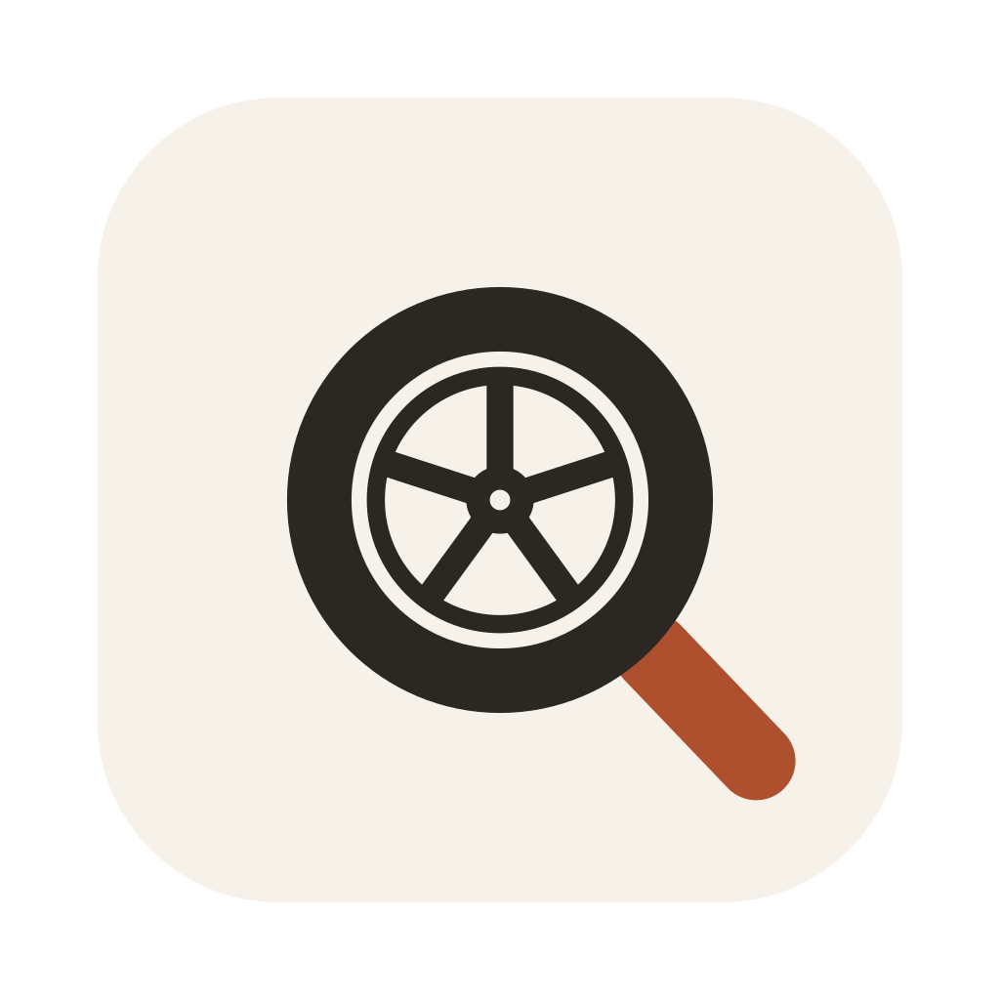
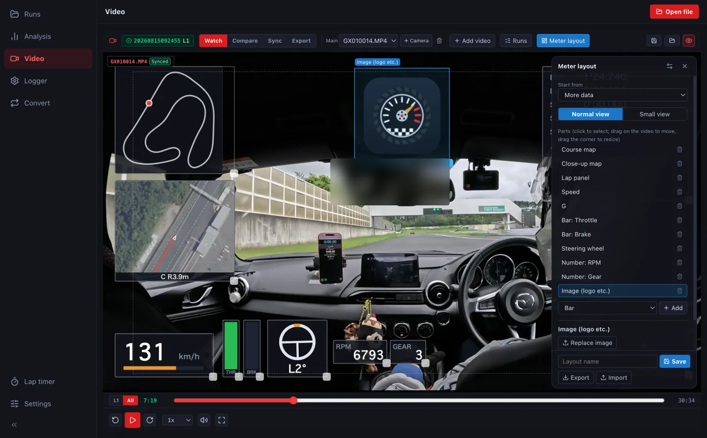
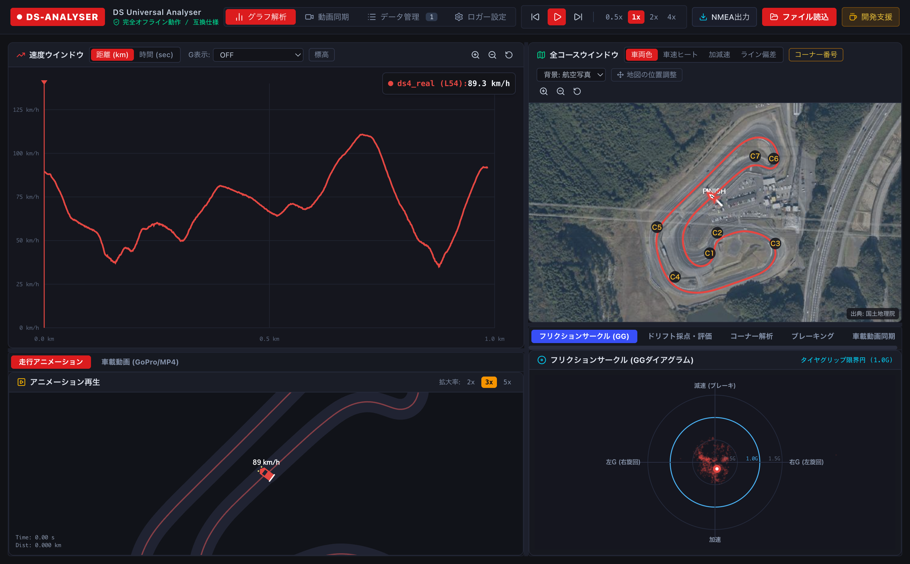
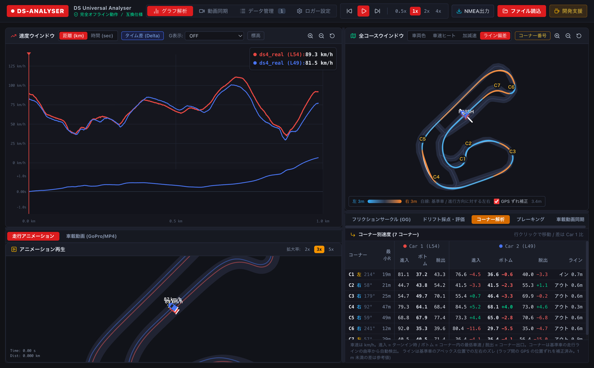
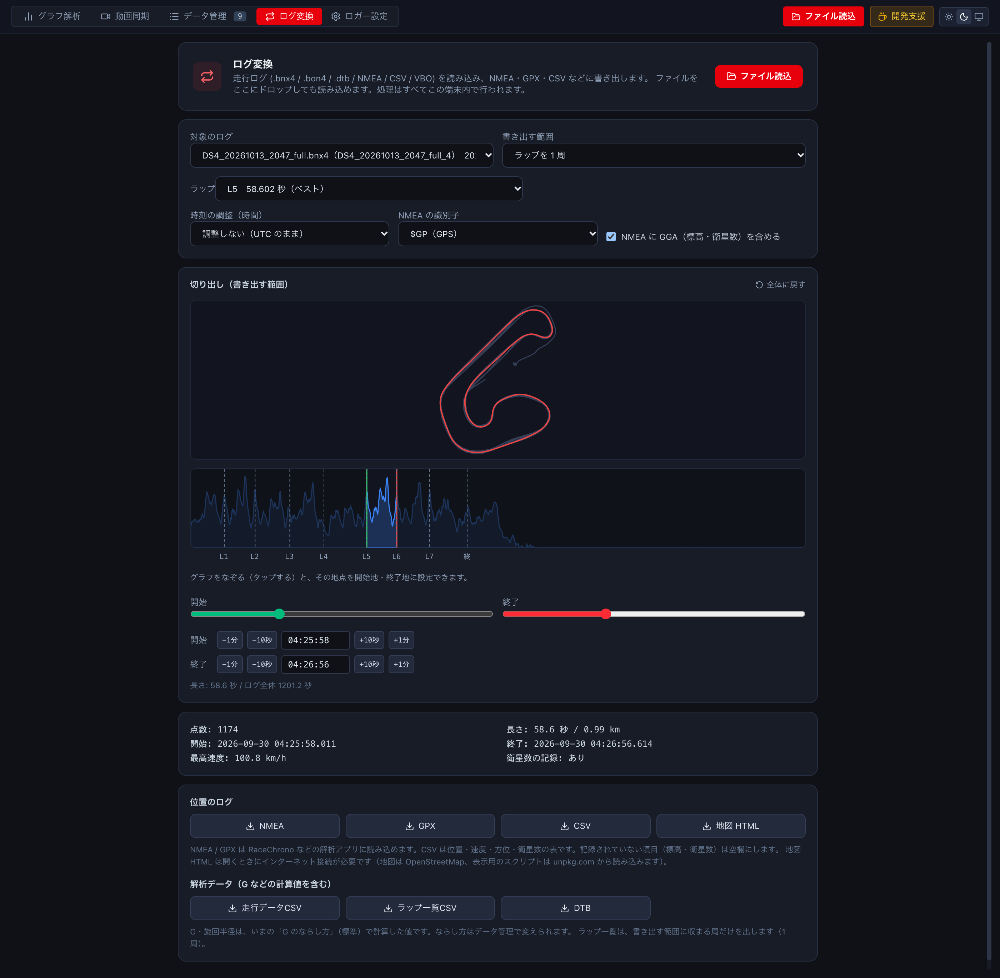
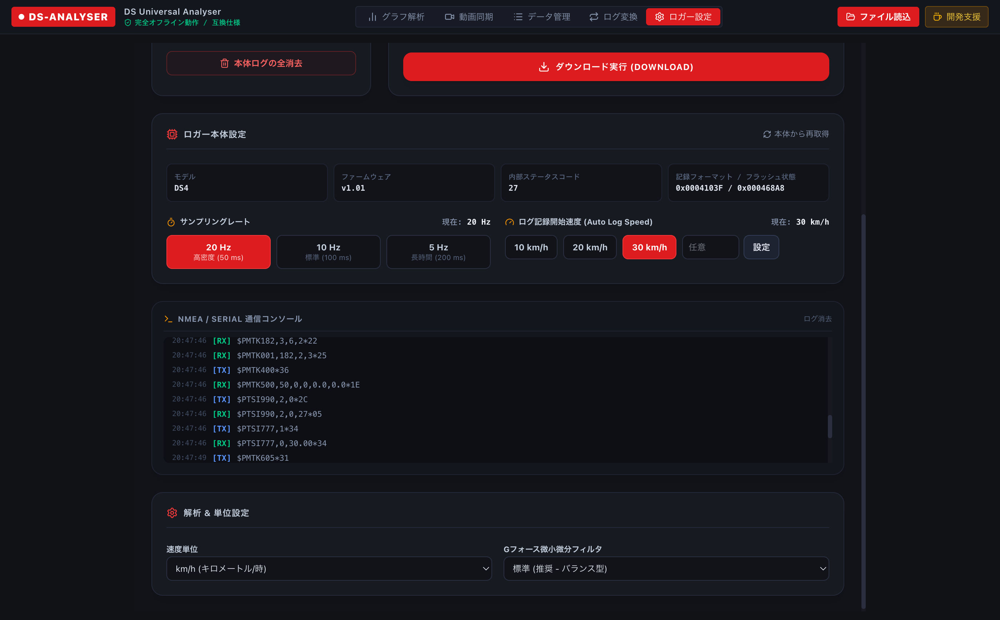

<p align="center"></p>

# LapLoupe — GPS Lap Timer & Track Log Analyzer

[日本語](README.md) | **English**

**An unofficial lap and track analyzer for the DigSpice GPS logger that runs on Mac, Windows, iPhone / iPad and in the browser**

Log download and logger settings for DigSpice IV, racing line / speed / G analysis, and onboard video (GoPro etc.) sync. **On a computer, choose your gauge components, customise their layout, colours and sizes, and export the video.**

Guides by task:

- [DashWare alternative for Mac video overlays](https://oud0n.github.io/ds_universal/dashware-mac.en.html)
- [Analyse saved AiM and RaceStudio logs on Mac](https://oud0n.github.io/ds_universal/racestudio-mac.en.html)
- [Track analyzer for Mac: GPS lap analysis](https://oud0n.github.io/ds_universal/track-analyzer-mac.en.html)
- [Use DigSpice on a Mac](https://oud0n.github.io/ds_universal/digspice-mac.html) (Japanese)
- [Compare lap times and racing lines](https://oud0n.github.io/ds_universal/help/d2-compare.html?lang=en)
- [Sync GoPro and other onboard video with GPS logs](https://oud0n.github.io/ds_universal/help/e2-sync.html?lang=en)
- [Export onboard video with speed and G-force overlays (computer)](https://oud0n.github.io/ds_universal/help/e4-export.html?lang=en)


[](https://buymeacoffee.com/oud0n)

> [!WARNING]
> **The Windows (x64) build has not been tested on real hardware.** The macOS (Apple Silicon) build is tested, and the iPhone / iPad app is available on the App Store. Windows builds are also published. Reports from Windows users (issues / pull requests) are very welcome.
> Linux and Intel Macs (including Rosetta 2) are not supported, and no builds are provided for them.

> [!NOTE]
> On 2026-10-19 the app was renamed from "DS Universal" to **LapLoupe**. The repository name (`ds_universal`) and the browser version's URL stay the same.

The app's screens are available in Japanese and English (it follows your device's language; switch with the globe icon).

---

## 🏎️ Overview

**LapLoupe (formerly DS Universal)** is an unofficial lap and track analyzer for the DigSpice IV, a GPS data logger for circuit driving. The official analysis software runs only on Windows; LapLoupe runs on **Mac, Windows, iPhone / iPad and in the browser**. The iPhone / iPad app is free on the [App Store](https://apps.apple.com/jp/app/id6826272937).

- Connect the DigSpice over USB to download logs and change the logger's settings (works on a Mac too)
- On the iPhone app, connect the DigSpice over Bluetooth and use it as a lap timer (the iPhone's own GPS works too)
- Overlay and compare the driving line, speed, G and corner speeds between laps and cars
- Sync onboard video from a GoPro and other cameras with the log automatically, and export video with gauges
- Free and source-available. Logs are processed on your device and never sent to a server (the desktop app only asks GitHub whether a new version exists; you can turn this off in Settings)

---

## Build your own telemetry overlays for onboard video

**Looking for a DashWare alternative?** LapLoupe lets you build video overlays from GPS track logs and CSV data, including logs from devices other than DigSpice.

- **Choose components**: combine speed, G-force, lap time, time delta, course maps, numbers, bars, graphs and images such as logos.
- **Customise the look**: drag and resize components, select their data, colours and scales, then save and share your layout.
- **Use your own data**: map CSV columns and units to RPM, throttle and other values. Gauges can also use values calculated with formulas.
- **Choose your export**: MP4 with gauges burned in, or gauges only on a transparent background as WebM or a ZIP of PNG frames for your video editor.

Create and edit layouts and export video in the **Mac / Windows desktop app or a browser on a computer**. On iPhone / iPad, select a saved layout for playback.



[Customise gauge components and layouts](https://oud0n.github.io/ds_universal/help/f1-layout.html?lang=en) · [Export video with telemetry overlays](https://oud0n.github.io/ds_universal/help/e4-export.html?lang=en)

---

## ✨ Features

| Area | What it does |
| :--- | :--- |
| **Logger** | USB connection to the DigSpice IV, log download (`.bnx4`), sampling rate (5 / 10 / 20 Hz) and logging start speed settings, erasing the logger's memory |
| **Analysis** | speed graph comparison of up to 4 cars (4 laps), track map and driving line (with GSI aerial photos as the background), G and friction circle, corner analysis, braking analysis, line difference heat map, X/Y graph |
| **Run library** (desktop app) | list of the runs in your storage folder by date, importing logs split by run and circuit, lap time records, corner names (`corners.json`) |
| **Course data** | 101 courses in Japan and 26 circuits abroad built in, automatic timing and sector lines for unknown courses, course editor, loading the official software's course folder |
| **Onboard video** | automatic sync of GoPro / DJI / generic MP4 with the log, seamless playback of GoPro chapter files, multi-camera view of up to 4 cameras, lap-to-lap comparison, export of video with gauges or of transparent gauge-only video |
| **Import formats** | DigSpice (.bnx4 / .bon4), Racelogic VBO, RaceChrono CSV, GPX, NMEA, MoTeC CSV, AiM (CSV, .xrk / .xrz), Garmin FIT / TCX, RaceBox, iRacing (.ibt), GPS from GoPro videos |
| **Log conversion** | export to NMEA, GPX, VBO, CSV, KML, DTB, MoTeC CSV, map HTML, .bon4 and more; cut out laps or time ranges, adjust the time zone |

See **[Features](docs/features.en.md)** for the details.

---

## 📸 Screenshots

**Graph analysis**: speed graph, track map (with GSI aerial photos as the background; it can follow the car close up and start all cars from a sector), friction circle



**Corner analysis and lap comparison**: speed, time delta and line difference between two laps; entry, minimum and exit speed for each corner



**Log conversion**: cut out part of a log (a lap or a time range) and export it to NMEA / GPX / CSV / map HTML and more



**Logger settings**: connect the logger over USB to change the sampling rate and the logging start speed, and to download logs



---

## 🌐 Browser version (no installation)

- Analysis: <https://oud0n.github.io/ds_universal/>
- Log conversion: <https://oud0n.github.io/ds_universal/#convert>
- Sample log: [sodegaura_20260815.nmea](https://oud0n.github.io/ds_universal/demo/sodegaura_20260815.nmea) (12 laps of Sodegaura Forest Raceway in a Mazda MX-5 (ND), position and speed only. No log of your own? Download it and open it with "Choose files" to try the app)

USB communication with the logger **only works in Chrome / Edge on a PC** (it uses the Web Serial API). In Safari, Firefox or on smartphones you can load, analyse and convert logs.
Logs are processed on your device and never sent to a server (what the app does connect to, such as map tiles, is listed in [Features](docs/features.en.md#-what-the-browser-version-connects-to)).

---

## 📥 Download and installation

**iPhone / iPad**: get [LapLoupe on the App Store](https://apps.apple.com/jp/app/id6826272937) (free).

**Mac / Windows**: download the latest version for your OS from [GitHub Releases](https://github.com/oud0n/ds_universal/releases).

| OS | Files | Status |
| :--- | :--- | :--- |
| **Windows** (x64) | `.exe` (installer) / `.zip` (portable) | Published (not yet tested on real machines) |
| **macOS** (Apple Silicon `arm64`) | `.dmg` (installer) / `.zip` | **Tested** |

### 🍎 macOS: if you see "is damaged and can't be opened"

From v1.0.2 the Mac version is signed and notarized by Apple, so it opens normally. Only if an older version shows this message, open it as follows (the file is not actually damaged).

1. Copy `LapLoupe.app` from the DMG to your Applications folder.
2. Run this command in Terminal.app (it removes the mark added when the file was downloaded):

```bash
xattr -cr "/Applications/LapLoupe.app"
```

If it still won't open, run this command, then Control-click the app and choose "Open":

```bash
codesign --force --deep --sign - "/Applications/LapLoupe.app"
```

- **Macs with Apple Silicon (M1 or later) only.** It does not run on Intel Macs.
- What the commands do, and more steps if it still fails, are in **[Installation](docs/install.en.md)**.

---

## 📚 Documentation

| Document | Contents |
| :--- | :--- |
| [Features](docs/features.en.md) | details of each feature, where the course data (timing lines) comes from, features not implemented |
| [Installation](docs/install.en.md) | requirements, detailed steps when the app won't open on macOS |
| [Release notes](docs/release-notes.en.md) | changes in each version (latest: v1.1.0) |
| [Developer setup](docs/development.en.md) | running, building and packaging from source |
| [Developer documents](docs/README.md) | architecture, procedures, design notes and open items (Japanese; for developers and AI agents) |
| [Course data](courses/README.md) | the built-in course files and how they were made (Japanese) |
| [Zenn article (Japanese)](https://zenn.dev/oud0n/articles/ace1347602c574) | why this app was made, and how the DigSpice's USB communication works |

Report bugs or send requests in [Issues](https://github.com/oud0n/ds_universal/issues). If a timing line is in the wrong place, please open a [course data issue](https://github.com/oud0n/ds_universal/issues/new?template=course.yml).

---

## ☕ Support the developer (Buy Me a Coffee)

LapLoupe is a free, personal project. Your support, from the price of a coffee ($3 and up), helps cover track days, keeping up the Mac version, and further work on the video features.

👉 **[Support oud0n on Buy Me a Coffee](https://buymeacoffee.com/oud0n)**

---

## ⚖️ Trademarks and disclaimer

- **Trademarks**: "デジスパイス" and "DigSpice" are trademarks or registered trademarks of DigSpice Co., Ltd. Other product and company names are trademarks or registered trademarks of their respective owners.
- **Unofficial compatible software**: this software (`ds_universal`) is an unofficial, third-party compatible tool developed by an individual. It has no relationship, partnership or endorsement of any kind with DigSpice Co., Ltd.
- **Disclaimer**: the developer accepts no responsibility for any damage or device malfunction caused by using, or being unable to use, this software. Use it at your own risk.

---

## 📜 License

[PolyForm Noncommercial License 1.0.0](LICENSE) (Copyright 2026 oud0n)

- **Free for non-commercial use**: personal use (hobby, study, research and other uses not leading to commercial gain) and use by non-profit organisations, educational institutions, public research organisations and government bodies is free, including modification and redistribution. When you redistribute, pass on `LICENSE` (or the license URL) and the `Required Notice:` line with it.
- **Commercial use requires prior permission**: if you want to use it at work, include it in a paid product or service, or sell it, please contact [caliber.trivia66@icloud.com](mailto:caliber.trivia66@icloud.com).
- **Common cases** (when in doubt, just ask):

  | Use | Contact needed |
  |---|---|
  | Posting screens or videos made with LapLoupe on your personal YouTube, social media or blog (**even if monetized**) | No |
  | Showing or giving your own data or videos to friends at track days or in your club, free of charge | No |
  | Showing your own laps to a coach when you take lessons | No |
  | A shop or tuner using it for business (analysing customers' cars, promotional videos) | Yes |
  | A school or coach using it in paid lessons, or an event organiser providing it to participants for a fee | Yes |
  | Doing video or data analysis for others as paid work | Yes |
  | Selling this software or including it in a paid product or service | Yes |

  A mention such as "Made with LapLoupe" in the video description is appreciated (optional).
- **If you publish or distribute a modified version**, please make its origin clear:
  - State, somewhere users will see it such as the README, that it is based on this software ([oud0n/ds_universal](https://github.com/oud0n/ds_universal)) and that you modified it.
  - Give the modified version a different name, and do not use names or wording that could be mistaken for the official or an endorsed version.
- Versions up to v0.7.1 were published under the MIT License. Copies of v0.7.1 and earlier that you already have are not affected.
