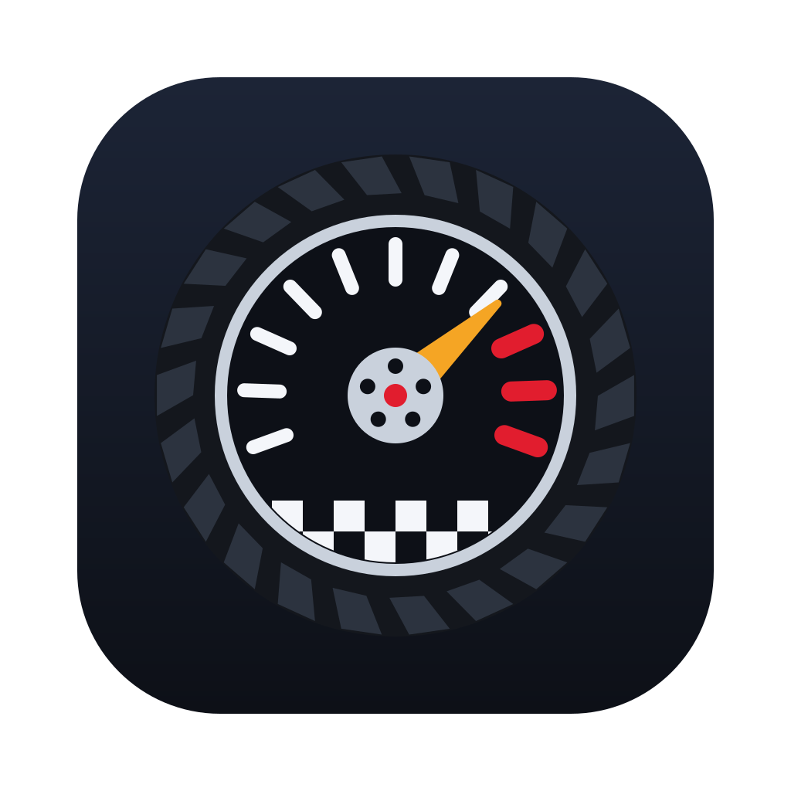
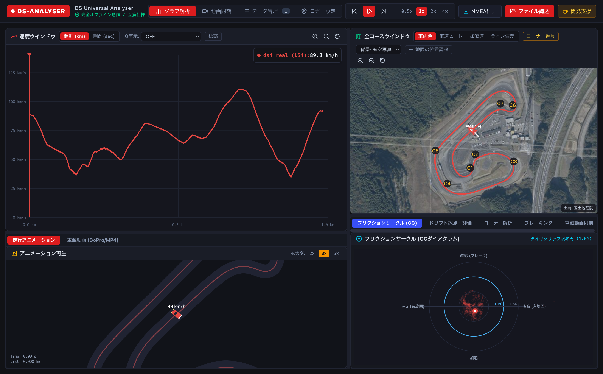
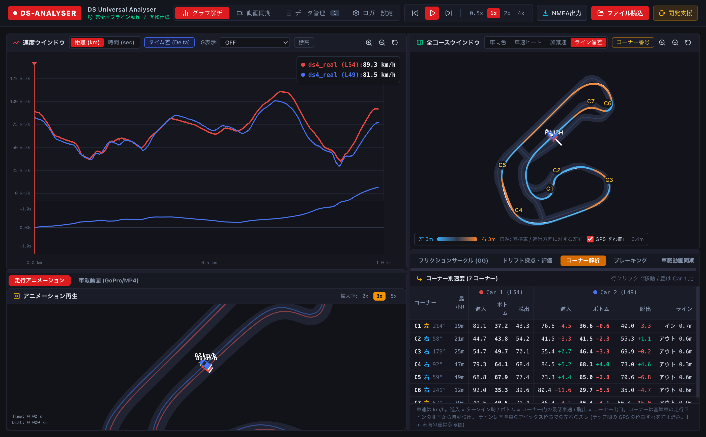
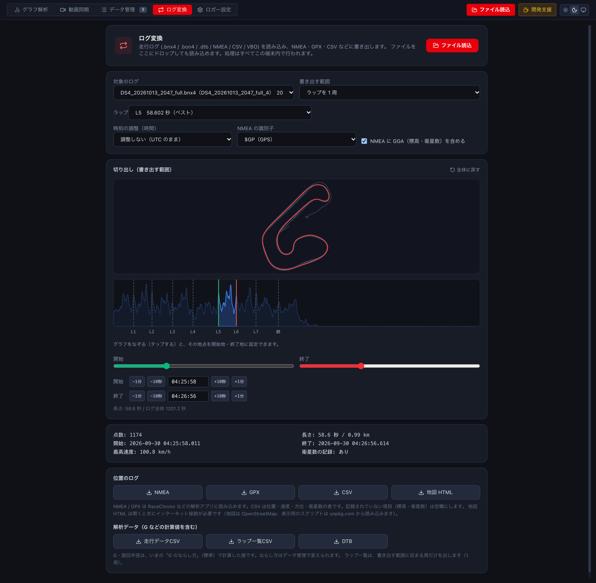
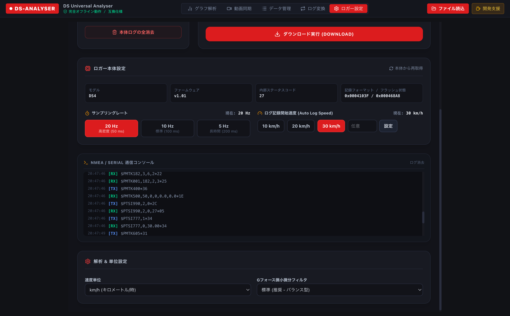

<p align="center"></p>

# LapLoupe（ラップルーペ、旧名 DS Universal）— Lap / Track Analyzer

**日本語** | [English](README.en.md)

**デジスパイス（DigSpice IV）を Mac・Windows・ブラウザで使える、非公式の走行ログ解析ソフト（ラップ・サーキットの走行解析 / Lap & Track Analyzer）**

デジスパイスのログの吸い出し・本体の設定、走行ライン・車速・G の解析、GoPro などの車載動画との同期


[](https://buymeacoffee.com/oud0n)

> [!WARNING]
> ### ⚠️ 動作確認状況について（重要）
> 本ソフトウェアは現在、**macOS（Apple Silicon）環境でのみ動作確認を行っています**。  
> GitHub Actions により Windows（x64）向けのインストーラー / ZIP も自動ビルド・リリースされていますが、実機での動作確認は未完了です。  
> Windows 環境をご利用の方からの動作報告・不具合フィードバック（Issue / PR）をお待ちしております。
>
> **サポート対象プラットフォーム**: Windows (x64) / macOS (Apple Silicon, arm64)。  
> Linux および Intel Mac（Rosetta 2 経由での実行を含む）はサポート対象外で、バイナリも配布していません。

> [!NOTE]
> ### 名前を変えました（2026-10-19）
> 「DS Universal」から **LapLoupe（ラップルーペ）** に名前を変えました。
> 「DS Universal」で検索すると、ゲーム機の改造ソフトなど、このアプリと関係のない、あまり好ましくないサイトばかりが出てくるためです。
> リポジトリの名前（`ds_universal`）とブラウザ版の URL は変わりません。アプリの中の表記は、順に新しい名前に直します。

---

## 🏎️ 概要

**LapLoupe（旧名 DS Universal、`ds_universal`）** は、公式の解析ソフトが Windows 専用のデジスパイスを、Mac でもブラウザでも使えるようにする非公式のソフトです。サーキット走行用GPSデータロガー「デジスパイスIV」のデータ吸い出し・設定変更から、走行軌跡・車速・Gフォースの本格テレメトリ解析、さらにはGoPro車載動画とのミリ秒精度自動同期・2カメラPinP再生・メーター焼き込みMP4エクスポートまでを1つに統合した、ソースコード公開のアプリです（デスクトップ版とブラウザ版）。

---

## 📸 画面サンプル

**グラフ解析**: 車速グラフ、コース図（国土地理院の航空写真を背景に表示）、走行アニメーション、フリクションサークル



**コーナー解析とラップ比較**: 2 つのラップの車速・タイム差・走行ラインのずれ、コーナーごとの進入・ボトム・脱出速度



**ログ変換**: 読み込んだログの一部（ラップ・時間）を切り出して、NMEA / GPX / CSV / 地図 HTML、走行データCSV・ラップ一覧CSV・DTB に書き出し



**ロガー設定**: ロガーを USB でつないで、サンプリングレートとログ記録開始速度の変更、ログの吸い出し



---

## ✨ 主な機能

### 1. デジスパイスIV USB通信・ロガー設定 (`LoggerTab`)
- **Web Serial API による直接通信**: ネイティブドライバのビルド不要で、USBケーブル1本で接続可能。
- **本体ログ高速ダウンロード**: 走行データを一括ストリーミングダウンロードし、公式互換の `.bnx4` 形式で保存。
- **各種設定変更**: 測位レート（`20Hz` / `10Hz` / `5Hz`）、記録開始/停止速度（5〜100km/h）を書き換え、本体から読み戻した値で反映を確認。
- **本体メモリ消去**: 次回走行前のフラッシュメモリ全消去（誤消去防止ロック付き）。

### 2. 本格モータースポーツ・テレメトリ解析 (`Graph / DataTab`)
- **速度グラフ比較**: 最大4台（または4ラップ）の車速・距離を重ね合わせ比較。
- **コースマップ & 走行軌跡**: OpenStreetMap / 自作サーキット定義に対応したコースプロット。国土地理院の航空写真・地図を背景に表示でき（要インターネット接続）、GPS 軌跡に合わせて地図の位置を微調整可能。
- **Gフォース・フリクションサークル**: 加速・減速・コーナリングGの分布とフリクションサークル表示。
- **コーナー解析**: コーナーを自動検出し、進入・ボトム・脱出速度を車両（ラップ）間で比較。
- **ブレーキング診断**: 制動開始位置、最大減速G、立ち上がり、リリース、トレイルブレーキングを数値とグラフで表示（GPS 車速からの推定）。
- **走行ライン偏差ヒートマップ**: 基準ラップに対する走行ラインの左右のズレをコース図上に色分け表示。ラップ間の GPS の位置ずれは自動で補正。
- **他形式の読み込み**: Racelogic VBO・RaceChrono CSV・GPX・MoTeC CSV（i2 の書き出し）・AiM（Race Studio の CSV、ロガーのファイル .xrk / .xrz の GPS）に対応。
  - MoTeC と AiM は、インターネットで公開されているサンプルのファイルで確かめただけで、開発者が自分の実機で記録したログでは確かめていません。うまく読めないファイルがあれば Issue でお知らせください。
- **iRacing のテレメトリ（.ibt）**: iRacing で記録したテレメトリを「ファイル読込」で開くと、緯度・経度で実車のログと同じコースに重ねて比べられます（ゲームで練習した走りと実車の走りのブレーキを踏む位置などを比べるため）。アクセル・ブレーキ・ハンドルの角度・回転数・ギアも読み、速度グラフにアクセル（実線）とブレーキ（点線）を重ねて表示できます。コースに出ていた間ごとに別のログになります。G は実車のログと同じく位置と車速から計算します。
  - 公開されているサンプル（筑波 2000）で確かめただけです。iRacing でテレメトリを記録するには、iRacing の設定でディスクへの記録を有効にしてください（走行中に Alt + L でも切り替えられます）。
- **GoPro の動画の GPS**: GoPro（HERO5 以降の GPS 付きの機種）で撮った動画（.MP4）を「ファイル読込」で開くと、動画に記録された GPS を走行ログとして読み込みます。同じ動画は動画同期にも登録され、GPS の時刻で合わせた状態で再生できます。1 回の撮影が複数のファイル（チャプター）に分かれているときは、まとめて選ぶと 1 つのログになります（動画は端末内で読み、全体をメモリに載せません）。
- **ログ変換ページ**: 読み込んだログを NMEA（GGA + RMC）・GPX・VBO・CSV・TXT（空白区切り）・KML（Google Earth 用、線の色は車速）・DTB・地図 HTML（カーソルを乗せると時刻・車速を表示）・MoTeC CSV と、デジスパイス形式の走行データ CSV（G 付き）・ラップ一覧 CSV に書き出し。ログ全体 / ラップ 1 周 / 時間指定（グラフで切り出し）の範囲と、時刻の調整（時差）を選べます。書き出しはすべてこのページにまとめ、データ管理の各ログの「変換画面で開く」から開けます。

#### コースデータ（計測線）について
- **内蔵プリセット**: 国内 101 コース（サーキット・カートコース）と海外 26 サーキット（アメリカ・オランダ・フランス・スペイン）の名称と中心座標、うち 126 コースのスタート / フィニッシュの計測線を内蔵しています。いずれも本アプリ独自のデータで、中心座標は OpenStreetMap のコース形状から、計測線は航空写真（国内は国土地理院、海外は各国が自由に使えるとしているもの）でスタートライン付近の位置を確認して作成しています（海外の 3 コースは写真で確かめられなかったため、ピットロードの中ほどの仮の位置。写真で路面の線が見えなかった 3 コースは推定。国内のカートコースなどの多くは、OpenStreetMap のコースの線に直交させた推定の位置で、写真で路面にかかることだけを確かめています）。周回の区切りには使えますが、各サーキットの公式計測位置と一致するとは限りません（区切る位置が違うと、同じ走行でも各周のタイムは少し変わります）。73 コースにはセクター線も入れています（SUGO は公式のコース図の計測地点、鈴鹿・富士はレースの区間の分け方から推定、もてぎは 4 等分、ほかは 3 等分の仮の位置）。データはデジスパイスと同じ形式のファイル（.cln・.sci）で [`courses/`](courses/) に置いて同梱しています。位置が違うときは、[コースデータの Issue](https://github.com/oud0n/ds_universal/issues/new?template=course.yml) でお知らせください（コース編集で直した .cln / .sci を添付してもらえると助かります）。
- **お手持ちのコースデータを使う場合**: デジスパイス公式ソフトをお持ちの方は、ご自身の PC にあるコースフォルダ（`Circuit` / `ControlLine` / `Sector` を含むフォルダ）を、データタブの「コースフォルダ一括設置」で読み込めます。読み込んだデータは内蔵プリセットより優先されます。本アプリは公式ソフトのコースデータを同梱・配布していません。
- **計測線が無いコース**: データタブの「コース編集」で計測線の 2 点（緯度・経度）を入力するか、`.cln` ファイルを読み込んでください。計測線が未設定、または走行中に通過していない場合は、データタブに案内が表示されます。
- 出典: 内蔵プリセットの座標は [© OpenStreetMap contributors](https://www.openstreetmap.org/copyright) のデータ（[Open Database License (ODbL) 1.0](https://opendatacommons.org/licenses/odbl/1-0/)）と、[国土地理院](https://maps.gsi.go.jp/development/ichiran.html)のシームレス空中写真をもとに作成しています。該当するデータは [`courses/`](courses/) のファイルです（作り方は [`courses/README.md`](courses/README.md)）。SUGO のセクターの位置は[スポーツランドSUGO のコース図](https://www.sportsland-sugo.co.jp/assets/docs/course/c-racing/2026_racing-course_layout.pdf)の計測地点の距離を使っています。

### 3. 車載動画（GoPro / DJI / 一般MP4）自動同期 (`VideoSyncWindow`)
- **タイムゾーン完全自動判定 & 9時間時差スキャン**: GPS座標（日本国内ならJST自動判定）と動画メタデータ（UTC/JST）から時差を自動検出・ミリ秒単位でオフセット補正。
- **GoPro 4GBチャプター分割ファイルの自動連続再生**:
  - `GX010017.MP4` $\rightarrow$ `GX020017.MP4` $\rightarrow$ `GX030017.MP4` などの分割ファイルを自動検出・直列連結。
  - チャプター境界を跨ぐシームレス自動連続再生に対応。
- **動画編集ソフト風 NLE マルチトラック・タイムラインインスペクター**:
  - セッション絶対時間に対して、GPS走行ログ（各ラップ区間）と車載動画（各チャプタークリップ）がどの時間帯にマッピングされているかを一目で可視化。
  - タイムライン上を直接クリック＆ドラッグしてスクラブ（シーク）可能。
- **速度ウィンドウとの完全双方向シーク同期**:
  - 選択中ラップ（またはセッション全体）の時間軸にシークバーが完全同期。
- **前後2カメラ / PinP（ピクチャー・イン・ピクチャー）同時同期再生**:
  - 前方車載と後方カメラ（またはペダルカメラ等）を2画面（左右 1:1）またはPinPで完全同期再生。
- **手動キーフレーム同期（Sync Pin）**:
  - 縁石のクリッピングポイントやコントロールライン通過フレームで「ピン留め同期」を押すだけでオフセットを一発固定。
- **動画テレメトリ焼き込みエクスポート（Overlay Burn-in Export）**:
  - 速度計・Gボール・ラップタイムを合成したMP4動画をブラウザ標準機能のみで直接レンダリング・書き出し。
- **フラットデザイン（Flat Design）**:
  - プロ仕様のモータースポーツ解析ツールらしい、無駄な影や丸みを抑えたクリスプな高視認性UI。

---

## 🌐 ブラウザ版

インストールせずに、ブラウザからそのまま使えます。ログの読み込み・解析・変換はお使いの端末内で行い、ログをサーバーへ送信しません。

外部と通信するのは、地図の表示（地図タイルの取得）、コース定義の自動取得（コース中心の座標を OpenStreetMap の Overpass API に送信）、書き出した地図 HTML を開いたとき（表示用スクリプトを unpkg.com から、地図タイルを OpenStreetMap から取得）です。また、ブラウザ版はアクセス数を数えるために [GoatCounter](https://www.goatcounter.com/) を使っています（開いたページ・参照元などを送ります。Cookie は使わず、ログの内容は送りません）。デスクトップ版には入っていません。

- 解析画面: <https://oud0n.github.io/ds_universal/>
- ログ変換ページ: <https://oud0n.github.io/ds_universal/#convert>

ロガーとの USB 通信（ロガー設定タブ）は Web Serial API を使うため、**Chrome / Edge（PC 版）でのみ動作**します。Safari / Firefox やスマートフォンでは、ログの読み込み・解析・変換だけが使えます。

## 📥 ダウンロード & インストール

[GitHub Releases](https://github.com/oud0n/ds_universal/releases) より、ご利用のOSに合わせた最新のインストーラー / zip版をダウンロードしてください。

| OS | 配布形式（インストーラー版 / zip版） | 動作状況 |
| :--- | :--- | :--- |
| **Windows** | `.exe` (インストーラー) / `.zip` (ポータブル版) | ビルド配布中（実機での動作確認は未完了。上記の注意を参照） |
| **macOS** | `.dmg` (インストーラー) / `.zip`（Apple Silicon `arm64` 専用） | **動作確認済み** |

---

### 🍎 macOS 版の動作要件

- **Apple Silicon（M1 以降）搭載 Mac 専用**です。`arm64` ネイティブバイナリのみを配布しており、Rosetta 2 は使用しません。
- **Intel Mac では動作しません**（`x64` 版は配布していません）。
- ネイティブ動作の確認: アクティビティモニタの「種類」列が **Apple** と表示されます（Rosetta 経由の場合は Intel）。

### 🍎 macOS 版ご利用時の注意事項（「壊れているため開けません」と表示される場合）

macOS で DMG を展開してアプリを起動しようとした際、**「“DS Universal”は壊れているため開けません。ゴミ箱に入れる必要があります。」** という警告ダイアログが表示される場合があります。

#### 💡 原因
本アプリは有志による個人開発であり、有償の Apple Developer Program による公証（Notarization）および正規の開発者署名を付与していません。  
macOS のセキュリティ機能（Gatekeeper）は、Web ブラウザ等からダウンロードされた未署名・未公証のバイナリに対してダウンロード検疫フラグ（`com.apple.quarantine`）を付与し、セキュリティ保護のために「破損している（BundleIntegrity 警告）」と表示して実行を強制キル（SIGKILL）する仕様になっています（**実際のファイル破損ではありません**）。

#### 🚀 解決方法（ターミナルでの解除コマンド）

1. DMG 内の `DS Universal.app` を「**アプリケーション（/Applications）**」フォルダにコピーします。
2. **ターミナル.app** を開き、以下のコマンドを実行します：

```bash
xattr -cr "/Applications/DS Universal.app"
```

##### 📖 コマンドの解説
* `xattr`: macOS の拡張ファイル属性（Extended Attributes）を表示・操作するシステム標準コマンドです。
* `-c` (`--clear`): ファイルに付与されているすべての拡張属性を消去します。ブラウザから保存された際に自動付与される **検疫属性（`com.apple.quarantine`）** を剥がすことで、Gatekeeper による起動ブロックを無効化します。
* `-r` (`--recursive`): アプリバンドル（.app）内の全バイナリ・ライブラリ・リソースに対して再帰的に属性削除を適用します。

---

##### ⚠️ それでも開かない場合（Ad-hoc 自己署名の適用）
macOS のセキュリティポリシー（macOS Sequoia / Sonoma 等）によっては、未署名コードの実行が厳格に遮断される場合があります。その場合はターミナルで以下の自己署名コマンドを実行してください：

```bash
codesign --force --deep --sign - "/Applications/DS Universal.app"
```

##### 📖 コマンドの解説
* `codesign`: macOS のコード署名（Code Signature）を作成・検証するツールです。
* `--force`: 既存の不完全な署名情報を強制的に上書きします。
* `--deep`: アプリバンドルに含まれるすべての埋め込みフレームワーク（Electron Framework / Chromium 等）に対して再帰的に署名を適用します。
* `--sign -`: 開発者証明書（Apple Developer ID）の代わりに「Ad-hoc 署名（ハイフン `-`）」を指定し、ローカル実行を許可する自己完結署名を生成します。

上記を実行後、通常通りダブルクリックするか、**Control キーを押しながらクリック（右クリック）して「開く」** を選択してください。

---

## 📝 リリースノート

### v0.12.0（未リリース）

<!-- 下書き。PLAN-16（FIT・TCX）・PLAN-12（計測線の自動設定）は、マージしたらここに足す -->

**追加**

- **車載動画の作り直し**: 動画とログを「走行」としてまとめて扱うようにしました。
  - **マルチカメラ**: 1 台の車の走行を、最大 4 台のカメラで同じ時刻に並べて見られます（左右・2×2・PinP。枠を押すと大きく出します）。
  - **走行比較**: Car 1〜4 の周の動画を、Car 1 と同じ地点を走ったときの映像で並べます。遅い周の動画は速めに回し、各枠にメーターと Car 1 とのタイム差を出します。動画 1 本でも、同じ動画の別の周どうしを比べられます。
  - **ログごとの時計の補正**: ロガーごとの GPS の遅れを直せます。「自動」は、同じ走行のほかのログと位置を比べて見積もり、確かなときだけ入れます。
  - **同じ走行の判定**: 時間が重なるだけの別の車のログ（同じ走行枠のチームメイトなど）に、動画を付けないようにしました。
  - **走行の確認**: 走行ごとのログと動画、動画の時刻の出どころ（GPS / 合わせ / 撮影日時）、地図を 1 つの画面で確かめられます。
  - **GoPro の .LRV**: 低画質のファイルも一緒に読み込むと、小さな枠を軽く出します。
  - **枠の並びの書き出し**: 今の並び（メーター・Car の札を含む）のまま動画に書き出せます。
- **スマートフォンで動画**: スマートフォン向けの配置にも動画のタブを出しました（走行比較は縦に 2 枠、マルチカメラはスワイプで切り替え）。
- **狭いウインドウ**: パソコンでもウインドウの幅が 600px より狭いときは、スマートフォン向けの配置にします。
- **変換の切り出し**: 走り終わってもロガーを点けたままにしたログでは、グラフをはじめは走っている部分だけ大きく出し、「走っている部分だけ書き出す」を足しました。

**修正**

- 撮影時刻の違うサブの動画が、メインの時刻に引っ張られていたのを直しました。
- 2 画面・PinP のとき、メーターがメインの映像からずれていたのを直しました。
- iPhone の Safari で、動画が黒いまま再生されない・再生がカクつくのを直しました。
- 同期プロジェクトを保存・読み込みすると、動画の位置やログの時計の補正が戻らないことがあったのを直しました（同期プロジェクトの形式を 2.0 にしました。1.0 も読めます）。

### v0.11.0

**追加**

- **日本語 / 英語の切り替え**: 画面右上の JA / EN で、画面の言葉を切り替えられます。
- **ハイコントラスト**: テーマに、屋外の直射日光の下で見やすいハイコントラストを足しました。
- **iRacing のテレメトリ（.ibt）の読み込み**: ゲームで走ったログを、実車のログと同じ画面で比べられます。アクセル・ブレーキの記録がある車両では、速度グラフの下に重ねて表示できます。
- **VBO（Racelogic）の書き出し**: ログ変換で VBO に書き出せます。
- **内蔵のコースを増やしました**: 国内 101 コース（カートコース・小さなサーキットを含む）と海外 26 サーキット（アメリカ・オランダ・フランス・スペイン）の計測線を内蔵し、73 コースにはセクター線も入れています。データは [`courses/`](courses/) にデジスパイスと同じ形式のファイル（.cln・.sci）で置いています。
  - 多くは推定の位置です。公式の計測位置とずれていることがあります。位置が違うときは [コースデータの Issue](https://github.com/oud0n/ds_universal/issues/new?template=course.yml) でお知らせください。
- **1 周の短いコース**: 1 周が 15 秒より短いコース（ポケバイコースなど）でも、周回が区切れるようにしました。

**修正**

- **コース編集の書き出し**（#7）: アプリ版（Windows / Mac）で、.cln に続けて .sci が書き出されなかったのを直しました。
- **iPhone / iPad**: ブラウザ版で、ファイルの選択画面から .bon4 などのログが選べなかったのを直しました（実機での確認はこれからです）。
- 関係ないファイルや壊れたファイルを読み込んだときに、メッセージを出して止まるようにしました（以前は、でたらめな 1 点のログができることがありました）。
- 計測線の上で止まっている間の GPS の揺れを、周と数えないようにしました。
- 近くの別のコースのログに、通らない計測線を当てて周回が区切れなくなることがあったのを直しました。

### v0.10.0

**追加**

- **GoPro の動画の GPS の読み込み**: GoPro（HERO5 以降の GPS 付きの機種）で撮った動画（.MP4）を「ファイル読込」で開くと、動画に記録された GPS を走行ログとして読み込みます。同じ動画は動画同期にも登録され、GPS の時刻で合わせた状態で再生できます。1 回の撮影が複数のファイル（チャプター）に分かれているときは、まとめて選ぶと 1 つのログになります。同じ走行のデジスパイスなどのログを基準車にしても、記録の時刻から換算して動画を合わせます。GPS の記録がない動画は、動画同期に登録だけします。
- **AiM のログの読み込み**: Race Studio が書き出す CSV と、ロガーのファイル（.xrk / .xrz）の GPS を読み込めます。
- **MoTeC CSV**: i2 が書き出す CSV の読み込みと、MoTeC CSV への書き出しを使えるようにしました。
  - MoTeC と AiM は、インターネットで公開されているサンプルのファイルで確かめただけで、実機で記録したログでは確かめていません。うまく読めないファイルがあれば Issue でお知らせください。
- **コース編集の保存と読み書き**（#7）: コース編集で直した計測線・セクターをアプリに保存し、次から同じ計測線を通るログに使います。計測線（.cln）・セクター（.sci）の読み込みと書き出しもできます。
- **ログ変換の書き出し**:
  - KML（Google Earth 用。線の色は車速）と TXT（空白区切り）を足しました。
  - 地図 HTML は、カーソルを乗せると時刻・車速・方位・位置を出します。
  - 時刻の調整に UTC / JST の切り替えボタンを付け、時刻の入る書き出しのファイル名に `_UTC` / `_JST` などを付けます。GPX・CSV・KML の時刻には時差（`+09:00` など）を付けます。
  - 概要に平均車速と開始・終了の位置を出します。
- **フリクションサークル**: 現在の G の点の後ろに直近 1 秒の軌跡を、前ほど薄く描きます。

**修正**

- **車載動画**（#10・#11・#13）:
  - 左下を「車載動画」にすると、動画がないときに再生が進まなかったのを直しました。
  - 動画を表示していると、速度・全コースのウインドウが 1 秒に 2〜3 コマになっていたのを直しました。
  - グラフ解析の左下の車載動画が映らないことがありました。
  - 動画タブとグラフ画面の動画の選択・表示を共有し、取り合わないようにしました。
  - 同期プロジェクトを読み込んだ後に動画を選び直すと、保存したずれを引き継ぎます。
  - 動画の書き出しを、始めた直後に止められなかったのを直しました。
- **再生の重さ**: 点の多いログで、再生中にグラフの動かない部分を描き直さないようにしました（20 万点のログで 1 秒に約 37 → 120 コマ）。
- 点の多い GPX・バイナリのログが読み込めなかったのを直しました。
- フリクションサークルの現在の点が、記録の間隔ごとに跳ねていたのを直しました（G も記録点の間で補間します）。
- コースフォルダを一括設置したとき、読み込み済みのログのコース図にも反映します。
- 内蔵の計測線: 富士・鈴鹿・SUGO・本庄を航空写真で見直して置き直しました。オートポリスはご提案（#12）の位置にしました。区切る位置が変わるので、同じログでも各周のタイムが前の版と少し違うことがあります。

**変更**

- ブラウザ版（GitHub Pages）は、アクセス数を数えるために GoatCounter を使います（Cookie は使わず、ログの内容は送りません）。デスクトップ版には入っていません。

### v0.9.0

**アプリ名の変更**

- アプリ名を「DS Universal Suite」から **DS Universal** に変えました。保存したユーザーコースや設定は、そのまま引き継がれます。
- macOS では、前の版の `DS Universal Suite.app` が「アプリケーション」フォルダに残ります。新しい `DS Universal.app` を入れたら、前の版はゴミ箱に入れてください。

**追加**

- **表示テーマ**: ライト・ダーク・システムに合わせる、を画面右上で切り替えられます。
- **スマートフォン向けの配置**: スマートフォンのブラウザでは、画面の大きさに合わせた配置で表示します。USB でロガーをつなげない端末では、ロガー設定タブを出しません。
- **ウインドウの折りたたみ**: パソコン表示の全コース・アニメーション・フリクションサークルなどのウインドウを、帯だけ残してたためます。
- **ログの切り出し**: ログ変換で、書き出す範囲をコース図と車速のグラフを見ながら選べます（ラップの区切りを押して「1〜3 周目」のように選ぶ、時刻の入力、±10 秒 / ±1 分）。
- **G のならし方**: G と旋回半径の計算を、デジスパイス公式ソフトと同じ考え方にしました。ならし方（弱 / 標準 / 強）をデータ管理タブで選べます。フリクションサークルの「なめらか」で「標準」と「強」を切り替えられます。
- **書き出しを変換画面にまとめる**: 書き出しはすべてログ変換で行います。「走行データCSV」（G・旋回半径を含む）と「ラップ一覧CSV」を加えました。データ管理タブの各ログの「変換画面で開く」から移れます。
- **複数の走行が入った .bnx4**: 記録が 10 分以上空いたところで分け、別々のログ（ファイル名_1, _2 …）として読み込みます。

**修正**

- NMEA の読み込みで、GGA の衛星数を読むようにしました。標高が記録されていない点は、書き出しで空欄にします（以前は 0 m）。GGA だけの NMEA も読めます。
- .bnx4 の重複したレコードを除き、ミリ秒の抜けた秒の時刻を正しく割り振ります。
- 吸い出したログに付けるメタデータを、南半球・西経でも正しく書きます。
- ライトモードで読みにくかった表示を直しました。
- 狭いウインドウで、車載動画の案内の文字が切れていました。

**変更**

- ヘッダーの「NMEA出力」と、データ管理タブの書き出しボタンをやめました（ログ変換にまとめました）。以前の NMEA / GPX 書き出しは衛星数・標高にダミー値を入れていたため、ログ変換の書き出しを使ってください。
- ドリフト採点・評価の表示をやめました。
- ロガー設定の、どこにもつながっていなかった「解析 & 単位設定」を外しました。
- ロガー設定のサンプリングレートに、記録設定も標準の値に書き直される旨の注意書きを付けました。
- 通信コンソールは、ふだんはたたんでおきます。
- ブラウザ版のファビコンをアプリアイコンにしました。

### v0.8.0

**ライセンスの変更**

- ライセンスを MIT から **PolyForm Noncommercial 1.0.0** に変更しました。非商用であれば、改変・再配布を含めて自由に使えます。商用利用には事前の許諾が必要です。詳しくは README の「ライセンス」を参照してください。v0.7.1 までの版の扱いは変わりません。

**追加**

- **GPX の読み込み**: RaceChrono などが書き出した GPX を読み込めます。
- **速度ウインドウ**: 拡大したときに表示位置を示すルーラーを表示します（ドラッグ・クリックで移動）。拡大はカーソル位置を中心に行います（#1）。
- **コマ送り・コマ戻し**: ← → キーで 0.1 秒、Shift を押しながらで 1 秒ずつ動かせます（#2）。
- **全コースウインドウの車両追従**: 「追従」で Car 1 を画面の中心に置き続けます。「コース全体を表示」で元に戻せます（#3）。
- **時間基準での比較**: 速度ウインドウを「時間」基準にすると、全コースウインドウ・アニメーション・フリクションサークルの比較車両も同じ経過時間の位置に出ます（#4）。
- **セクターの同時スタートの「全車をそろえる」**: 全車がそのセクターの始まりの線を同時に通るよう時刻をそろえて比べます。速度ウインドウは、そのセクターの始まりから表示し、それより前を薄く描きます（#8）。
- **比較スロットの割り当ての解除**: データ管理タブの比較スロットに「解除」ボタンを追加しました（#9）。
- **開始位置の違うログの重ね合わせ**:
  - 計測線を 1 回しか通らないログは、通過点から始まる 1 周として扱います。
  - 計測線が分からないときは、最初に読み込んだログの走り始めに仮の計測線を置き、後から読むログもそこにそろえます。
  - データ管理タブで、比較車両ごとの距離の補正（±m）と、「1 周の長さを基準車にそろえる」を設定できます。
- **公式のコースデータの読み込み**: 「コースフォルダ一括設置」で、.cln・.pth・.sci を場所で組み合わせて登録します。セクター（.sci）にも対応しました（#6）。登録したコースはアプリを閉じても残ります。
- **ファイル形式の判別**: テキストのログは拡張子でなく中身で判別します（.txt の NMEA、.log の CSV なども読めます）。

**修正**

- 速度ウインドウのセクター線と同時スタートの位置が、S2 以降ずれていました（#5）。
- 複数のログを読み込んだとき、コースの設定（計測線・セクター・コース図）が混ざっていました。設定はログごとに持ち、画面には基準車のコースを表示します。
- 計測線・セクター線を逆向きに横切った通過（ピットの出入り・スピンなど）を数えていました。
- セクター線を通らなかった区間の推定値がセクターベスト・理論ベストに使われていました。推定値は「~」付きで表示します。
- Car 1 を消すと再生・シークが止まっていました。
- アニメーション画面で、コースを横切る線が描かれることがありました。
- 時刻が「1:60.000」のように表示・書き出されることがありました。
- G・旋回半径の計算が、記録レートによって変わっていました。
- 日光サーキットの内蔵の計測線を、計測ゲートの位置に直しました。
- 車載動画: 手で合わせた同期が、動画の追加やセッションの切り替えで上書きされていました。日付の合わない動画を自動で組み合わせないようにしました。
- 汎用の CSV の読み込み（引用符を含む列、先頭の時刻が 0 秒でないもの、方位・衛星数の列）を直しました。

**変更**

- 画面上部のロゴとアプリ名の表示を外しました。

### v0.7.1

**追加**

- **ログ変換ページ**: 読み込んだログを NMEA（GGA + RMC）/ GPX / CSV / DTB / 地図 HTML に書き出せます。範囲（ログ全体・ラップ 1 周・時間指定）と時差を指定できます。
- **ブラウザ版**: インストールせずに <https://oud0n.github.io/ds_universal/> から使えます。ロガーとの USB 通信はパソコンの Chrome / Edge で動作します。
- **標高・衛星数の読み取り**: .bnx4 の衛星数と、.bon4 の標高を読み取り、解析と書き出しに反映します。
- **コース判定**: 筑波 2000 / 1000 のように隣り合うコースは、計測線を実際に通過している方を選びます。
- 計測線が未設定のとき、またはログが計測線を通過していないときに、データ管理タブで案内を表示します。

**修正**

- .bnx4 の読み取りを実際の記録内容に合わせました。方位と横 G が誤った値になる問題、壊れたレコードが解析に混ざる問題を解消しています。
- ラップの開始・終了を計測線上で補間するようにし、ラップタイムと書き出し時刻のずれを解消しました。
- コースデータ（.cln やコースフォルダ）を読み込んだとき、読み込み済みのログの周回を再計算します。
- ログの吸い出しで、欠落や破損を検出するようにしました。
- NMEA・DTB・CSV の読み込みと書き出しで、記録日時が現在時刻に置き換わる問題を修正しました。
- コース編集で、無効な計測線やセクターを保存できないようにしました。

**変更**

- **内蔵コースの計測線を作り直しました**: 国内 12 コースの中心座標と計測線を、OpenStreetMap と国土地理院の航空写真から作成した独自データに置き換えています。計測線の位置が変わるため、同じログでもラップタイムが v0.7.0 とわずかに異なる場合があります。名阪スポーツランドは計測線を内蔵していません（コース編集または .cln で設定してください）。
- アプリ版で、シリアル通信の対象をデジスパイスIV に限定し、外部ページへの遷移やファイル読み取りを制限しました。

### v0.7.0

- アプリ名を「DS Universal Suite」に変更し、アプリアイコンを追加しました。
- 対応プラットフォームを Windows (x64) と macOS (Apple Silicon) に整理しました。
- **ロガー本体設定**: サンプリングレート（5 / 10 / 20 Hz）とログ記録開始速度（5〜100 km/h）を変更できます。
- **コーナー解析**: コーナーを自動検出し、進入・ボトム・脱出速度をラップ間で比較できます。
- **ブレーキング診断**: 制動開始位置、最大減速 G、リリース、トレイルブレーキングを表示します（GPS 車速からの推定）。
- **走行ライン偏差**: 基準ラップに対する走行ラインの左右のずれを、コース図に色分け表示します。
- **コース図の背景地図**: 国土地理院の航空写真・地図を背景に表示できます。
- **読み込み対応形式の追加**: Racelogic VBO、RaceChrono CSV。

---

## 🛠️ 開発者向けセットアップ

### 必要要件
- Node.js 20 以降
- npm 9 以降

```bash
# リポジトリのクローン
git clone https://github.com/oud0n/ds_universal.git
cd ds_universal

# 依存パッケージのインストール
npm install

# 開発サーバー起動 (ブラウザ版)
npm run dev

# Electron デスクトップアプリとして起動
npm start

# ビルド (型チェック + Viteバンドル)
npm run build

# 各OS向けパッケージング
npm run dist:win   # Windows用 (.exe, .zip)
npm run dist:mac   # macOS用 (.dmg, .zip / Apple Silicon arm64)
```

---

## ☕ 開発者を支援（Buy Me a Coffee）

**DS Universal (`ds_universal`)** は有志による個人開発のプロジェクトです（無料・ソースコード公開）。  
サーキット走行費・ガソリン代・高速代、Mac 環境への対応・維持、GoPro車載動画とのミリ秒精度同期やテレメトリオーバーレイ機能の開発を継続するため、コーヒー1杯（$3〜）からの温かいご支援をいただけると大変励みになります！☕🏎️

👉 **[Buy Me a Coffee で oud0n を支援する](https://buymeacoffee.com/oud0n)**

---

## 🚫 実装していない機能

- **公式ソフトのドリフト採点方式**: デジスパイス株式会社の著作権を侵害する可能性があるため、実装していません（実装の予定もありません）。
  本アプリ独自の簡易的な「ドリフト」表示もありましたが、2026-10-17 に表示をやめました。
- ロガーのログデータの読み込み・変換は、記録されたデータそのもの（位置・時刻・車速など）とファイルの付随情報を扱う一般的な解析であり、上記とは区別しています。

---

## ⚖️ 商標および免責事項（Disclaimer）

- **商標について**: 「デジスパイス」および「DigSpice」は、デジスパイス株式会社の商標または登録商標です。その他の製品名、社名等は各社の商標または登録商標です。
- **非公式互換ソフトウェア**: 本ソフトウェア（`ds_universal`）は有志によって開発されている非公式（サードパーティ）の互換ツールであり、デジスパイス株式会社とは一切の関係、提携、公認はありません。
- **免責**: 本ソフトウェアの使用、または使用不能によって生じたいかなる損害・機器の不具合についても、開発者は一切の責任を負いません。各自の責任においてご利用ください。

---

## 📜 ライセンス

[PolyForm Noncommercial License 1.0.0](LICENSE)（Copyright 2026 oud0n）

- **非商用であれば自由に使えます**: 個人的な目的（趣味・学習・研究など、商用につながらないもの）での利用と、非営利団体・教育機関・公的な研究機関・政府機関での利用は、改変・再配布を含めて自由です。再配布するときは、`LICENSE`（またはライセンスの URL）と `Required Notice:` の行を一緒に渡してください。
- **商用利用には事前の許諾が必要です**: 業務での利用、有償の製品・サービスへの組み込み、販売などを考えている方は、[caliber.trivia66@icloud.com](mailto:caliber.trivia66@icloud.com) までご連絡ください。
- **改変版を公開・配布するときのお願い**: 出どころが分かるよう、次を守ってください。
  - 本ソフトウェア（[oud0n/ds_universal](https://github.com/oud0n/ds_universal)）をもとにしていることと、改変したことを、README など利用者の目に入る場所に書く
  - 改変版には別の名前を付け、本家の公式版・公認版と誤解されるような名前や表示を使わない
- v0.7.1 までは MIT License として公開していました。すでに入手した v0.7.1 までの版の扱いは変わりません。
