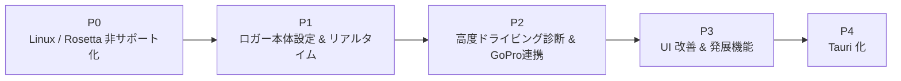

# DS Universal Suite - 開発ロードマップ & 今後の TODO

本プロジェクトの今後の機能拡張・実装タスク一覧です。公式解析ソフト（`DigSpice.exe`）の全機能網羅に加え、現代的なモータースポーツ解析スイートとしての独自強化項目を定義しています。

---

## 📌 優先度一覧

| 優先度 | 項目 | 状態 |
|---|---|---|
| **P0（最優先）** | [Linux / Rosetta の非サポート化](#-p0-linux--rosetta-の非サポート化最優先) | 完了 |
| P1 | [ロガー本体設定 & リアルタイムモニター](#️-p1-ロガー本体digspice-iv設定変更--リアルタイムモニター) | 完了（衛星受信モード・リアルタイムモニターは本体非対応のため見送り） |
| P2 | [高度ドライビング診断 & 外部データ連携](#-p2-高度ドライビング診断--外部データ連携) | 実装済み（GoPro・AIM と実データ確認が残り） |
| P3 | [UI 多言語化・テーマ切替 / 合成動画エクスポート](#-p3-ui-改善--発展機能) | 未着手 |
| P4 | [Tauri 化（Electron からの移行）](#-p4-tauri-化electron-からの移行) | 未着手 |
| 未定 | [アプリアイコンの作成](#-アプリアイコンの作成) | 採用案を反映済み（Windows 実機確認待ち） |
| 将来 | [iPhone アプリ版（Bluetooth 接続）](#-iphone-アプリ版bluetooth-接続) | プロトコル解析済み |
| 完了 | [車載動画同期 & オーバーレイ / Windows 配布 / リリース CI](#-完了済み) | 完了 |

サポート対象プラットフォーム: **Windows (x64)** / **macOS (Apple Silicon, arm64)**

---

## 🚫 P0: Linux / Rosetta の非サポート化【最優先】

配布対象を Windows (x64) と macOS (Apple Silicon ネイティブ) の 2 つに絞り、検証できていないビルドの配布をやめる。

- [x] **0.1 Linux 向けビルドの削除**
  - [x] GitHub Actions ワークフロー (`build-and-release.yml`) のビルドマトリクスから `ubuntu-latest`（`npm run dist:linux`）を削除
  - [x] `electron-builder.json` から `linux` セクションを削除
  - [x] `package.json` から `dist:linux` スクリプトを削除
  - [x] `README.md` の対応 OS バッジ・配布形式の表・ビルド手順・支援文言、および寄付モーダルから Linux の記載を削除
- [x] **0.2 macOS 版の Rosetta 非サポート化（Apple Silicon ネイティブのみ）**
  - [x] `electron-builder.json` の `mac.target`（`dmg` / `zip`）の `arch` から `x64` を外し `arm64` のみにする
  - [x] ローカルの `npm run dist:mac` で `arm64` の DMG / ZIP が生成され、Rosetta 2 を介さずネイティブ起動することを確認
  - [x] GitHub Actions の macOS ビルド（`macos-latest`）で `arm64` の DMG / ZIP が生成されることを確認（作業ブランチで手動実行。Windows ビルドも成功）
  - [x] `README.md` の macOS 向け利用案内・トラブルシューティングを更新（Intel Mac / Rosetta 非サポートの明記、アプリ名の修正）

---

## ⚙️ P1: ロガー本体（DigSpice IV）設定変更 & リアルタイムモニター

USB シリアル通信をさらに拡張し、公式アプリを使わずにロガーのすべての動作設定をコントロール可能にする。

本体設定（1.1）は実装済みで、設定の読み出し・サンプリングレート変更・記録開始速度変更・ログ吸い出しを macOS (Apple Silicon) 上の実機で確認した。
衛星受信モード設定とリアルタイムモニター（1.2）は本体が非対応のため見送り。
開発用シミュレーター（開発サーバーで `?sim=1`）で実機なしの画面確認ができる。

- [ ] **1.1 ロガー本体設定の書き込み（NMEA コマンド送信）**
  - [x] **サンプリングレート設定**: 5Hz / 10Hz / 20Hz の切り替え（キャプチャ済みの公式送信シーケンスを再現、本体からの読み戻しで反映確認）
  - [x] **ログ記録開始速度（Auto Log Speed）設定**: 10 / 20 / 30 km/h プリセットと 5〜100 km/h の任意値（本体からの読み戻しで反映確認）
  - [x] **ファームウェア・システム情報取得**: モデル、バージョン番号、内部ステータスコード、記録フォーマット、フラッシュ状態の表示
  - [ ] **シリアル番号の取得**: USB では取得コマンドが未判明（キャプチャに該当なし）
    - Bluetooth では、BLE のデバイス名（`DS4B` + 7 桁）の番号部分が本体記載のシリアル番号と一致する（実機で照合済み）。USB 版で表示する手段は引き続き不明
  - [x] **衛星受信モード設定** → **見送り（本体仕様により実現不可）**: 実機は問い合わせコマンド（`PMTK355`）に応答しないため、機能は実装から削除した
  - [x] 実機でのサンプリングレート変更の確認（10Hz ⇄ 20Hz を本体からの読み戻しで確認）
  - [x] 実機でのログ記録開始速度の変更確認（20 km/h ⇄ 30 km/h を本体からの読み戻しで確認）
  - [ ] 内部ステータスコード（`PTSI990` の `27`）の意味の解明。レート変更時は公式アプリと同じ固定値 `27` を送っている
- [x] **1.2 リアルタイム GPS モニター（Live Telemetry）** → **見送り（本体仕様により実現不可）**
  - 実機で確認した結果、デジスパイスIV は USB 接続中に位置情報 NMEA を出力せず、出力設定コマンド（`PMTK414` / `PMTK314`）にも応答しない。
  - 本体側の仕様と判断し、機能は実装から削除した。

---

## 📊 P2: 高度ドライビング診断 & 外部データ連携

単なるログの可視化にとどまらず、ラップタイム向上のための「弱点特定・ドライビング分析」を自動化する。

2.4（GoPro）以外は実装済み。解析は日光サーキットの実走ログ（20Hz）で動作を確認した。
いずれも GPS の位置・車速だけから算出しており、しきい値はこの 1 コースのデータで調整したものなので、他のコース・車両での確認が残っている。

- [x] **2.1 コーナー別ボトムスピード & 脱出速度の自動抽出**（グラフ解析 → 右下の「コーナー解析」）
  - [x] 走行ラインの曲率からコーナーを自動検出し、コーナーごとに「進入速度」「ボトム速度」「脱出速度」を算出（複合コーナーは曲率の谷で分割）
  - [x] 基準車（Car 1）とのコーナー別比較テーブル（車速差と、アペックス位置でのラインのイン / アウトを表示。行クリックでその位置へ移動）
  - [x] コース図へのコーナー番号表示
- [x] **2.2 ブレーキング診断（Braking Analysis）**（右下の「ブレーキング」）
  - [x] 制動開始ポイントの距離・車速の自動特定
  - [x] 最大減速Gとブレーキ立ち上がり（最大減速の 80% に達するまでの時間と増加率）の評価
  - [x] ブレーキリリース（所要時間と減速Gの最大変化率）・トレイルブレーキング（旋回しながらの制動時間と横G）の数値化、前後G / 横G のグラフ表示
  - 補足: ブレーキ操作そのものは記録されていないため、0.3G 以上の減速区間を制動として扱う推定
- [x] **2.3 走行ライン偏差（Line Delta）ヒートマップ**（コース図の「ライン偏差」）
  - [x] 基準車と他の車両（他ラップ）の走行軌跡の左右ズレを、基準ライン上の最近点への距離として計算
  - [x] コース図上に偏差量を色分け（左: 青 / 右: オレンジ）して重ね描き
  - [x] ラップ間の GPS の位置ずれ補正: ずれを平行移動として推定して差し引く（周回コースでのみ有効。切り替え可）
    - 実走ログでは補正量 1.5〜5 m、補正後のライン差の中央値は 0.4〜1.0 m（補正前 1.1〜3.7 m）
    - 補足: 取り除けるのはラップ全体で一定のずれだけ。1 周の中で変動する誤差は残るため、1 m 未満の差は参考値
- [x] **2.6 コース図の背景地図**（コース図の「背景」）
  - [x] 国土地理院タイルの航空写真 / 標準地図を背景に表示（API キー不要、出典表示あり。既定は「なし」でオフライン動作のまま）
  - [x] 地図の位置調整: 調整 ON の間はドラッグで地図だけを動かして GPS 軌跡に合わせる。補正量は場所ごとに保存
  - 補足: 表示にはインターネット接続が必要。対象は国内のみ（海外は高精細な画像がない）
  - [ ] Google Maps 対応（利用者が自分の API キーを設定する方式。要望があれば）
- [ ] **2.4 GoPro GPS（GPMF）からの直接インポート**
  - [ ] GoPro の MP4 動画内に記録されている GPMF (GoPro Metadata Format) トラックをブラウザ上で解析
  - [ ] 外部ロガーなしでも GoPro 単体の走行動画から GPS テレメトリを抽出し即座に解析可能にする
- [ ] **2.5 MoTeC i2 / AIM / RaceChrono 形式の相互インポート・エクスポート**
  - [x] MoTeC CSV 形式（i2 の CSV エクスポートと同じ書式）の出力と読み込み: **試験機能としてコードのみ組み込み、画面には出していない**
    - `src/services/externalFormats.ts` の `MOTEC_CSV_ENABLED` を `true` にすると、データ管理の書き出しボタンと読み込み時の自動判別が有効になる
  - [x] RaceChrono CSV（v2 / v3）・VBO (Racelogic) 形式のインポート対応
  - [ ] MoTeC: 実物の i2 から書き出した GPS 入り CSV での読み込み確認（入手できた公開サンプルは書式の確認用で、GPS チャンネルを含まない）。確認できたら画面に出す
  - [ ] RaceChrono: 実機で書き出した CSV での確認（入手できた公開サンプルは数行の合成データ）
  - [ ] AIM 形式（未着手）

---

## 🎨 P3: UI 改善 & 発展機能

- [ ] **3.1 UI 多言語化 & テーマ切替**
  - [ ] 日本語 / 英語 切り替え対応 (i18n)
  - [ ] サーキットの屋外直射日光下で見やすいハイコントラスト表示モード
- [ ] **3.2 テレメトリ合成動画のエクスポート**
  - [ ] WebCodecs / WebAssembly 版 FFmpeg (`@ffmpeg/ffmpeg`) を用いた動画レンダリング
  - [ ] メーターが焼き込まれた YouTube / SNS 共有用 MP4 動画のローカル書き出し

---

## 🦀 P4: Tauri 化（Electron からの移行）

シェルを Electron から Tauri に置き換え、配布サイズとメモリ使用量を削減する。USB シリアル通信（Web Serial API 依存）の作り直しが必要になるため優先度は低く、機能追加（P1〜P3）の後に着手する。

- [ ] **4.1 事前調査・技術検証**
  - [ ] **USB シリアル通信**: 現状は Web Serial API（`src/services/digspiceDevice.ts`）に依存。macOS の WKWebView は Web Serial 非対応のため、Rust 側（`tauri-plugin-serialplugin` / `serialport` crate 等）への置き換え方式を検証
  - [ ] **HEVC (H.265) 動画再生**: Electron の `PlatformHEVCDecoderSupport` 相当が WebView2 (Windows) / WKWebView (macOS) で成立するか、GoPro 動画の実ファイルで確認
  - [ ] Canvas オーバーレイ描画・動画シーク同期の性能が OS 標準 WebView で維持できるか確認
  - [ ] 検証結果をもとに移行可否を判断
- [ ] **4.2 Tauri プロジェクトの導入**
  - [ ] `src-tauri/` の追加と既存 Vite + React フロントエンドの接続
  - [ ] ウインドウ設定・アプリメニュー・アイコンの移植（`electron/main.cjs` 相当）
- [ ] **4.3 Electron API の置き換え**
  - [ ] `electronAPI.saveBinaryFile` / `readFileBuffer` → Tauri コマンド or `fs` / `dialog` プラグイン
  - [ ] `electronAPI.openExternal` → `opener` プラグイン
  - [ ] `electronAPI.onOpenFiles` / `onOpenDonateModal` → Tauri イベント（ファイル関連付け・メニュー操作）
  - [ ] シリアルポート選択・権限処理（`select-serial-port` 等）の Rust 側実装
- [ ] **4.4 ビルド・配布の移行**
  - [ ] Windows: NSIS インストーラー & ポータブル `.zip` 版の維持
  - [ ] macOS: `aarch64-apple-darwin` のみの DMG 生成
  - [ ] GitHub Actions を `tauri-action` ベースに置き換え
  - [ ] `electron` / `electron-builder` 依存、`electron/`、`electron-builder.json` の削除
- [ ] **4.5 ドキュメント更新**（`README.md` の開発・ビルド手順、動作要件）

---

## 🎨 アプリアイコンの作成

現状は Electron 既定のアイコンのまま。デジスパイス関連の意匠は使わず、サーキット向けアプリだと分かるデフォルメしたタイヤ等のイラストにする。

- [x] アイコン候補の作成（`build/icon-candidates/` に SVG 8 種と一覧 `preview.png`）
- [x] 採用案の決定・調整: D 案（タイヤをスピードメーターに見立てたもの）。既存アプリとの類似を避けるため調整した版を採用（原本は `build/icon.svg`）
  - App Store の関連アプリ約 160 本と見比べ、同一・酷似のものはなし
  - 「タイヤの中にメーター」という発想自体は空気圧管理アプリに例があり、針式メーターは公式デジスパイスアプリも使っているため、
    連続した円弧をやめてブロック状の目盛りにし、5 穴ハブとチェッカー柄を加えて差別化した
- [x] `build/icon.icns`（macOS）/ `build/icon.ico`（Windows）/ `build/icon.png` の生成と `electron-builder` への反映
- [ ] Windows ビルドでのアイコン表示確認（インストーラー・タスクバー）
- [ ] アプリ内ヘッダー・README のロゴ差し替え

### アプリ名の表記揺れ（UI 修正時に対応）

アプリ内の名称表記が統一されていない。UI の修正案が出たタイミングで、どの表記に揃えるかを決めて一括で直す。

- [ ] 表記の統一（現状: `DS Universal Suite` / `DS Universal Analyser` / `DS-ANALYSER`（ヘッダーのロゴ）/ `DS Universal Tool`（旧 `main.js`）/ `ds_universal`）

---

## 📱 iPhone アプリ版（Bluetooth 接続）

デジスパイスIV と Bluetooth Low Energy で接続する iPhone アプリ。プロトコルは `bluetooth_protocol_analysis.md` を参照。

- [x] Bluetooth 通信ログ（Android HCI スヌープログ）の解析とパケット仕様の抽出
  - 標準の Location and Navigation Service (`0x1819`) から、位置・速度・高度・UTC 時刻を 20Hz の通知で取得できる
- [ ] 追加キャプチャの取得
  - [ ] 走行中のログ（速度の単位の確定）
  - [ ] 公式アプリで設定変更・ログ吸い出しを行ったときのログ（書き込み特性の用途の解明）
  - [ ] Device Information（シリアル番号・ファームウェア版数）の読み出し
- [ ] アプリの技術選定（Swift / SwiftUI + CoreBluetooth など）
- [ ] **Bluetooth ペアリング（機器登録）機能**: 公式アプリ「DigSpice Circuit Timer Pro」と同等の接続操作
  - [ ] 周辺のデジスパイス（識別名が `DS3` / `DS4` で始まる機器）をスキャンして一覧表示
    - 公式アプリと同じく、一覧にはシリアル番号を表示して選ばせる。シリアル番号はアドバタイズされるデバイス名の番号部分から取得できる（実機で照合済み）ため、接続前に表示できる
  - [ ] 一覧から選んで接続し、接続状態（未接続 / 接続中 / 接続済み / 測位待ち）を表示
  - [ ] 選んだ機器を記憶し、次回以降は自動で再接続
  - [ ] 登録の解除・別の機器への切り替え
  - [ ] 本体側の操作（スライドスイッチを BLE にする）の案内表示
  - 補足: 解析したログでは OS レベルのペアリング（ボンディング）なしで受信できているため、ここでの「ペアリング」はアプリ内の機器選択・登録を指す。
    暗号化が必要な操作があるかは未確認
- [ ] BLE 接続・リアルタイム表示（車速・座標・測位状態）の実装
- [ ] ラップ計測・走行ログ保存、デスクトップ版との形式互換

---

## ✅ 完了済み

### 🎥 車載動画（オンボード映像）同期 & テレメトリオーバーレイ再生

公式解析ソフトの重要機能であり、走行ログと実際のドライバー視線・ステアリング操作・挙動を視覚的に突き合わせるためのコア機能。

- [x] **動画プレイヤーコンポーネントの実装 (`VideoSyncWindow.tsx`)**
  - [x] ローカル動画ファイル (`.mp4`, `.mov`, `.webm`) の選択 & 複数トラック一括登録
  - [x] Chromium / Electron H.265 (HEVC) ハードウェアアクセラレーション再生対応 (`PlatformHEVCDecoderSupport`)
  - [x] 低遅延再生コントロール（再生、一時停止、コマ送り、コマ戻し、0.5x〜4.0x 倍速再生）
  - [x] 大画面タブ表示 & グラフ解析画面下部サブウインドウ表示の両対応
- [x] **GPS 走行ログと動画のタイムライン同期エンジン (`videoSyncManager.ts`, `videoMetadataParser.ts`)**
  - [x] デジスパイスIV の JST (UTC+9) タイムスタンプと動画の ISOBMFF QuickTime エポックメタデータを自動照合して初期オフセット（$\Delta t$）を自動計算
  - [x] GoPro の 4GB チャプター分割ファイルや複数ヒートの複数動画トラック一括管理
  - [x] 特定フレームによるワンクリック現フレーム同期ボタン & ±0.05秒（1フレーム単位）の微調整スピンボタン
  - [x] シークバー操作・グラフクリック時の動画現在時刻への完全双方向同期
  - [x] 同期情報および動画ファイル構成のプロジェクト保存・復元 (`.dssync.json`)
- [x] **リアルタイム・テレメトリオーバーレイ描画**
  - [x] 動画上に Canvas で計器類を透過オーバーレイ合成
  - [x] デジタルスピードメーター（km/h, 色付きバーメーター）
  - [x] Gフォースメーター（前後G・横Gのインジケーター & フリクションサークル）
  - [x] ラップタイム・リアルタイムセクター差分表示
  - [x] 球面三角法 Bearing 演算による車両進行方向（Heading）のリアルタイム回転描画（コースマップ連携）

### 📦 パッケージング & 配布

- [x] **Windows**: `.exe`（NSIS インストーラー & USB メモリ等で持ち運べるポータブル `.zip` 版）
- [x] **CI/CD**: タグプッシュ時に自動でバイナリをビルドし GitHub Releases にアタッチ
