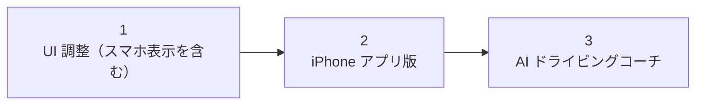

# DS Universal - 開発ロードマップ & 今後の TODO

本プロジェクトの今後の機能拡張・実装タスク一覧です。公式解析ソフト（`DigSpice.exe`）の全機能網羅に加え、現代的なモータースポーツ解析スイートとしての独自強化項目を定義しています。

---

## 🔖 残件一覧（ID）

ID の付け方: 不具合は `BUG-NN`（[BUGS.md](BUGS.md) と同じ番号）、そのうち対応するものは `LATER-NN`、大きい計画は `PLAN-NN`、実機などがそろえばやりたいもの（今は進められない）は `WISH-NN`。番号は使い回さない。

| ID | 内容 | 状態 |
|---|---|---|
| BUG-08 | 開始位置の違うログの重ね合わせの残り（計測線より後ろから始まるログ・ロガーごとの GPS の遅れ） | 一部対応 |
| BUG-17 | フリクションサークルの点の跳ね（G の補間） | 一部対応（「なめらか」） |
| BUG-20 | グラフ解析で再生すると、車載動画のコマがときどき抜ける (グラフを毎コマまるごと描き直す負荷) | BUG-14 の修正で改善・M2 の実機で確認待ち |
| BUG-21 | 動画同期で撮影時刻の全く違う動画を 2 本読み込むと（袖ヶ浦と TC2000 など）、sub が main に引っ張られて同期してしまう。撮影時刻のある動画は撮影時刻で合わせる | 未対応 |
| BUG-23 | 2画面・PinP のとき、メーターのオーバーレイが main の動画に合わせて描かれない | 未対応 |
| LATER-01 | 吸い出しの欠けたブロックの読み直しの有効化（実機確認が要る） | 実装済み・無効 |
| LATER-02 | 大きいログの書き出しのメモリ使用量 | 未対応 |
| LATER-03 | ds4_convert から未移植の機能（地図 HTML のホバー表示・JST / UTC 切り替え・.txt 書き出し・平均車速） | 未対応 |
| LATER-04 | Windows ビルドのアイコン表示確認 | 未確認 |
| LATER-05 | USB でのシリアル番号の取得 | 方法不明 |
| LATER-06 | 内部ステータスコード（`PTSI990` の `27`）の意味 | 不明 |
| LATER-07 | Google Maps の背景地図（要望があれば） | 未対応 |
| LATER-08 | QSTARZ のログの重ね合わせ（NMEA / GPX で読める見込み） | 未確認 |
| LATER-10 | フリクションサークルの G の軌跡を、直前を濃く・前のものほど薄く描く。現在の G の点を少し小さくする。濃く描く秒数などの見た目は公式アプリの表示に合わせる（BUG-17 と合わせて見直す） | 未対応 |
| LATER-11 | 別々の走行の動画を main と sub に横に並べて見る方式（それぞれの走行の時刻で再生し、周や地点でそろえて比べる）。BUG-21 の撮影時刻での同期と両立させる | 検討 |
| LATER-12 | 同じ時間帯の走行ログが複数あるとき（GoPro の GPS のログとデジスパイスのログなど）、動画を付けるログを選べるようにする。既定（デジスパイス優先 / GoPro の GPS）の設定と動画同期の画面での切り替え。ずれは動画の先頭の UTC 時刻から計算し直す。デジスパイス優先のとき GoPro のログを加えるかも選ぶ。**BUG-21 と同じ作業で行う**（動画ごとに正確な時刻を持たせ、その時刻で各ログに合わせる作り替え） | 未対応 |
| PLAN-01 | iPhone アプリ版（Bluetooth 接続。通信の層の分離を含む） | プロトコル解析済み |
| PLAN-02 | AI によるドライビングコーチ | 検討のみ |
| PLAN-03 | GoPro の動画の GPS（GPMF）の読み込み | 対応 |
| PLAN-04 | MoTeC / AIM / RaceChrono 形式（AIM の CSV・.xrk / .xrz の読み込み、MoTeC CSV の有効化、KML の書き出し） | 対応（RaceChrono の実機の CSV での確認が残り） |
| PLAN-05 | 日本語 / 英語の切り替え・ハイコントラスト表示 | 未着手 |
| PLAN-06 | メーターを焼き込んだ動画の書き出し | 未着手 |
| PLAN-07 | Tauri 化（Electron からの移行） | 未着手 |
| WISH-01 | AiM のロガー（MyChron・Solo など）から USB で直接データを吸い出す。USB の通信の形は一部分かったが、確かめるには AiM の実機が要る | 実機待ち |

---

## 📌 優先度一覧

現在の優先順（2026-10-16 決定）: **UI 調整（スマホ表示を含む）→ iPhone アプリ版 → AI によるドライビングコーチ**

| 優先度 | 項目 | 状態 |
|---|---|---|
| **1（最優先）** | [UI 調整（スマホ表示を含む）](#-ui-調整スマホ表示を含む最優先) | 完了（v0.9.0。UI 修正案はクローズ） |
| 2 | [iPhone アプリ版（Bluetooth 接続）](#-iphone-アプリ版bluetooth-接続優先度-2) | プロトコル解析済み |
| 3 | [AI によるドライビングコーチ](#-ai-によるドライビングコーチ2026-10-16-追加優先度-3) | 検討のみ |
| P0 | [Linux / Rosetta の非サポート化](#-p0-linux--rosetta-の非サポート化完了) | 完了 |
| P1 | [ロガー本体設定 & リアルタイムモニター](#️-p1-ロガー本体digspice-iv設定変更--リアルタイムモニター) | 完了（衛星受信モード・リアルタイムモニターは本体非対応のため見送り） |
| P2 | [高度ドライビング診断 & 外部データ連携](#-p2-高度ドライビング診断--外部データ連携) | 実装済み（GoPro・AIM と実データ確認が残り） |
| P3 | [UI 多言語化・テーマ切替 / 合成動画エクスポート](#-p3-ui-改善--発展機能) | 未着手 |
| P4 | [Tauri 化（Electron からの移行）](#-p4-tauri-化electron-からの移行) | 未着手 |
| 未定 | [アプリアイコンの作成](#-アプリアイコンの作成) | 採用案を反映済み（Windows 実機確認待ち） |
| 随時（高→低） | [既知の問題（影響度順、BUG-01〜18）](#-既知の問題未対応影響度順) | 未対応は BUG-08・14・17・18・19（上の残件一覧） |
| 完了 | [車載動画同期 & オーバーレイ / Windows 配布 / リリース CI](#-完了済み) | 完了 |

P0〜P2 は完了（P2 は実データ確認が残り）。P3（多言語化・テーマ切替 / 合成動画）と P4（Tauri 化）の順位は未定。

サポート対象プラットフォーム: **Windows (x64)** / **macOS (Apple Silicon, arm64)**

---

## 🎨 UI 調整（スマホ表示を含む）【最優先】

2026-10-16 に最優先と決めた。2026-10-17 の v0.9.0 で区切り、UI 修正案はクローズした。

- [x] **（2026-10-17 対応）ウインドウの折りたたみ（パソコン表示）**（2026-10-17 決定）: 全コース・アニメーション／動画・フリクションサークル等のウインドウを見出しのボタンでたたむ。空いた高さは同じ列のウインドウへ、右列を両方たたんだら細い帯にして左列を広げる。状態は端末に保存
- [x] **（2026-10-17 対応）変換画面の切り出し UI**（2026-10-17 決定、折りたたみの後）: ds4_convert の TrackPreview 相当（軌跡と車速グラフのプレビュー、範囲スライダー、「ここを開始地 / 終了地に設定」、HH:mm:ss 入力と ±10 秒 / ±1 分）
- [x] **（2026-10-17 対応）G フィルタの設定（BUG-16 の「解析 & 単位設定」）**（2026-10-17 決定）: 公式ソフトと同じ考え方の計算（3 点の円で旋回半径、記録レートに応じた中央値＋加重平均、1 区間の差分の加減速 G、最後に 3 点平均）を「標準」にして、弱 / 強を選べるようにし、説明を付ける。読み込み済みのログは設定を変えたら計算し直す。速度単位（mph）は表示箇所が多いので、つなぐまで隠す
- [x] **（2026-10-17 対応）BUG-10（NMEA の入出力）**: NMEA の書き出しを変換画面の処理（実測値、ないものは空欄）に 1 本化する。ヘッダーの「NMEA出力」と、データ管理の書き出し（走行データCSV・ラップ一覧CSV・NMEA出力・GPX出力・.dtb 保存）はすべて変換画面にまとめ、データ管理の各ログに「変換画面で開く」（そのログを選んで変換画面へ）を付ける。変換画面の対象のログの選択欄は「ファイル名・日付・コース名・周数」を出し、最初は基準車のログ。読み込みで GGA の衛星数を保持し、標高の未記録と 0 m を区別する
- [x] **（2026-10-17 対応）BUG-09（.bnx4 の複数セッション）**: 記録が 10 分以上空いたら別のセッションにする（名前は「ファイル名_1」「_2」…、10 秒未満の走行は読まない）。重複レコードの除去、ミリ秒の抜けた秒だけの等分、メタデータの南半球・西経とチェックサム
- [ ] **LATER-01（そのうち）吸い出しの欠けたブロックの読み直しの有効化**（BUG-16、2026-10-17 決定）: 処理は `digspiceDevice.ts` に実装済みで、`PARTIAL_REFETCH_ENABLED = false` で止めてある。公式アプリは範囲を指定した読み出し（`PMTK182,7,<アドレス>,<サイズ>` を 0 番地以外から）を使っておらず、本体が正しく応じるかは未確認。実機で、途中の番地からの読み出しの応答（ブロックの区切り・終端の応答）を確かめてから有効にする
- [x] **（2026-10-17 対応）README の画面サンプルの撮り直し**（2026-10-17 決定）: `docs/images/` は v0.7.1 の画面。切り出し・G フィルタ・BUG-10 で画面が変わるので、それらの後、次のリリースの前に撮る
- [x] **UI 修正案の反映** → **クローズ**（2026-10-17。修正案は出さず、ここまでの UI 調整で区切る）
- [x] **（2026-10-17 対応、v0.9.0）スマートフォン向けレイアウト**（ブラウザ版）: ロガー設定タブ（USB 通信）はスマートフォン・タブレットでは出さない（2026-10-17 対応済み）。iPhone / iPad は Web Serial 非対応、Android の Chrome も USB 接続のシリアルは使えないため
- [x] **（2026-10-17 対応）アプリ名の表記の統一**: 「DS Universal」に統一した（画面・README・書き出すファイルの作成元・Electron の productName）。デスクトップ版のデータの保存先は、前の名前のフォルダ（DS Universal Suite）を使い続ける
- [x] **（2026-10-17 対応）README のロゴ差し替え**: 新しいアイコン（`build/icon.svg`）に置き換える（アプリ内ヘッダーのロゴ「DS-ANALYSER」と名称「DS Universal Analyser」は 2026-10-17 に削除した）
- [x] **（2026-10-17 対応）ブラウザ版（GitHub Pages）のファビコン設定**: `index.html` が存在しない `/vite.svg` を参照しており 404 になっているため、`build/icon.svg`（および `apple-touch-icon` 用の `build/icon.png`）を `public/` に配置して相対パスで参照させる

---

## 🚫 P0: Linux / Rosetta の非サポート化【完了】

配布対象を Windows (x64) と macOS (Apple Silicon ネイティブ) の 2 つに絞り、検証できていないビルドの配布をやめる。

- [x] **0.1 Linux 向けビルドの削除**
  - [x] GitHub Actions ワークフロー (`build-and-release.yml`) のビルドマトリクスから `ubuntu-latest`（`npm run dist:linux`）を削除
  - [x] `electron-builder.json` から `linux` セクションを削除
  - [x] `package.json` から `dist:linux` スクリプトを削除
  - [x] `README.md` の対応 OS バッジ・配布形式の表・ビルド手順・支援文言、および寄付モーダルから Linux の記載を削除
- [x] **0.2 macOS 版の Rosetta 非サポート化（Apple Silicon ネイティブのみ）**
  - [x] `electron-builder.json` の `mac.target`（`dmg` / `zip`）の `arch` から `x64` を外し `arm64` のみにする
  - [x] ローカルの `npm run dist:mac` で `arm64` の DMG / ZIP が生成され、Rosetta 2 を介さずネイティブ起動することを確認
  - [x] GitHub Actions の macOS ビルド（`macos-latest`）で `arm64` の DMG / ZIP が生成されることを確認（作業ブランチで手動実行。Windows ビルドも成功）
  - [x] `README.md` の macOS 向け利用案内・トラブルシューティングを更新（Intel Mac / Rosetta 非サポートの明記、アプリ名の修正）

---

## ⚙️ P1: ロガー本体（DigSpice IV）設定変更 & リアルタイムモニター

USB シリアル通信をさらに拡張し、公式アプリを使わずにロガーのすべての動作設定をコントロール可能にする。

本体設定（1.1）は実装済みで、設定の読み出し・サンプリングレート変更・記録開始速度変更・ログ吸い出しを macOS (Apple Silicon) 上の実機で確認した。
衛星受信モード設定とリアルタイムモニター（1.2）は本体が非対応のため見送り。
開発用シミュレーター（開発サーバーで `?sim=1`）で実機なしの画面確認ができる。

- [ ] **1.1 ロガー本体設定の書き込み（NMEA コマンド送信）**
  - [x] **サンプリングレート設定**: 5Hz / 10Hz / 20Hz の切り替え（キャプチャ済みの公式送信シーケンスを再現、本体からの読み戻しで反映確認）
  - [x] **ログ記録開始速度（Auto Log Speed）設定**: 10 / 20 / 30 km/h プリセットと 5〜100 km/h の任意値（本体からの読み戻しで反映確認）
  - [x] **ファームウェア・システム情報取得**: モデル、バージョン番号、内部ステータスコード、記録フォーマット、フラッシュ状態の表示
  - [ ] **LATER-05 シリアル番号の取得**: USB では取得コマンドが未判明（キャプチャに該当なし）
    - Bluetooth では、BLE のデバイス名（`DS4B` + 7 桁）の番号部分が本体記載のシリアル番号と一致する（実機で照合済み）。USB 版で表示する手段は引き続き不明
  - [x] **衛星受信モード設定** → **見送り（本体仕様により実現不可）**: 実機は問い合わせコマンド（`PMTK355`）に応答しないため、機能は実装から削除した
  - [x] 実機でのサンプリングレート変更の確認（10Hz ⇄ 20Hz を本体からの読み戻しで確認）
  - [x] 実機でのログ記録開始速度の変更確認（20 km/h ⇄ 30 km/h を本体からの読み戻しで確認）
  - [ ] **LATER-06** 内部ステータスコード（`PTSI990` の `27`）の意味の解明。レート変更時は公式アプリと同じ固定値 `27` を送っている
- [x] **1.2 リアルタイム GPS モニター（Live Telemetry）** → **見送り（本体仕様により実現不可）**
  - 実機で確認した結果、デジスパイスIV は USB 接続中に位置情報 NMEA を出力せず、出力設定コマンド（`PMTK414` / `PMTK314`）にも応答しない。
  - 本体側の仕様と判断し、機能は実装から削除した。

---

## 📊 P2: 高度ドライビング診断 & 外部データ連携

単なるログの可視化にとどまらず、ラップタイム向上のための「弱点特定・ドライビング分析」を自動化する。

2.4（GoPro）以外は実装済み。解析は日光サーキットの実走ログ（20Hz）で動作を確認した。
いずれも GPS の位置・車速だけから算出しており、しきい値はこの 1 コースのデータで調整したものなので、他のコース・車両での確認が残っている。

- [x] **2.1 コーナー別ボトムスピード & 脱出速度の自動抽出**（グラフ解析 → 右下の「コーナー解析」）
  - [x] 走行ラインの曲率からコーナーを自動検出し、コーナーごとに「進入速度」「ボトム速度」「脱出速度」を算出（複合コーナーは曲率の谷で分割）
  - [x] 基準車（Car 1）とのコーナー別比較テーブル（車速差と、アペックス位置でのラインのイン / アウトを表示。行クリックでその位置へ移動）
  - [x] コース図へのコーナー番号表示
- [x] **2.2 ブレーキング診断（Braking Analysis）**（右下の「ブレーキング」）
  - [x] 制動開始ポイントの距離・車速の自動特定
  - [x] 最大減速Gとブレーキ立ち上がり（最大減速の 80% に達するまでの時間と増加率）の評価
  - [x] ブレーキリリース（所要時間と減速Gの最大変化率）・トレイルブレーキング（旋回しながらの制動時間と横G）の数値化、前後G / 横G のグラフ表示
  - 補足: ブレーキ操作そのものは記録されていないため、0.3G 以上の減速区間を制動として扱う推定
- [x] **2.3 走行ライン偏差（Line Delta）ヒートマップ**（コース図の「ライン偏差」）
  - [x] 基準車と他の車両（他ラップ）の走行軌跡の左右ズレを、基準ライン上の最近点への距離として計算
  - [x] コース図上に偏差量を色分け（左: 青 / 右: オレンジ）して重ね描き
  - [x] ラップ間の GPS の位置ずれ補正: ずれを平行移動として推定して差し引く（周回コースでのみ有効。切り替え可）
    - 実走ログでは補正量 1.5〜5 m、補正後のライン差の中央値は 0.4〜1.0 m（補正前 1.1〜3.7 m）
    - 補足: 取り除けるのはラップ全体で一定のずれだけ。1 周の中で変動する誤差は残るため、1 m 未満の差は参考値
- [x] **2.6 コース図の背景地図**（コース図の「背景」）
  - [x] 国土地理院タイルの航空写真 / 標準地図を背景に表示（API キー不要、出典表示あり。既定は「なし」でオフライン動作のまま）
  - [x] 地図の位置調整: 調整 ON の間はドラッグで地図だけを動かして GPS 軌跡に合わせる。補正量は場所ごとに保存
  - 補足: 表示にはインターネット接続が必要。対象は国内のみ（海外は高精細な画像がない）
  - [ ] **LATER-07** Google Maps 対応（利用者が自分の API キーを設定する方式。要望があれば）
- [x] **PLAN-03（2.4）GoPro GPS（GPMF）からの直接インポート**（2026-10-18 対応、`gpmfParser.ts`）
  - [x] GoPro の MP4 動画内に記録されている GPMF (GoPro Metadata Format) トラックをブラウザ上で解析（GPS9 / GPS5。MP4 の箱をたどって GPMF のサンプルだけを読む）
  - [x] 外部ロガーなしでも GoPro 単体の走行動画から GPS テレメトリを抽出し即座に解析可能にする。同じ動画を動画同期に登録し、GPS の時刻から求めたずれで合わせる
  - 確認: 手元の HERO（GPS9、10Hz）の 5 本で、デジスパイスのログとラップタイムが 0.1 秒以内で一致。2.1 GB の動画が 0.5 秒で読める
  - チャプター分割（GX01xxxx・GX02xxxx など）の動画は、まとめて選ぶと 1 つのログにつなげ、動画同期でもチャプターとして登録する
  - 残り: ピットロードをゆっくり通るとき、GoPro の位置が内蔵の計測線の端の外を通って周が 1 つにつながることがある（TC2000・袖ケ浦）
- [ ] **PLAN-04（2.5）MoTeC i2 / AIM / RaceChrono 形式の相互インポート・エクスポート**
  - [x] MoTeC CSV 形式（i2 の CSV エクスポートと同じ書式）の出力と読み込み: **試験機能としてコードのみ組み込み、画面には出していない**
    - `src/services/externalFormats.ts` の `MOTEC_CSV_ENABLED` を `true` にすると、データ管理の書き出しボタンと読み込み時の自動判別が有効になる
  - [x] （2026-10-18 対応、`aimFormats.ts`）AIM の読み込み（MUST）: Race Studio の CSV（`"Format","AiM CSV File"`）と .xrk / .xrz。.xrk は GPS の記録（u-blox NAV-SOL）だけを読む。富士 GP ショートの .xrk / .xrz / CSV が AiM の区間タイムと 3 ミリ秒以内で一致。.xrk / .xrz は libxrk（MIT）を参考にする。サンプルは `_private/samples/aim_libxrk/`（富士 GP ショート・筑波など）
  - [x] （2026-10-18 対応）MoTeC CSV の有効化（小数点のカンマ・dd.mm.yyyy の日付・速度の列がないもの（位置から求める）に対応。記録日時は端末の時刻で読み書き）: 実物の i2 の書き出し（`_private/samples/motec_lapsim/`、小数点がカンマ）で確かめてから `MOTEC_CSV_ENABLED` を true にする
  - [x] （2026-10-18 対応）KML の書き出し（Google Earth 用。車速を 6 段に分け、段ごとに色を付けた線）
  - [x] RaceChrono CSV（v2 / v3）・VBO (Racelogic) 形式のインポート対応
  - [x] MoTeC: 実物の i2 から書き出した GPS 入り CSV での読み込み確認（2026-10-18、`motec_lapsim` の 2 本）（入手できた公開サンプルは書式の確認用で、GPS チャンネルを含まない）。確認できたら画面に出す
  - [ ] RaceChrono: 実機で書き出した CSV での確認（入手できた公開サンプルは数行の合成データ）
  - [x] AIM 形式（上の「AIM の読み込み」）
  - [x] **GPX の読み込み**（2026-10-16 追加・実装、dev ブランチ。要望: issue #1〜#3 の投稿者のブログ、みんカラ 2026-10-15「RaceChrono で書き出した GPX を読みたい」）
    - `externalFormats.ts` の `parseGpx`。`trkpt` の緯度経度・`ele`・`time` を読み、複数の `trk` / `trkseg` は連結する
    - 速度・進行方向は `<speed>` / `<course>` か拡張要素（`gpxtpx:speed` など、m/s）。速度がなければ位置と時刻から求める
    - 時刻が秒単位までしかない GPX は、同じ時刻の点を次の時刻までに等間隔に割り振る
    - 確認済み（Node で読み込み処理のみ）: RaceChrono の GPX（20Hz）が、元の bon4・ds4_convert の NMEA・RaceChrono CSV と同じラップ（8 周、ベスト 74.716 秒）になる。速度を除いた GPX・時刻を秒単位にした GPX でも同じラップ
    - [x] アプリ上での確認（2026-10-17 確認 OK）
    - サンプル: `_private/samples/racechrono_20261012/`（git 管理外）
  - [ ] **LATER-08 QSTARZ のログの重ね合わせ**（2026-10-16 追加。同じブログに「将来的に QSTARZ のログも重ねられるかも」とある。要望というより期待）
    - QSTARZ の付属ソフトから NMEA か GPX で書き出せば、既存の NMEA 読み込みか上の GPX 読み込みで読める見込み。実ファイルでは未確認
    - 独自形式（.BIN など）を直接読むのは、要望が具体的になってから

---

## 🎨 P3: UI 改善 & 発展機能

- [ ] **PLAN-05（3.1）UI 多言語化 & ハイコントラスト表示**（テーマ切替は v0.9.0 で対応）
  - [ ] 日本語 / 英語 切り替え対応 (i18n)
  - [ ] サーキットの屋外直射日光下で見やすいハイコントラスト表示モード
- [ ] **PLAN-06（3.2）テレメトリ合成動画のエクスポート**
  - [ ] WebCodecs / WebAssembly 版 FFmpeg (`@ffmpeg/ffmpeg`) を用いた動画レンダリング
  - [ ] メーターが焼き込まれた YouTube / SNS 共有用 MP4 動画のローカル書き出し

---

## 🦀 PLAN-07（P4）: Tauri 化（Electron からの移行）

シェルを Electron から Tauri に置き換え、配布サイズとメモリ使用量を削減する。USB シリアル通信（Web Serial API 依存）の作り直しが必要になるため優先度は低く、機能追加（P1〜P3）の後に着手する。

- [ ] **4.1 事前調査・技術検証**
  - [ ] **USB シリアル通信**: 現状は Web Serial API（`src/services/digspiceDevice.ts`）に依存。macOS の WKWebView は Web Serial 非対応のため、Rust 側（`tauri-plugin-serialplugin` / `serialport` crate 等）への置き換え方式を検証。先に iPhone アプリ版の「通信の層の分離」を済ませておくと、送受信の層だけを書けばよい
  - [ ] **HEVC (H.265) 動画再生**: Electron の `PlatformHEVCDecoderSupport` 相当が WebView2 (Windows) / WKWebView (macOS) で成立するか、GoPro 動画の実ファイルで確認
  - [ ] Canvas オーバーレイ描画・動画シーク同期の性能が OS 標準 WebView で維持できるか確認
  - [ ] 検証結果をもとに移行可否を判断
- [ ] **4.2 Tauri プロジェクトの導入**
  - [ ] `src-tauri/` の追加と既存 Vite + React フロントエンドの接続
  - [ ] ウインドウ設定・アプリメニュー・アイコンの移植（`electron/main.cjs` 相当）
- [ ] **4.3 Electron API の置き換え**
  - [ ] `electronAPI.saveBinaryFile` / `readFileBuffer` → Tauri コマンド or `fs` / `dialog` プラグイン
  - [ ] `electronAPI.openExternal` → `opener` プラグイン
  - [ ] `electronAPI.onOpenFiles` / `onOpenDonateModal` → Tauri イベント（ファイル関連付け・メニュー操作）
  - [ ] シリアルポート選択・権限処理（`select-serial-port` 等）の Rust 側実装
- [ ] **4.4 ビルド・配布の移行**
  - [ ] Windows: NSIS インストーラー & ポータブル `.zip` 版の維持
  - [ ] macOS: `aarch64-apple-darwin` のみの DMG 生成
  - [ ] GitHub Actions を `tauri-action` ベースに置き換え
  - [ ] `electron` / `electron-builder` 依存、`electron/`、`electron-builder.json` の削除
- [ ] **4.5 ドキュメント更新**（`README.md` の開発・ビルド手順、動作要件）

---

## 🎨 アプリアイコンの作成

現状は Electron 既定のアイコンのまま。デジスパイス関連の意匠は使わず、サーキット向けアプリだと分かるデフォルメしたタイヤ等のイラストにする。

- [x] アイコン候補の作成（`build/icon-candidates/` に SVG 8 種と一覧 `preview.png`）
- [x] 採用案の決定・調整: D 案（タイヤをスピードメーターに見立てたもの）。既存アプリとの類似を避けるため調整した版を採用（原本は `build/icon.svg`）
  - App Store の関連アプリ約 160 本と見比べ、同一・酷似のものはなし
  - 「タイヤの中にメーター」という発想自体は空気圧管理アプリに例があり、針式メーターは公式デジスパイスアプリも使っているため、
    連続した円弧をやめてブロック状の目盛りにし、5 穴ハブとチェッカー柄を加えて差別化した
- [x] `build/icon.icns`（macOS）/ `build/icon.ico`（Windows）/ `build/icon.png` の生成と `electron-builder` への反映
- [ ] **LATER-04** Windows ビルドでのアイコン表示確認（インストーラー・タスクバー）
- アプリ内ヘッダー・README のロゴ差し替えは [UI 調整](#-ui-調整スマホ表示を含む最優先) に移した

---

## 📱 PLAN-01: iPhone アプリ版（Bluetooth 接続）【優先度 2】

デジスパイスIV と Bluetooth Low Energy で接続する iPhone アプリ。プロトコルは `bluetooth_protocol_analysis.md` を参照。

- [x] Bluetooth 通信ログ（Android HCI スヌープログ）の解析とパケット仕様の抽出
  - 標準の Location and Navigation Service (`0x1819`) から、位置・速度・高度・UTC 時刻を 20Hz の通知で取得できる
- [ ] 追加キャプチャの取得
  - [ ] 走行中のログ（速度の単位の確定）
  - [ ] 公式アプリで設定変更・ログ吸い出しを行ったときのログ（書き込み特性の用途の解明）
  - [ ] Device Information（シリアル番号・ファームウェア版数）の読み出し
- [ ] アプリの技術選定（Swift / SwiftUI + CoreBluetooth など）
  - 既存の Web の画面を包む方式（Capacitor など + BLE プラグイン）なら、画面と解析処理（TypeScript）を共有できる。Swift で作るなら移植になる
- [ ] **通信の層の分離**（2026-10-16 追加。iPhone アプリ版と P4 の Tauri 化の前提）
  - 環境ごとにロガーとのつなぎ方が変わる

    | 環境 | つなぎ方 | 状態 |
    |---|---|---|
    | ブラウザ版（パソコンの Chrome / Edge） | USB + Web Serial | 実装済み |
    | デスクトップ版（Electron） | USB + Web Serial（ブラウザ版と同じコード） | 実装済み |
    | デスクトップ版（Tauri にした場合） | USB + Rust 側のシリアル通信（`serialport` crate など） | 未着手。macOS の WKWebView は Web Serial 非対応。Windows の WebView2 も Chrome と同じには使えない見込み（未確認） |
    | iPhone アプリ版 | Bluetooth（BLE） | プロトコル解析済み |
    | スマホのブラウザ | 基本は使えない（iPhone の Safari は USB も BLE も不可。Android の Chrome は Web Bluetooth があるので BLE は届く可能性あり、未確認） | ロガー設定タブは無効化する予定 |

  - [ ] `src/services/digspiceDevice.ts` を、共通のプロトコル層（コマンドの組み立て・応答の解析・ログ吸い出しの手順）と、環境ごとに差し替える送受信の層（つなぐ・切る・送る・受け取る）に分ける
  - 注意: 共有できるのは USB シリアルどうし（Web Serial と Rust）の中身。BLE は、位置などが標準の Location and Navigation Service の通知で届く別の仕組みで、設定変更・ログ吸い出しのコマンドが BLE で通るかは未解明（上の「追加キャプチャ」）。BLE 側は当面、リアルタイム受信の別実装になる見込み
- [ ] **Bluetooth ペアリング（機器登録）機能**: 公式アプリ「DigSpice Circuit Timer Pro」と同等の接続操作
  - [ ] 周辺のデジスパイス（識別名が `DS3` / `DS4` で始まる機器）をスキャンして一覧表示
    - 公式アプリと同じく、一覧にはシリアル番号を表示して選ばせる。シリアル番号はアドバタイズされるデバイス名の番号部分から取得できる（実機で照合済み）ため、接続前に表示できる
  - [ ] 一覧から選んで接続し、接続状態（未接続 / 接続中 / 接続済み / 測位待ち）を表示
  - [ ] 選んだ機器を記憶し、次回以降は自動で再接続
  - [ ] 登録の解除・別の機器への切り替え
  - [ ] 本体側の操作（スライドスイッチを BLE にする）の案内表示
  - 補足: 解析したログでは OS レベルのペアリング（ボンディング）なしで受信できているため、ここでの「ペアリング」はアプリ内の機器選択・登録を指す。
    暗号化が必要な操作があるかは未確認
- [ ] BLE 接続・リアルタイム表示（車速・座標・測位状態）の実装
- [ ] ラップ計測・走行ログ保存、デスクトップ版との形式互換

---

## 🤖 PLAN-02: AI によるドライビングコーチ（2026-10-16 追加）【優先度 3】

UI 調整と iPhone アプリ版の後に着手する。まずは方法の検討から。走行ログをもとに、AI が「どこで・何を変えればタイムが縮むか」を言葉で助言する。

- [ ] **入力の決め方**: 生ログ（20Hz・数万点）をそのまま渡さず、既存の解析結果を要約して渡す
  - コーナー別の進入・ボトム・脱出速度（2.1）、ブレーキング診断（2.2）、セクタータイム、基準ラップとのタイム差が開いた区間など
  - 比較の相手（自分のベスト / 他の車両）と、車両・コースの情報をどう添えるか
- [ ] **AI の使い方の比較**
  - クラウドの LLM API（利用者が自分の API キーを設定する方式）: 精度は高いが、費用と、走行データを外部に送ることの説明が要る
  - ローカルの LLM: 送信しない・オフラインで動くが、端末の性能と配布サイズの負担が大きい
  - ルールで助言を作り、AI は言い回しだけに使う方式: 誤った助言を出しにくい
- [ ] **助言の正しさ**: GPS の位置・車速だけから推定した値（ブレーキ操作は記録されていない、など）を、断定せずに伝える。根拠になった区間をグラフ・コース図で示す
- [ ] **スマホ版との関係**: スマホ版で使う場合の通信・電池・オフラインの扱い

---

## 🌐 ブラウザ版・ログ変換（2026-10-13 追加）

- [x] ログ変換ページ（NMEA / GPX / CSV / DTB / 地図 HTML、範囲と時差の指定）をアプリ内のタブとして追加
- [x] GitHub Pages でブラウザ版を公開（`.github/workflows/pages.yml`）
- [x] ds4_convert（旧変換サイト）からの案内・統合後の扱いを決める（2026-10-16、ds4_convert v1.0.5 で画面トップと README に移行先案内・単体更新終了の旨を記載して公開）
- [x] ログ全消去を実機で確認（2026-10-13、記録量 11.4 MB で完了応答まで 72 秒。消去後は書き込み位置 0x200、設定は 20 Hz / 30 km/h のまま。待ち時間 120 秒の設定で足りる）
- [x] ブラウザ版でのロガー通信を実機で確認（2026-10-13、macOS の Chrome で接続し、通信ログが流れることを確認。Edge と Windows は未確認）
- [x] **GGA の HDOP 空欄の互換性**: 標高・衛星数・HDOP がすべて空欄の GGA（.bon4 由来、ds4_convert v1.0.3）を RaceChrono に取り込めることを確認（2026-10-13）。標高・衛星数入りで HDOP だけ空欄の GGA（.bnx4 由来、変換ページの出力）も取り込めることを確認（同日）
- [ ] **LATER-02 大きいログの書き出しのメモリ使用量**: 30 万点の GPX は約 68 MiB の文字列になり、生成中は配列・結合結果・Blob が重なる。メモリの少ない端末向けに、分割生成や Worker への移行を検討する（実機では未計測）
- [ ] **LATER-03 `ds4_convert` から未移植の機能・UI の取り込み**（2026-10-16 追加）
  - [x] **（2026-10-17 対応）変換タブ内のビジュアルトリミング UI**（`ds4_convert` の `TrackPreview.tsx` 相当）: コース軌跡マップ & 車速グラフのプレビュー表示（選択区間ハイライト・除外区間グレーアウト）、開始・終了レンジスライダー、グラフのホバー地点を「開始地 / 終了地に設定」するボタン、`HH:mm:ss` 時刻入力と `±10秒` / `±1分` 微調整ステッパー
  - [ ] **地図 HTML（`.html`）出力のホバーマーカー**: ダーク地図タイル上に間引いたマーカー（最大 300 点）を置き、ホバー時に時刻・車速・方位・緯度経度のツールチップを表示する（現状は標準タイル＋軌跡線＋START/END のみ）
  - [ ] **時差補正の初期値・ワンクリック切り替え・ファイル名サフィックス**: 公式アプリ出力に合わせた JST (`+9h`) 既定または `JST (+9h)` / `UTC (+0h)` のクイック切り替え、および出力ファイル名への `_JST` / `_UTC` 付与
  - [ ] **スペース区切り `.txt`（`RAW GPS TXT`）出力**: `Timestamp Latitude Longitude Speed(km/h) Heading(deg)` 形式のプレーンテキスト書き出し
  - [ ] **変換概要欄の「平均車速」・座標表示**: 選択区間の最高車速に加えて平均車速と開始・終了座標を表示する
  - （ライト / ダーク / システム連動のテーマ切り替えは P3 の「3.1 UI 多言語化 & テーマ切替」に含む）
- スマートフォン向けレイアウトは [UI 調整](#-ui-調整スマホ表示を含む最優先) に移した

## ✅ v0.8.0 の変更の確認（2026-10-17 リリース、確認済み）

v0.8.0 として main にマージ・リリース済み（issue #1〜#6・#8・#9 は close 済み）。下の項目は 2026-10-17 にすべて確認済みとした。

- [x] #1 速度ウインドウのルーラー（拡大時のみ表示、枠のドラッグ・枠外クリック、ルーラーで別の所を見ているときの拡大、ウインドウを縮めても見切れない）
- [x] #2 ←→キーでコマ送り・コマ戻し（Shift で 1 秒）
- [x] #3 全コースウインドウの「追従」と「コース全体を表示」（ドラッグ・ボタンで追従を外しても表示が飛ばない）
- [x] **#5 速度ウインドウのセクター線と同時スタートの位置**（16f45c4）: セクター線を入れたコースで、距離基準のセクター線が全コースウインドウと同じ位置に出るか、同時スタートで各セクター線へ飛ぶか
- [x] **#4 速度ウインドウを「時間」基準にしたとき、全コースウインドウ・アニメーション・摩擦円の Car 2 以降が同じ経過時間の位置に出る**（距離基準では従来どおり同じ距離の位置）
  - 確認用サンプル: `_private/samples/racechrono_20261012/issue4_dtb/`（git 管理外）。bon4 から別々のラップを 1 周ずつ（計測線の前後 3 秒を含む）切り出した .dtb
    - `lap8_74.716s.dtb`（ベスト）/ `lap4_76.837s.dtb` / `lap3_80.211s.dtb`。いずれも読み戻して 1 周に区切れることを確認済み
    - 同じ経過時間での 2 台の距離の差: lap8 と lap4 は 10〜70 秒で -2〜58 m、lap8 と lap3 は 15〜167 m。lap3 と並べると違いが分かりやすい
  - issue への返信: 時間基準では速い車ほど先に進むので、地図上で車同士が離れていくのが正しい見え方であることを添える
- [x] GPX 読み込み（`_private/samples/racechrono_20261012/racechrono.gpx`。Electron 版の「ファイルを開く」でも選べる）
- [x] 重ね合わせのずれ対策（下の「既知の問題」8 番。`offset_test/` の B / C / D がそろう、E はそろわない、U1 → U2 の順で仮の計測線、データ管理タブの距離補正と「1 周の長さを基準車にそろえる」）
  - [x] B / C / D が基準車と完全に重なる（2026-10-17 確認 OK）
  - [x] E はそろわない（仕様の限界）/ U1 → U2 の順で仮の計測線 / 距離補正 / 「1 周の長さを基準車にそろえる」

2026-10-17 に追加した修正（どれも Node・ブラウザでの確認まで済み。実データは `sample/Track`、git 管理外）:

- [x] **コースの設定をセッションごとに持つ（BUG-03）**: 筑波のログの後に別の場所のログを読んでも、Car 1 のコース・コース図・計測線が書き換わらない。プリセット・コース図・計測線の読み込みは近くのログにだけ反映される
- [x] **公式コースデータのフォルダ読み込み（BUG-15）**: `sample/Track/digspice` を「コースフォルダ一括設置」で読み込む → 再起動しても残る（223 件）。袖ケ浦・日光・TC2000 のログに公式のコース図とコース名が付き、TC2000 は 3 区間のセクタータイムが出る（ベスト 1:26.731 / 0:45.836 / 1:14.715）。ControlLine・Circuit・Sector を別々に読み込んでも組み合わさる
- [x] **日光の内蔵の計測線**: コースデータを読み込まずに日光のログを開くと、15 周・ベスト 0:45.835
- [x] **セクターの推定値（BUG-02）**: セクター線を通らなかった区間は「~」付きの薄い色で、セクターベスト・理論ベストに使われない
- [x] **Car 1 を消しても再生できる（BUG-04）**: 2 本読み込んで Car 1 のセッションを削除 → 再生・コマ送り・シークが動く
- [x] **車載動画（BUG-06 の一部）**: 手でオフセットを合わせた動画が、動画の追加・トラックやセッションの切り替えで上書きされない。日付の合わない動画は自動で組み合わされない。GoPro の動画（例: 袖ケ浦 20260808 の GX010012.MP4）の自動照合は -28.15 秒
- [x] **ファイル形式の判別（BUG-11）**: NMEA を .txt に、RaceChrono の CSV を .log にしても読める
- [x] 時刻の表示（BUG-13）・G の計算（BUG-12）は見た目の変化がほぼないので、上の確認の中でおかしな表示がなければよい

- [x] **#9 比較スロットの「解除」**（166dcb5）: データ管理タブの比較スロットの「解除」で割り当てだけが外れ、セッションは残る。Car 1 を解除すると次のスロットが基準車になる
- [x] **#8 同時スタートの「全車をそろえる」**（a23066f）: `digspice` を読み込んで TC2000 の lap8 と lap3（`issue4_dtb/`）を開き、アニメーションの「全車をそろえる」→ S2 で、2 台が S2 の始まり（S1 の線）の上にそろい時間基準になる。「S2 にそろえ中 ✕」で解除できる。周の終わりでループしたら、2 台が計測線から同時に走り出す。同時スタートのボタンは S1 = 計測線（周の始め）、S2 = S1 の線、S3 = S2 の線から始まる
- [x] **アニメーション画面のコースの崩れ**（1014ab8）: 拡大率 3x で計測線付近を再生しても、コースを横切る線が出ない

最終レビュー（Argon High）の修正（77459a1）:

- [x] コース編集で計測線・セクターを直したあと、同じコースのログを読み込んでも直した設定が引き継がれる
- [x] TC1000 のログの後に TC2000 のログを読み込むと、TC2000 には TC2000 のコース図が付く
- [x] 近くを走ったログのない .pth を読み込むと、今のログのコース図は変わらず、案内が出る
- [x] 複数チャプターの GoPro 動画で、2 本目を選んだまま基準車のセッションを切り替えても、照合先が戻らない

## 🐞 既知の問題（未対応・影響度順）

2026-10-13 の調査および 2026-10-16 の敵対的コードレビューで見つかった不具合一覧。解析結果の正確性や主要ワークフローへの影響度順（**影響度 高 → 中 → 低**）に整理している（各バグの該当行番号・原因・修正方針の詳細は [`BUGS.md`](./BUGS.md) を参照）。

### 🔴 影響度：高（解析結果の誤り・主要機能の破綻・データ汚染）

1. - [x] **セクター距離の定義不整合によるグラフ描画・セクター同時スタートの破綻**（2026-10-17 修正、16f45c4。issue #5 で報告。累積距離 `splitDistance` を追加）（`lapCalculator.ts`, `SpeedGraphWindow.tsx`, `App.tsx`）
   - `calculateLapSectors` は `LapSectorResult.distance` に「前セクターからの区間距離（`splitDist - prevSplitDist`）」を格納しているが、`SpeedGraphWindow`（距離軸モード）は `secRes.distance` をラップ先頭からの累積距離として縦線を描画するため、S2 以降のセクター境界線が実際の位置ではなくラップ序盤に重なって描画される
   - さらに `App.tsx` の `handleSyncSectorStart`（リプレイ画面の「セクター同時スタート」ボタン）も `handleSeekDistance(sec.distance)` を呼ぶため、S1 を選ぶと S1 開始地点（`0 km`）ではなく S1 終了地点へ飛び、S2 以降も累積距離ではなく区間長の位置へ誤シークする
2. - [x] **（2026-10-17 修正、bb047d2）セクター未通過時の等分推計フォールバックによる「セクターベスト・仮想ベスト」の汚染と途中終了ラップのベストラップ誤判定**（`lapCalculator.ts`）
   - `calculateLapSectors` はセクターラインを通過しなかった周（ピットイン、コース外、または `isPartialLap` の短い周）で、通過タイムを `totalLapTime * fraction` で等分推計し、実測通過と区別せず `LapSectorResult` に格納している
   - その結果、`extractLaps` がこの架空の分割タイム（特に `isPartialLap` の短い周では数秒になる）を `isBest = true`（セクターベスト）として採用し、`theoreticalBestTime`（仮想ベスト）が異常に速い偽の値になる
   - またベストラップ判定も `isPartialLap` / `isWholeSession` を除外していないため、15 秒以上の途中終了ラップがあるとそれがベストラップ（王冠アイコン）に選ばれる
3. - [x] **複数セッション読み込み時のコース設定・計測線・ポリラインの混線**（2026-10-17 修正、f45e432。コースの設定をセッションごとに持つ）（`App.tsx`）
   - [x] 2 本目以降のログがコース自動判定に一致しなかった場合に、1 本目のコース名・計測線・セクターがそのまま流用され、仮計測線も作られない → 計測線から 1 km 以内を通らないログでは前の設定とコース図を使わない（05b9427 / 3a99299）。複数ファイルを一度に読み込んだときの古いセクター・コース名の流用と、計測線のないコース（名阪）でログごとに仮計測線ができる件も 3a99299 で修正
   - [x] プリセット切り替え時に前のコース図が残る件は 0f2644c で修正
   - [x] （f45e432 で修正）コースの設定がアプリ全体で 1 つのため、2 本目に別のサーキットを読み込むと Car 1 のコース図・セクター表示も書き換わる
   - 逆に 2 本目のログが別サーキットに一致した場合、グローバルな `currentControlLine` / `currentSectors` / `currentCircuitName` / `currentPthPolylines` が 2 本目のコースで上書きされ、基準車（Car 1 = 1 本目）のコース図やセクター表示が別サーキットのものにすり替わる
   - また `handleSelectCircuitPreset` でプリセットを手動切り替えした際、`resolveCircuitPolylines` を呼ばず `currentPthPolylines` もクリアしないため、前のコースのコース図（`.pth` / OSM）が画面に残り続ける
4. - [x] **基準車スロット（Car 1）のセッション削除・未割り当て時に再生・シークが完全停止する**（2026-10-17 修正、0f2644c）（`App.tsx`）
   - セッション削除やスロット変更で `slot === 0`（Car 1）が空になり `slot === 1`（Car 2）等だけが残った場合、`activeCars[0]` は Car 2 になるため各サブウインドウは Car 2 を基準車として描画するが、`App.tsx` の `baseSelected` / `baseLap` は `slot === 0` 固定で `undefined` になるため、再生（`isPlaying`）・コマ送り（`handleStep`）・グラフやマップからの距離シーク（`handleSeekDistance`）が一切動かなくなる
5. - [x] **計測線・セクターラインの交差判定に進行方向（通過向き）のチェックがない**（2026-10-17 修正、c67967f）（`lapCalculator.ts`）
   - `findGateCrossings` は線分交差のみを判定し、外積による通過向きの判定を行っていない。ピットレーンや隣接ストレート、スピン・後退、8 の字やジムカーナ等で逆向きにゲートをかすめた場合に誤ってラップやセクターを区切ってしまう
6. - [x] **（2026-10-18 修正、c69c286 / cdb1492 / 0ba3fac / c2b93de。ブランチ feat/bug06-video を dev に統合）BUG-06 車載動画の同期・書き出しまわりの不具合**（`VideoSyncWindow.tsx`, `videoSyncManager.ts`, `videoMetadataParser.ts`, `telemetryVideoExporter.ts`）
   - [x] （c69c286。再生の基準を App の時刻 1 つにし、動画はそれに合わせる。修正前後と配布版で手順どおりに確認） **issue #10（2026-10-17 報告）: 左下を「車載動画」にすると、動画がないときに再生が進まない**: 動画のウインドウを開いているだけで再生の基準を動画に切り替え（`App.tsx` の `isVideoModeActive`）、アニメーションループを止めるため。動画が読み込まれていない・照合されていないときは、従来のループで進める必要がある
   - [x] （c69c286。同上。速度・全コースウインドウの描き直しは修正前 7 回 / 3.7 回毎秒、修正後 約 116 回毎秒） **issue #11（2026-10-17 報告）: 動画を表示していると、速度・全コースウインドウが 2〜3 fps になる**: 動画を再生の基準にしているとき、時刻を `timeupdate` イベント（ブラウザが 1 秒に 4 回ほどしか出さない）で受け取っているため（`VideoSyncWindow.tsx` の `handleTimeUpdate`）。`requestVideoFrameCallback` か、アニメーションループで `video.currentTime` を読む形にする
   - [x] （c69c286。動画の一覧と表示の状態を 1 か所で持ち、見えていないウインドウは再生しない。タブを行き来したら時刻を周の中 / セッション全体で読み替える） **動画タブとグラフ内動画画面の競合**: 両方が同時に動き、更新の通知先（`onStateChange`）や再生時刻を取り合う
   - [x] （1071c3e） **トラック切り替え・セッション切り替えによる手動同期の上書き**: 動画を追加したときだけでなく、`VideoSyncWindow.tsx` の `useEffect` が `activeTrack.matchedSessionId !== baseSession.id` のときに自動で `resyncTrack` を呼ぶため、手動でオフセットや同期ピンを合わせた後でもトラック切り替えやセッション変更のたびに自動計算値で上書きされる
   - [x] （1071c3e） **自動照合失敗時の 0 秒扱い**: 自動照合に失敗した動画を「差分 0 秒で一致」として扱う
   - [x] （1071c3e） **MP4 作成日時の誤検出と無警告フォールバック**: `videoMetadataParser.ts` の `findFourCC` が ISOBMFF のボックス構造を辿らず生バイト列から `'mvhd'` の 4 バイトを単純検索しているため、`mdat` 内の映像データに偶然同バイト列があると誤検出し、後続の本当の `mvhd` を探さずに失敗して `file.lastModified`（コピー日時等）へ無警告フォールバックする。また `version === 1`（64bit）時に 40 バイト必要なところ 32 バイトしか境界チェックしていない
   - [x] **同期プロジェクト（`.dssync.json`）の復元・検証不備**（異常値の検証は 1071c3e、再選択時の引き継ぎ（オフセット・ピン）は c69c286 で修正）: 保存した同期プロジェクトを再起動後に読み込んでも動画を選び直したときに設定が引き継がれない / JSON 内の数値を検証しておらず異常な値で画面が固まる
   - [x] **動画書き出しのキャンセル不発・録画位置巻き戻し・拡張子不一致**（拡張子は 1071c3e、キャンセル・巻き戻しは c69c286 / cdb1492 で修正）: エクスポートを開始直後にキャンセルすると終了しない / エクスポート中に通常の同期処理が録画位置を巻き戻す / `MediaRecorder` が `video/mp4` 非対応で `video/webm` にフォールバックした環境でも出力ファイル名が `.mp4` 固定になり、拡張子とコンテナ形式が不一致になって QuickTime 等で開けない

---

### 🟡 影響度：中（特定条件・比較モードでの計算ずれ・ファイル入出力の不整合）

7. - [x] **距離補正（`distanceOffsetM`）およびラップ長伸縮（`alignLapLength`）の他機能との不整合**（2026-10-16 確認・修正。グラフの右端切れは 05b9427、途中までの周のコーナー・ブレーキング照合は 05b9427 / 3a99299。タイム差の不連続は確認したところ起きない。コーナー診断は位置で照合するため距離補正を反映しないのが正しい。負の距離補正で 0 km より手前がグラフに出ないのは、基準車の計測線より前の部分なのでそのまま）（`SpeedGraphWindow.tsx`, `lapCalculator.ts`, `drivingAnalysis.ts`）
   - **グラフの表示範囲切れ**: `SpeedGraphWindow` の横軸 `maxDomain` が `distanceOffsetM` を考慮しないため、正のオフセットで右端が切れ、負のオフセットで先頭が `0 km` 未満になり描画されない
   - **タイム差（Delta）の不連続**: `calculateDeltaTimes` は比較車に距離オフセットがあるとき先頭/末尾で `targetIdx = 0` に張り付き、タイム差にオフセット分の時間シフトが反映されず不連続になる
   - **コーナー診断・ブレーキング診断への未反映と途中終了ラップの比較破綻**: `buildLapGeometry`（`drivingAnalysis.ts`）は `pts[i].distance` を使わず緯度経度から独自に距離 `s[i]` を再積算するため、データ管理タブで設定した `distanceOffsetM` や `alignLapLength` が一切反映されない。また `matchIndex` は `ref.s[refIndex] / refTotal * target.s[n - 1]` で探索位置を決めるため、比較車が `isPartialLap`（途中までの周）や `isWholeSession` の場合に探索位置が大きくずれて「対応区間なし」になる
8. - [ ] **BUG-08 開始位置の違うログを重ねるとずれる問題の残り**（2026-10-16 実装、dev ブランチ。アプリ画面上での確認待ち）
   - 報告: issue #1〜#3 の投稿者のブログ（みんカラ、2026-10-15）に「RaceChrono の出力は計測ラインの少し手前から始まるため、重ねるとずれる。補正機能が必要」とある
   - 原因: `extractLaps` は計測線の通過が 2 回以上なら通過点で 0 m に揃えるが、通過が 1 回以下・計測線なしだとファイル全体を 1 周扱い（`isWholeSession`）にし、ファイル先頭を 0 m にする。1 周ぶんの書き出しは通過 1 回になりやすく、計測線より手前の部分が先頭に残る（再現: 手前 0.5 / 3 / 8 秒で基準ラップとの位置の差 15 / 96 / 200 m 前後）
   - 対策状況:
     - [x] 通過 1 回のときは、通過点〜ファイル末尾を（終わりが不完全な）1 周（`isPartialLap`）として切り出す（通過点より後ろが 15 秒未満なら従来どおり全体扱い）
     - [x] 車両ごとの手動の距離補正（±m）: データ管理タブの比較スロット（Car 2〜4）
     - [x] 1 周の長さを基準ラップに合わせて伸縮する設定（データ管理タブ「1 周の長さを基準車にそろえる」、既定 OFF）
     - [x] 計測線がないとき、最初に読み込んだログの走り始め（初めて 10 km/h を超えた所）に進行方向と直角な仮の計測線（40 m）を置き、後から読むログにも使う
     - [ ] **残課題（限界）**: 計測線より後ろから始まるログ（通過が末尾近くの 1 回だけ）や、仮の計測線より後ろから始まるログはそろわない（現状は手動補正で合わせる。基準ラップの長さを使って末尾側でそろえる案は未検討）
     - [ ] **残課題（別件）**: ロガーごとの GPS の受信遅れ（0.x 秒）。距離軸の重ね合わせには影響しないが、時間軸と動画同期には影響する
   - 確認用サンプル: `_private/samples/racechrono_20261012/offset_test/`（git 管理外）。`A_pre3s_end+2s` / `B_pre3s_end-1s` / `C_pre8s_end-1s` / `D_pre0.5s_end-1s` / `E_start+2s_end+2s` / `U1_unknown_*` / `U2_unknown_*`
9. - [x] **（2026-10-17 対応、BUG-09）生バイナリ（`.bnx4` / `.bon4`）の複数セッション連結・重複時刻・メタデータ計算の不備**（`rawBinaryParser.ts`, `digspiceDevice.ts`）
   - **複数日・複数枠のログ連結と重複未除去**: `rawBinaryParser.ts` はフラッシュメモリ内に複数日・複数枠の走行が残っている `.bnx4` を読むと、全セッションを 1 つの巨大なセッションとして繋げ、セッション間の移動や数時間〜数日の空白がそのまま含まれる。またコメントに「時間順にソート & 重複除去」とあるが実際には同一タイムスタンプの重複除去を行っていない
   - **ミリ秒補間の誤無効化**: 1 秒間に複数レコードがあるログで、ファイル内に 1 点でも `0 < ms < 1000` のレコードが混ざると、残りの `ms === 0` の秒グループに対する等分補間がすべて無効化される
   - **吸い出し時のメタデータ書き込み（`applyOfficialMetadata`）**: チェックサム検証なしでレコードを数えており、また南半球・西経（`firstLat < 0` 等）で `resFixed < 0n` になると `bitLen = 0` となり不正なメタデータを書き込む
10. - [x] **（2026-10-17 対応、BUG-10）NMEA 入出力の実装の不整合（`ds4_convert` v1.0.3〜v1.0.4 との差分）**（`nmeaParser.ts`, `nmeaExporter.ts`, `logConverter.ts`）
    - [x] **出力経路による GGA ダミー値の混入**: 変換タブ（`logConverter.ts` の `convertToNmea`）は実測の衛星数を出し未記録の HDOP 等を空欄にするが、データ管理タブの「NMEA出力」（`DataTab.tsx` → `nmeaParser.ts` の `exportNmea`）と上部ヘッダーからの NMEA エクスポート（`App.tsx` → `nmeaExporter.ts` の `exportSessionToNmea`）は、常に衛星数 `12`・HDOP `0.9` のダミー値を出力している（`exportNmea` は RMC → GGA の逆順・ミリ秒 2 桁にもなっている）
    - [x] **NMEA 読み込み時の GGA 情報の欠落**: `nmeaParser.ts` の `parseNmea` が GGA から標高（`parts[9]`）しか読んでおらず、衛星数（`parts[7]`）や元の GGA フィールドを保持しないため、NMEA ログを読み込んで再出力すると衛星数などが失われる。また RMC を含まない GGA のみのログは 0 点になる
    - [x] **標高未記録と `0 m` の区別がない**: `TelemetryPoint.altitude` が非 null の `number`（初期値 `0`）のため、標高が記録されていないログ（旧 `.bon` や RMC のみの NMEA 等）でも GGA 出力時に空欄ではなく `0.0,M` が出力される
11. - [x] **（2026-10-17 修正、b390189）CSV / GPX / VBO パーサーおよびファイル読み込みの個別不具合**（`App.tsx`, `main.cjs`, `csvParser.ts`, `externalFormats.ts`）
    - [x] **拡張子と中身の判別不足**（GPX ダイアログフィルタ漏れは a8b630c で修正済み）: `App.tsx` で `.txt` が常に CSV として処理され、NMEA 形式の `.txt` や VBO が読めない（`.log` も NMEA 固定）。また `electron/main.cjs` のネイティブ「ファイルを開く」ダイアログの拡張子フィルタに `.gpx` が含まれていない
    - [x] **CSV パーサーの列ずれ・先頭時刻未正規化・方位/衛星数の欠落**: `parseCsv` が引用符対応の `splitCsvLine` を使っておらずカンマを含む引用符フィールドで列がずれる / 先頭時刻 `t0` を差し引いておらず先頭が 0 秒でない CSV でタイムラインがずれる / `heading`（方位）列・`satellites`（衛星数）列を読んでおらず、自アプリの「ログ変換」で書き出した CSV を読み戻しても方位・衛星数が失われる
    - [x] **GPX パーサーの最終秒グループ切り捨てと速度 0 落ち**（a8b630c で修正。測位の途切れ直前の秒の引き伸ばしと、未測位点による速度の破綻も 3a99299 で修正）: 秒単位タイムスタンプの等間隔補間ループ（`j < raw.length`）でファイル末尾の最終秒グループが補間されず `finalize` で重複として切り捨てられる / `hasSpeed` がファイル全体で 1 点でも `<speed>` があれば `true` になるため、一部の点だけ `<speed>` が欠けている GPX でその点の速度が `0 km/h` になる
12. - [x] **（2026-10-17 修正、4ab6f21）物理計算（G 値・旋回半径・ドリフト指標）の微分ウィンドウがサンプル数固定**（`physics.ts`）
    - `calculatePhysics` の `windowSize = 2`（前後 2 サンプル）が点数固定のため、サンプリングレート（1Hz / 5Hz / 10Hz / 20Hz / 50Hz）によって微分時間幅が 0.08 秒〜4 秒まで大きく変動し、ログの記録レートによって G 値や旋回半径の平滑化度合い・ピーク値が変わってしまう
13. - [x] **（2026-10-17 修正、020c5a4）分・秒フォーマットの「60 秒」繰り上がりバグ**（`csvParser.ts`, `DataTab.tsx`, `videoSyncPinManager.ts`, `VideoSyncWindow.tsx`）
    - `(sec % 60).toFixed(n)` により `59.9995` 秒などが `"60.000"` に丸められ、CSV エクスポートや画面表示で `"1:60.000"` のような不正な時刻文字列が出力される

---

### 🟢 影響度：低（パフォーマンス・コース管理・UI 表示・補助機能）

17. - [ ] **BUG-17 フリクションサークル（GG）の点が動きすぎて見づらい**（2026-10-17 追加。「なめらか」のトグルは v0.9.0 で追加済み、G の補間は未対応）
  - 現象: 再生中、現在の G を示す点が小刻みに跳ねて、見るに堪えない
  - 原因（コード上）: ①G は GPS の速度・進行方向の微分なので、もともとノイズが多い。②再生位置は記録点の間を補間するようにしたが（c38574c）、`interpolatePoint` は位置・速度・進行方向だけを補間し、G（加減速 G・横 G・合算 G）は手前の記録点の値をそのまま使うので、記録レートごとに段差で跳ぶ
  - 対策案: ①G も前後の記録点の間で線形に補間する（段差をなくす）。②表示用に移動平均（0.2〜0.3 秒程度）などで平滑化する（解析・判定に使う値は変えない）。③点の後ろに直近 0.5〜1 秒の軌跡を薄く描くと、動きが追いやすい
  - 確認方法: 実データ（`sample/Track` の 20Hz のログ）で、再生中の点の動きを修正前後で比べる
14. - [ ] **BUG-14 点数の多いログでの再生性能と毎フレームの線形探索**（`SpeedGraphWindow.tsx`, `TrackMapWindow.tsx`, `FrictionCircleWindow.tsx`）
    - 再生中、毎フレーム全点の再計算・Canvas 再描画が走る（20 万点規模で重くなる。特に `FrictionCircleWindow` の全点散布図など）
    - さらに `SpeedGraphWindow` 右上インジケーター（`L582`）や `TrackMapWindow`（`L210`, `L456`）が二分探索（`findClosestPointByDistance`）ではなく `Array.prototype.reduce` による線形探索 $O(N)$ を毎フレーム実行している
15. - [x] **（2026-10-17 対応、残りは BUG-18 に分けた）コースデータの登録・自動判定まわり**（`userCircuitStorage.ts`, `circuitDatabase.ts`）
    - [x] **コースデータの登録不備**（2026-10-17 修正、ブランチ fix/bug15-course-data。場所での組み合わせ・IndexedDB への保存・.sci の利用・表示名）: セクタ（`.sci`）は件数だけ表示して中身を使っていない / 別フォルダの同名ファイルが混ざる / `localStorage` 保存に失敗しても成功と表示する
      - 2026-10-17 実データで確認（`sample/Track/digspice` の公式コースデータ 342 件をフォルダごと読み込み、git 管理外）:
        - 保存に失敗する（約 5 MB の上限を超えて `QuotaExceededError`）のに「登録しました」と出る。読み込んだその場では使えるが、再起動すると消える
        - コース図とコントロールラインが対にならない。ファイル名（拡張子なし）で組み合わせているが、公式は `Circuit/cd_<名前>_DS4.pth` と `ControlLine/cl_<名前>.cln` で名前が違う（日光は `cd_nikko_DS4` と `cl_nikko2`）。計測線は使われるが、公式のコース図は使われない
        - コース名が `cl_sodegaura (ユーザー設置)` のようにファイル名のまま出る
        - `cl_ISKtoki.cln` は座標が 1 点しかなく読み込めない（公式データ側の問題。読み込み失敗は件数に数えない方がよい）
        - 公式の計測線を使うと、袖ケ浦 3 本・日光・TC2000 のベストラップが公式のタイムと 0.01 秒以内で一致する（ラップ計測の処理は正しい）
    - [x] **隣接コースの自動判定（利用者が読み込んだコースデータ側）**（2026-10-17 修正。計測線を通過した回数で選ぶ）: 内蔵プリセットは計測線を実際に通過している方を選ぶようにしたが、利用者が読み込んだコースデータはログの先頭位置に近いものを選ぶだけのまま
    - [x] **（2026-10-18 対応、acd174b / fe0c332 / 1619492）BUG-18（BUG-15 から分けた）コースフォルダ一括設置で読み込んだ、組み合わせ先のないコース図 (.pth) が、OpenStreetMap のコース図を取得済みのログに反映されない**（2026-10-17 最終レビューで判明）: 自動取得したコース図と手で読み込んだコース図を区別していないため、手で読み込んだものを消さないよう取得済みのログは変えていない。セッションにコース図の出どころを持たせれば直せる
    - [x] **内蔵の計測線を実走ログで確認する**（2026-10-17 完了扱い。手元にログのないコースは確かめようがないため、今後は Issue・PR で報告を受けたら直す。2026-10-17 にオートポリスを PR #12 で修正）: 位置は航空写真から決めたもので、実走ログで確認できたのは手元にログがあるコースのみ
      - 2026-10-17 実データで確認: 袖ケ浦・TC2000 は公式の計測線から 3〜5 m で、ベストラップの差は 0.03 秒以内。日光は 41 m 離れており、ベストラップが 0.08 秒短く出ていた（45.752 秒、公式 45.84 秒）→ 2026-10-17 に航空写真で見直して修正。以前の線は隣の直線に置いていた。管制塔から架かる計測ゲートの位置（ピットロードまで）に移し、15 周・ベスト 45.835 秒
    - [x] **内蔵コース定義のコントロールラインが誤っている**（2026-10-13 対応済み: 独自データ 12 コースに置換）
16. - [x] **（2026-10-17 対応、BUG-16。欠けたブロックの読み直しは実装済みで無効、上の「そのうち」を参照）ロガー設定タブのダミー UI と通信まわりの軽微な残件**（`LoggerTab.tsx`, `digspiceDevice.ts`）
    - [x] **「解析 & 単位設定」が未接続のダミー UI**: `LoggerTab.tsx` 下部の速度単位（`km/h` / `mph`）および G フォース微小微分フィルタ（`弱` / `標準` / `強`）はローカル state を変えるだけで、解析処理にも表示にも一切反映されていない
    - [x] **記録レート変更時の副作用の明示**: レート変更は記録マスク等も標準値で書き直す（公式ソフトと同じ動作）。画面にその旨を出していない
    - [x] **ログ吸い出しの欠落時の部分再取得**: 欠けを検出したら失敗にするところまで対応済み。欠けたブロックだけを取り直す処理は未対応

---

## 🚫 実装しないと決めたもの

- **公式ソフトのドリフト採点方式**: アルゴリズムの検討は行ったが、デジスパイス独自の要素が多分に含まれるため実装しない。
  - アプリ内の「ドリフト」表示は、旋回の強さをもとにした本アプリ独自の簡易指標（参考値）で、公式の採点方式とは無関係
  - [ ] 独自指標の扱い（名称を「参考値」と分かる表記に改める / 外す）は UI 修正時に決める

---

## ✅ 完了済み

### 🗺️ コース編集の保存と読み込み（LATER-09、issue #7、2026-10-18。413ed5c / b9dd07d / ff78a7c、ブランチ feat/later09-course-editor を dev に統合）

- [x] 「保存して適用」でアプリに保存し、次から同じ計測線を通るログに使う（チェックで選べる。読み込んだコースデータ・内蔵のコースより優先。コース図があれば、ログがその上を走っているときだけ）
- [x] コース編集の画面で .cln（計測線）と .sci（セクター）を読み込む。公式の .sci にはないフィニッシュ（計測線まで）を最後の区間として足す
- [x] 計測線を .cln、セクターを .sci に書き出す（公式アプリと同じ形。筑波 2000 の .sci は公式のファイルと一致）
- [x] 保存したコースの一覧から呼び出し・削除する。同じ名前で別の場所のコースを保存するときは確かめる
- [x] 編集したコースは、その計測線を通過したログにだけ反映する（以前は 1 km 以内のログすべてで、筑波 2000 を直すと 1000 のログにも付いていた）

### 🎥 車載動画（オンボード映像）同期 & テレメトリオーバーレイ再生

公式解析ソフトの重要機能であり、走行ログと実際のドライバー視線・ステアリング操作・挙動を視覚的に突き合わせるためのコア機能。

- [x] **動画プレイヤーコンポーネントの実装 (`VideoSyncWindow.tsx`)**
  - [x] ローカル動画ファイル (`.mp4`, `.mov`, `.webm`) の選択 & 複数トラック一括登録
  - [x] Chromium / Electron H.265 (HEVC) ハードウェアアクセラレーション再生対応 (`PlatformHEVCDecoderSupport`)
  - [x] 低遅延再生コントロール（再生、一時停止、コマ送り、コマ戻し、0.5x〜4.0x 倍速再生）
  - [x] 大画面タブ表示 & グラフ解析画面下部サブウインドウ表示の両対応
- [x] **GPS 走行ログと動画のタイムライン同期エンジン (`videoSyncManager.ts`, `videoMetadataParser.ts`)**
  - [x] デジスパイスIV の JST (UTC+9) タイムスタンプと動画の ISOBMFF QuickTime エポックメタデータを自動照合して初期オフセット（$\Delta t$）を自動計算
  - [x] GoPro の 4GB チャプター分割ファイルや複数ヒートの複数動画トラック一括管理
  - [x] 特定フレームによるワンクリック現フレーム同期ボタン & ±0.05秒（1フレーム単位）の微調整スピンボタン
  - [x] シークバー操作・グラフクリック時の動画現在時刻への完全双方向同期
  - [x] 同期情報および動画ファイル構成のプロジェクト保存・復元 (`.dssync.json`)
- [x] **リアルタイム・テレメトリオーバーレイ描画**
  - [x] 動画上に Canvas で計器類を透過オーバーレイ合成
  - [x] デジタルスピードメーター（km/h, 色付きバーメーター）
  - [x] Gフォースメーター（前後G・横Gのインジケーター & フリクションサークル）
  - [x] ラップタイム・リアルタイムセクター差分表示
  - [x] 球面三角法 Bearing 演算による車両進行方向（Heading）のリアルタイム回転描画（コースマップ連携）

### 📦 パッケージング & 配布

- [x] **Windows**: `.exe`（NSIS インストーラー & USB メモリ等で持ち運べるポータブル `.zip` 版）
- [x] **CI/CD**: タグプッシュ時に自動でバイナリをビルドし GitHub Releases にアタッチ
