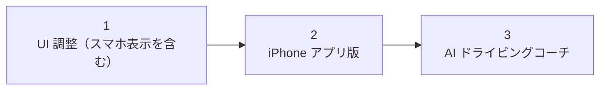

# DS Universal - 開発ロードマップ & 今後の TODO

本プロジェクトの今後の機能拡張・実装タスク一覧です。公式解析ソフト（`DigSpice.exe`）の全機能網羅に加え、現代的なモータースポーツ解析スイートとしての独自強化項目を定義しています。

---

## 🔖 残件一覧（ID）

ID の付け方: 不具合は `BUG-NN`（[BUGS.md](BUGS.md) と同じ番号）、そのうち対応するものは `LATER-NN`、大きい計画は `PLAN-NN`、実機などがそろえばやりたいもの（今は進められない）は `WISH-NN`。番号は使い回さない。

| ID | 内容 | 状態 |
|---|---|---|
| BUG-08 | 開始位置の違うログの重ね合わせの残り: ロガーごとの GPS の遅れ。**2026-10-19 対応**: ログごとの「時計の補正」と、同じ時間のほかのログと位置を比べる自動の見積もり（受信機ごとの位置の癖を差し引く）。日光のデジスパイスと GoPro で +0.055 秒（区間ごとに 0.050〜0.085 秒）。計測線より後ろから始まるログは手動の距離補正で合わせる（対応しない） | 対応（別々の機器の組で確かめたのは日光の 1 組だけ） |
| BUG-17 | フリクションサークルの点の跳ね（G の補間） | 対応（2026-10-18） |
| BUG-20 | グラフ解析で再生すると、車載動画のコマがときどき抜ける (グラフを毎コマまるごと描き直す負荷) | 対応（BUG-14 の修正で改善。2026-10-19 に issue #14 を閉じた） |
| BUG-21 | 動画同期で撮影時刻の全く違う動画を 2 本読み込むと、sub が main に引っ張られて同期してしまう。**2026-10-19 対応**: 動画とログを本当の時刻（UTC）で換算して再生する。時刻の重ならないサブは「この時刻の映像はありません」 | 対応 |
| BUG-23 | 2画面・PinP のとき、メーターのオーバーレイが main の動画に合わせて描かれない。**2026-10-19 対応**: メーターをメインの動画が映っている四角に重ね、PinP の小窓の隅のメーターは小窓の横へずらす | 対応 |
| BUG-24 | iPhone の Safari で、動画だけを読み込むと動画が黒いまま再生されない（2026-10-19 試験版で発見）。**2026-10-19 対応**: Safari は再生を始めるまでコマを読まないので、長さが分かった時点で再生を始め、止めたままでも最初のコマを出すために音を消して一度だけ再生して止める。音のある動画の再生を断られたら音を消して再生し、次に画面に触れたときに音を戻す。.LRV は MP4 の種類で渡す | 対応 |
| BUG-25 | スマートフォンで動画の再生がカクつく。メインの動画が特に重い（2026-10-19 試験版で発見）。**2026-10-19 対応**: 隠れたタブを描き直さない (Freeze)、スマートフォンでは再生中の描き直しを 1 秒に 20 回まで、速さの直しを減らす (40 ms で始めて 15 ms で終え、0.5 秒に 1 回・2% より大きいときだけ)、音を出している動画は速さを変えずに合わせる (Safari は速さを変えた動画の音の高さを保つ処理で重くなる)。iPhone では「かなり良くなった」 | 対応 |
| BUG-26 | 変換の切り出しのグラフが左に寄る（走り終わってもロガーを点けたままにしたログ。2026-10-19 スマートフォンで発見）。**2026-10-19 対応**: 走っている部分がログの 8 割より短いときは、はじめはその部分だけを大きく出し、「全体を表示」で切り替える。「走っている部分だけ書き出す」を足した | 対応 |
| BUG-27 | ロガー設定でサンプリングレートを 10 Hz にしても、本体のスイッチが **BLE** のときは 20 Hz で記録・BLE 送信を続ける（2026-10-19 発見）。設定は本体に入り（問い合わせで 10 Hz、電源を入れ直しても残る）、公式ソフトも同じ命令（`PMTK300`）しか送らない（バイナリで確認）。標準の `PMTK220` には本体が答えない。スイッチを **LOG** にした 3 秒間は 100 ms 刻み（10 Hz）で記録された（屋内で時速 5 km に届かず短い）。BLE のときは設定によらず 20 Hz、LOG のときは設定どおり、と見られる。注意書きを「BLE のときは 20 Hz」に直した。残り: LOG のまま時速 5 km を超えて走ったログで確定する | ほぼ原因判明（注意書きで対応） |
| BUG-28 | デスクトップ版（Mac）で ⌘C・⌘V・⌘A が効かない。コース・計測ライン編集で座標を貼り付けられない（issue #16、2026-10-19）。ブラウザ版では効く。**2026-10-19 対応**: デスクトップ版のメニューに「編集」がなかったため（Mac ではこのメニューの役割でコピー・ペーストが動く）。編集のメニュー（取り消す・やり直す・カット・コピー・ペースト・すべてを選択）を足した（06cf3cb） | 対応（v0.12.0 で出た） |
| BUG-29 | Safari（パソコン・iPhone）で、音を出している動画の再生がカクつき、App の時刻とずれ続ける（2026-10-20 確認）。WebKit は、音のある動画の速さを変えたり位置を動かしたりすると映像と音が止まる（WebKit の不具合 [163433](https://bugs.webkit.org/show_bug.cgi?id=163433)・[306350](https://bugs.webkit.org/show_bug.cgi?id=306350)。AVPlayer でも同じで、下の AVFoundation の動き）。**2026-10-20 暫定対応**: Safari では音のある動画の速さを変えず、0.2 秒より遅れたら飛ぶ。飛んでから動き出すまでの時間を測って先へずらし、動き出すまで飛び直さない。残り: 音のある動画で 0.2 秒までのずれ・再生の始めに 2 回ほど飛ぶ。**試作**（ブランチ `feat/video-master-clock`）: 音を出している動画を再生の時計の元にし、グラフ・地図・音のない動画はそれに付いていく（動画の再生ソフトのふつうのやり方）。実際のブラウザと iPhone の実機で今までと比べ、良ければ採用して WebKit だけの分け方（3 行）を外す。それでも足りなければ PLAN-20。**2026-10-21**: 試作は既定で入っている（`?clock=app` で前の動き）。1.0 に必須として、iPhone の実機で確かめてから出す | 1.0 で採用（2026-10-21 実機の iPhone のアプリで計測: 等倍の再生で動画と App の時刻のずれは ±0.03 秒。再生の始め・速さの切り替え・5 秒送り・再生バーの移動の直後に、動画が 0.4〜0.6 秒止まり、もう 1 回 0.2 秒ほど止まる。ずれは約 1.4 秒で 0.1 秒以内に戻る。残り: 切り替え直後の止まり (1.0 のあと)） |
| BUG-30 | iPhone のアプリで保管場所を iCloud Drive のフォルダにしているとき、そのフォルダで消したフォルダ (unsorted/ など) が、アプリを開き直すと戻る（2026-10-21 発見）。原因: アプリの中 (LapTimer/) に走行の控えを残したまま、選んだフォルダに無いものを開くたびに写していた (system.syncLapFiles)。**2026-10-21 対応** (ブランチ `feat/storage-single-place`): 書き終えたファイルは選んだフォルダへ移し、アプリの中には残さない。書いている最中のものだけ写す (system.closeFiles で閉じるまで。ページを読み込み直したら全部閉じる)。写せないときはアプリの中に残して次に移す。今までの控えは、初めの 1 回だけ選んだフォルダへ戻る (消したものと写していないものを見分けられないため)。保管先を「この iPhone」に戻しても、移した走行はフォルダに残る。残り: 実機の iPhone で、測る・取り込む・消す・開き直すを確かめる | 対応 (実機で未確認) |
| BUG-31 | iPhone のアプリで、動画の「比べる」を開いたまま、走行とコースの引き出しで Car 1・Car 2 を替えると、動画の枠が黒いままになることがある（2026-10-22 利用者が発見）。デスクトップ版 (写しの保管場所) と iPhone の実機で、入れ替え・Car 1 だけ替える・同じ走行の別の周、を試したが再現しなかった (直す前の版でも)。**念のための直し** (ブランチ `fix/compare-video-ios`): 動画のファイルが替わったかを、読み込みが始まるまで前のままの currentSrc でなく src で見る (止めたまま替えたとき、最初のコマを出すための一度だけの再生をやり直すように)。長さが分かったとき (loadedmetadata) にも位置を合わせ直す (iPhone は再生するまで loadeddata が来ない)。試験用の窓口 window.__laploupe.selectCar を足した (開発サーバーだけ)。残り: 再現したら、そのときの動画の readyState・networkState・error を Mac から見る (pymobiledevice3 webinspector cdp) | 再現待ち |
| BUG-32 | iPhone のアプリで、動画の「比べる」(2 枚並べる) の再生がときどきカクつく（2026-10-23 利用者。サンプルの FHD の動画）。「見る」では気にならない。疑い: 比べるでは Car 2 の動画の再生の速さを距離の対応の傾きに合わせて変え続け、ずれが 0.25 秒を超えると飛ぶ。iPhone は速さの変更で引っかかり、飛ぶと 0.4〜0.6 秒止まる (BUG-29 の計測)。FHD 2 本なので、読み解く負荷の可能性は低い。次: iPhone の実機で、コードを変えずに CDP (pymobiledevice3 webinspector cdp) から、動画ごとにコマが出た時刻 (requestVideoFrameCallback)・位置を飛ばした時刻・速さを変えた時刻を記録し、カクつきと重なるかを見る。重なれば PLAN-20 の方式の見直し | 改善（2026-10-23 実機で CDP 計測: 直す前は Car 2 の速さを 1 秒に 12 回ほど変え (距離の対応の傾きの揺れのたびに「元の速さへ戻す」が効いていた)、80 秒で 40 回以上コマが 0.2〜0.5 秒止まっていた。比べるでも Car 1 を時計の元にし (Car 1 の止まり 0)、倍率のある枠は傾きの 2% 未満の揺れに付いていかず 0.5 秒に 1 回までにした → 速さの変更 61 回/85 秒、止まり 3 回。残りは速さを変えた直後のたまの止まり。消すなら docs/ios_native_study.md の P2 (WebCodecs)） |
| BUG-33 | iPhone のアプリで、走行の画面の「Car 2 として足す」が押せない（「同じコースの走行だけ比べられます」のまま）ことがある。8/15 を Car 1 にして 9/18（同じ袖ヶ浦）を足せない（2026-10-24 利用者も確認）。原因: 同じコースかを、Car 1 のコースの名前と走行の一覧のコースの名前の完全一致で見ていた（自分で直したコースの「(ユーザー設置)」などで名前が少しでも違うと、違うコース扱い）。CDP で押したときに入らなかったのも、ボタンが押せない状態だったため。**2026-10-24 対応**: 同じフォルダ（コースごとのフォルダ）の走行か、書き添えを外した名前・記録のフォルダの名前が同じなら同じコース（courseNames.ts の sameCourseName）。走行の画面のボタン・走行を開いたときに Car 2〜4 を残すか・動画の比べるの 3 か所。実機では未確認（開発者モードを切ったので、次の TestFlight の版で） | 対応（1.0.3 で出した。iPhone の実機での確認は残り） |
| BUG-34 | 内蔵のコースと同じ名前の自分のコース (内蔵のコースを直したもの) があると、コーナーの名前 (corners.json) を名前から作ったフォルダ (sodegaura_forest_raceway・tsukuba_circuit_tc2000) に読み書きしていた。走行は内蔵のコースの ID のフォルダ (sodegaura) に入るので、解析では自動で作った C1… が出て、持ち主が付けた名前 (袖ヶ浦の「便所前」) が出ていなかった (2026-10-24、GUI の洗い出しで保管場所の写しを見て発見)。**2026-10-24 対応**: courseCorners.ts の folderForCircuitName で、保存フォルダ名を決めていない自分のコースは、同じ名前の内蔵のコースの ID を使う。分かれたフォルダの中身は自動で作ったものだけなので写さない (持ち主の保管場所の sodegaura_forest_raceway/ と tsukuba_circuit_tc2000/ は消してよい) | 対応（1.0.3 で出した） |
| BUG-35 | GUI の洗い出し (2026-10-24、agy・Fable で 4 回) で見つけて、まだ直していないもの。(1) 走行の日付 (Session.date) が UTC の日付で、日本の朝 9 時より前の走行は、変換の画面・動画の「走行の確認」で前の日になる。date は動画の同期の照合 (startDateJst) と時刻のないログの書き出しの基準にも使うので、端末の時刻での開始時刻を Session に持たせてから表示だけ替える。(2) 知らない場所のログを取り込むと、取り込みの画面では周を数えるのに、走行の一覧は「コース未設定・0 周」で、解析では周が出る (自動の計測線を保存しないため)。(3) 30 px より小さい押す所 (機器のタブ・解析のズーム・走行とコースの欄の小さなボタン・変換の画面の時刻の調整など) の見直し。(4) iPhone を横にしたとき、ラップタイマー以外の画面が左右の切り欠き (safe-area-inset-left/right) をよけていない (実機で確かめる)。(5) 複数のファイルを一度に取り込むと、1 つずつ画面が出るが「2/3」のような表示がない。(6) 比べる相手の動画が Car 1 の動画と同じファイル名だと読まない (PLAN-29 の (1)(2))。**2026-10-24**: (1) 画面に出す日付を端末の時刻の日付にした (sessionLocalDate。Session.date はそのまま)。(2) 走行の一覧で「0 周」と出さず「コース未設定 (開くと周を数えます)」にした (一覧で周を数えるのは PLAN-29 と一緒に)。(3) 見送り (利用者の判断)。(4) 上のバー・下のタブは端まで、中身だけ切り欠きをよける形にした。(5) 「2/3」を出した。(6) 同じ名前の相手の動画は、足したあとに道 (path) で見つけて同期を戻す (restoreTrackSync)。チャプターのまとめは同じフォルダの動画だけに。runs.json にはその走行の動画だけを書く (名前でなく動画で選ぶ)。相手の動画の同期を直しても runs.json に書かない (PLAN-29 の (2)) のは残る | (1)(4)(5)(6) 対応・(2) 表示だけ・(3) 見送り |
| BUG-36 | iPhone Duo のシミュレーター (2026-10-24、App Store の Duo 用のスクリーンショットを撮ったとき): 開いた画面 (横長) の動画の「比べる」で、Car 2 を足しても動画が 1 つしか出ない (閉じた画面では縦に 2 つ並ぶ)。閉じた画面の解析で、コースマップの上のボタンが 3 段に折り返し、地図がとても低い (コーナーの編集中は 1.0.3 でボタンを減らした)。1.0.3 の最後のレビューの残り: 「比べる」を Car 1 だけで開くと Car 2 の枠に「この時刻の映像はありません」と出る、ラップタイムを開くと開いている走行のサーキットでなく一覧の先頭が出る | 1.1.0 以降 (PLAN-30 と一緒に) |
| PLAN-30 | iPhone Duo の開いた画面 (iPad に近い広さ) を生かす: 今は iPhone の画面を横に伸ばしただけ。解析を PC 版のように (グラフ・コースマップ・コーナーの表を同時に)、動画の「比べる」を横に 2 つ並べる、など (2026-10-24 利用者) | 1.1.0 以降 |
| LATER-01 | 吸い出しの欠けたブロックの読み直しの有効化（実機確認が要る） | 実装済み・無効 |
| LATER-02 | 大きいログの書き出しのメモリ使用量 | 未対応 |
| LATER-03 | ds4_convert から未移植の機能（地図 HTML のホバー表示・JST / UTC 切り替え・.txt 書き出し・平均車速） | 対応（2026-10-18） |
| LATER-04 | Windows ビルドのアイコン表示確認 | 未確認 |
| LATER-05 | USB でのシリアル番号の取得（本体に書いてあり、使い道もないので後回し。2026-10-19）。公式アプリにも表示する機能がないので、キャプチャでは分からない。やるなら、ログを吸い出してから、問い合わせだけのコマンド（`PTSI` の独自の問い合わせ・MTK の問い合わせ）を順に送り、応答から 7 桁を探す（書き込み・消去・リセット・通信速度の変更は送らない） | 後回し |
| LATER-06 | 内部ステータスコード（`PTSI990` の `27`）の意味 | 不明 |
| LATER-07 | Google Maps の背景地図（要望があれば） | 見送り (2026-10-21。OpenStreetMap は世界中を描けるので要らない) |
| LATER-08 | QSTARZ のログの重ね合わせ（NMEA / GPX で読める見込み） | 未確認 |
| LATER-10 | フリクションサークルの G の軌跡を、直前を濃く・前のものほど薄く描く。現在の G の点を少し小さくする。濃く描く秒数などの見た目は公式アプリの表示に合わせる（BUG-17 と合わせて見直す） | 一部対応（2026-10-18、直近 1 秒の軌跡を前ほど薄く描き、点を小さくした。公式アプリの見た目との見比べは未） |
| LATER-11 | 別々の走行の動画を main と sub に並べて見る方式。**2026-10-19 対応**: サブの合わせ方に「走行比較: Car 2〜4」を足した（比較の車がメインと同じ地点を走った時刻の映像を出す。距離の補正・1 周の長さの伸縮を反映） | 対応 |
| LATER-12 | 同じ時間帯の走行ログが複数あるとき、動画を付けるログを選べるようにする。**2026-10-19 対応**: 既定は記録の細かい（Hz の高い）ログ。動画同期の画面の「動画に合わせるログ」で選ぶとそのログを Car 1 にする。「動画の GPS もログとして加える」の設定（既定: 加える） | 対応 |
| LATER-13 | 海外のコースを足す（2026-10-18）: アメリカの Streets of Willow Springs・Horse Thief Mile・Adams Motorsports Park（カート）・Pikes Peak International Raceway（PPIR）・Auto Club Speedway、スペインの Monteblanco。PLAN-13 と同じやり方（OpenStreetMap と航空写真、`tools/courses/`）。**2026-10-18 対応**: Streets of Willow Springs・PPIR（ロードコース）・Monteblanco を足し、Adams は計測線だけ（レイアウトが入り組んでいて、3 等分のセクター線が隣の路面までまたぐ）。Horse Thief Mile は OpenStreetMap のコースの線が路面から 20〜40 m ずれているので作らない。Auto Club Speedway は閉鎖され、OpenStreetMap からもコースがほぼ消されているので作らない。あわせて国内のフェスティカサーキット栃木を計測線だけで足した（OpenStreetMap にコースの線がない）。ほかの国のコース（中国・タイ・韓国など）は、その国で使ってよい航空写真が見つかってから | 対応（4 コースとフェスティカ。2 コースは作らない） |
| LATER-14 | 海外のコースの計測線の位置の確認（2026-10-18）。スタートの線とフィニッシュの線が違うコースがあるので、7 コース（Valencia・Aragón・Le Mans・Jerez・Paul Ricard・Laguna Seca・Assen）の写真を見直す。**2026-10-18 対応**: Valencia・Aragón・Paul Ricard はフィニッシュの白線、Assen はゲートの手前の白線に移した。Jerez は円形の建物の下で線が見えず、Laguna Seca は写真の解像度が低いので、推定の位置にした。Le Mans はいまの線（OpenStreetMap でスタート / フィニッシュのタグが付いた位置の白線）のまま。線を動かしたコースは、セクター線も新しい計測線からの 3 等分に置き直した | 対応 |
| LATER-15 | iPhone / iPad の GitHub Pages 版で、ファイルの選択画面から .bon4 などのログを選べるか確かめる（2026-10-18 追加）。iOS の選択画面が、accept に並べた iOS の知らない拡張子のファイルを灰色にしていたので、iOS では accept を付けないように直した（dev に入れた）。Pages に出さないと実機で試せない 2026-10-19、v0.11.0 の Pages 版で、iPhone の実機で選べることを確かめた | 対応 |
| LATER-16 | 国内のコースを足す（2026-10-19）。**対応**: 国内のカートコース・小さなサーキットを 87 コース足した（計測線は全部、セクター線は 36 コース）。OpenStreetMap のコースの線の上に計測線を置き、国土地理院の航空写真で 1 つずつ確かめて、路面のスタートラインやゲートが見えた 24 コースはその位置に引き直した（ほかは推定の位置）。あわせて、1 周が短いコースでも周回が区切れるようにし（計測線の通過の最短の間隔を、走っている通過の間隔の中央値の半分まで縮める。止まっている間の GPS の揺れによる通過は数えない）、コース図を引く範囲をコースの大きさに絞った。残り: OpenStreetMap にコースの線がないコース（40 ほど）は、OpenStreetMap に線を足すか、航空写真から 1 周を自分で引く道具ができてから。コース名が仮のもの（`notes.controlLine` に「コース名は仮」）は施設の正式な名前を確かめる | 一部対応 |
| LATER-17 | 動画だけからラップを作る（2026-10-19 追加）。GPS もログもない動画（ほかのツールで書き出した動画など）でも、周を作れるようにする。案は 2 つ: ①動画を再生しながら、計測線を通ったところで手でボタンを押してラップを打つ（打った時刻を周の区切りにする）。②スタートライン（計測線）の場面を 1 か所指定すると、映像からその場面を探して、あとの周の区切りを自動で作る（AI・画像の比べ）。周の区切りだけで、位置・速度はないので、走行比較のタイム差は周のタイムだけになる | 対応 (2026-10-25。案 1 の手で打つ形。走行の画面の「参考ラップ」→「動画から作る」で、保管場所のサーキットのフォルダにある、どの走行にも付いていない動画を選び、再生しながら計測線・セクターの印を打つ (1 コマ送り・キー L / S)。runs.json の行 (鍵は 日付/動画の名前) に印と誰・車を書く。「比べる」で、同じサーキットの自分の走行のうち同期した動画に映っている周と、周の始まりをそろえて 2 つの動画を並べ、周・セクターのタイムと差を出す。位置・速度は無い。案 2 (映像から自動で探す) は未着手。解析の Car・ラップタイムの一覧には入れていない) |
| LATER-18 | 中身のない走行のファイル（2026-10-20 追加）。測定開始のボタンを足す前の版で、つないだだけで止めた走行の 8 バイトだけの .bon4 が unsorted に残る。測位のない走行は保存しない（終了のときに消す）ようにする | 未対応 |
| LATER-19 | iPhone のアプリで、4 MB を超えるログの取り込みが途中で失敗すると、途中までのファイルが保管場所に残り、取り込み直すと「もうある」として飛ばされる（2026-10-22 の 1.0.1 の前のレビュー、agy。前の版から同じ）。失敗したら途中までのファイルを消す (アプリに消す窓口を足す) か、一時の名前で書いてから入れ替える | 未対応 |
| PLAN-01 | iPhone アプリ版（Bluetooth 接続。通信の層の分離を含む） | 対応 (ラップタイマー・内蔵カメラ・保存まで入った。1.0 で公開、1.1.0 で内蔵カメラ) |
| PLAN-02 | AI によるドライビングコーチ | 検討のみ (2026-10-21: 仕組みを docs/ai_coach_design.md に。手元のモデルか、利用者が入れる API キー。スマートフォンは API だけ。画像は API 前提) |
| PLAN-03 | GoPro の動画の GPS（GPMF）の読み込み | 対応 |
| PLAN-04 | MoTeC / AIM / RaceChrono 形式（AIM の CSV・.xrk / .xrz の読み込み、MoTeC CSV の有効化、KML の書き出し） | 対応（RaceChrono の実機の CSV での確認が残り） |
| PLAN-05 | 日本語 / 英語の切り替え・ハイコントラスト表示 | 対応（2026-10-18。画面右上の JA / EN、テーマの 4 つ目にハイコントラスト） |
| PLAN-06 | メーターを焼き込んだ動画の書き出し | 対応（1 つの動画・枠の並びの書き出し。**2026-10-20**: 1 コマずつエンコードする方式を試作（ブランチ `feat/encode-export`）。コマが抜けず、実時間より速い） |
| PLAN-07 | Tauri 化（Electron からの移行） | 見送り (2026-10-21) |
| PLAN-08 | DashWare が持っている機能をすべて実装する（車載動画にメーター・グラフ・コース図などを重ねて書き出す。部品（ゲージ）の配置・見た目を自由に作るエディタとテンプレート、多数のロガー・アプリの形式の読み込み、計算チャンネル、動画とデータの同期、動画の書き出し）。PLAN-06 を含む。まず DashWare の機能を洗い出して、既存の機能との差を一覧にする（一覧は docs/dashware_gap.md、2026-10-18 に作成。DashWare は 2017 年で開発が止まっているので、今も開発の続く RaceRender・Telemetry Overlay とも比べた（docs/overlay_tools_gap.md、2026-10-18）。足すとよいもの: 部品だけの透明な動画、タイム差・セクタータイムの焼き込み、FIT・TCX・RaceBox・DJI・Insta360 の読み込み） | 未着手（2026-10-20: 画面の作り直し (PLAN-24) の前に、配置エディタ・テンプレートの置き場所を決める） |
| PLAN-09 | iRacing のテレメトリ（.ibt）の読み込み（2026-10-18 追加）。ゲームで練習した走りと実車の走りを同じ画面で比べるため（ブレーキを踏む位置など）。形式は iRacing の SDK（irsdk）で公開されている（項目の一覧・セッション情報の YAML・60Hz の値）。緯度経度を使って実車のログと重ねる。仕様は SDK の資料で確かめてから作る | 対応（筑波の公開サンプルで確認。富士・鈴鹿と、利用者の .ibt での確認が残り） |
| PLAN-10 | 最終目標: RaceChrono の機能をすべて取り込んだうえで、それを上回るアプリにする（2026-10-18 追加・更新。利用者の数では及ばなくても、機能と使いやすさで勝つ）。最初の作業: RaceChrono（無料版・Pro）の機能を洗い出し、今の DS Universal との差を一覧にして、足りないものを PLAN / LATER に分ける（一覧は docs/racechrono_gap.md、2026-10-18 に作成。PLAN-08 の DashWare と同じやり方。RaceChrono のコードやデータは写さず、公開されている説明から機能だけを拾う）。勝ちどころの候補: デジスパイスの吸い出し・設定、公式ソフトと同じ G の計算、GoPro の動画の GPS、コーナー・ブレーキングの解析、ブラウザ版（インストール不要）。以下は当初のメモ: スマホアプリ版（PLAN-01）で、デジスパイス以外の外部の機器にもつないで計測する。仕様が公開されていてつなぎやすいものから: RaceBox（Mini / Micro。メーカーが Bluetooth の通信の形の資料を公開。Micro は NMEA でも送れる）、RaceChrono の DIY 用の Bluetooth の形（GitHub の aollin/racechrono-ble-diy-device。サービス `0x1FF8`、GPS と CAN の特性）、外付けの Bluetooth GPS（NMEA）、OBD-II（ELM327）。ファイルは VBOX の .vbo（文字・仕様公開）も読む | 構想 |
| PLAN-11 | 共有のコースデータベース（2026-10-18 追加）。1 コース 1 ファイル（中心の座標・計測線・セクター・コース図）を GitHub のリポジトリに置き、アプリはログの場所に近いコースだけをその場で取りに行く（OpenStreetMap のコース図の取得と同じ形。オフラインでは今までどおり）。追加・修正は Issue / PR で受け付ける（オートポリスの PR #12 と同じ流れ）。内蔵の 13 コースもここに移し、アプリを出し直さずに直せるようにする。コース編集で作ったコースを書き出して、投稿用の Issue の文面を作るところまで用意する。データは独自のもの（再配布できるもの）だけにする。**2026-10-18: 第 1 段を対応**（内蔵の 13 コースを courses/ にデジスパイスと同じ形式（.cln・.sci）と index.json で分けて同梱、修正依頼の Issue のひな形（.github/ISSUE_TEMPLATE/course.yml）と courses/README.md）。残り: アプリを出し直さずに取りに行く仕組み、コース図（.pth）、投稿用の文面づくり | 一部対応 |
| PLAN-12 | 知らないコースでの自動の設定（2026-10-18 追加）。コース図は OpenStreetMap から取る（対応済み）。計測線は、周回の繰り返しからメインストレートを見つけて置く。セクターがなければ 1 周を 3 等分して仮に置く。**2026-10-18: 内蔵の 12 コースにセクター線を入れた**（SUGO は公式のコース図の計測地点、鈴鹿・富士はレースの区間から推定、もてぎは 4 等分、ほかは 3 等分。並びが走る向きと逆なら周回の計算で並べ直す）。残り: 知らないコースでの自動の計測線・セクター | 対応（2026-10-19。知らないコースで計測線を自動で置く: ピットロード (走り始めのゆっくり走った、コースの外の道) の横に同じ向きで並ぶ直線のうち、いちばん長い直線の真ん中に置き、毎周通ることを確かめる。セクターがなければ速い周を距離で 3 等分。日光・袖ヶ浦 2 本・筑波 2000 のログで内蔵の計測線と比べ、日光は 16 m・袖ヶ浦は 1〜3 m (ラップタイムの差 0.1 秒以内)・筑波は同じ直線の 55 m 先 (差 0.35 秒以内)） |
| PLAN-13 | 海外のコースの計測線を集める（2026-10-18 追加。PLAN-11 のデータを作る作業）。①対応すべきサーキットの洗い出し: RaceChrono が対応しているサーキットの一覧（名前・国・場所）を参考にする。計測線の座標は写さない。一覧の取り方はアプリ・サイトの規約を確かめてから（機械的に集めない）。②スタートラインの推測: OpenStreetMap のコースの形（highway=raceway。まれに finish line などのタグがある）と航空写真から、路面のコントロールラインや計測のゲートを探して置く（2026-10-18 の富士・鈴鹿・SUGO・本庄と同じやり方）。**Google マップの航空写真は使わない**（Google の規約が地図の画像からデータを作ることを禁じている。OpenStreetMap でも禁止）。国内は国土地理院、海外は OpenStreetMap の編集に使ってよいと許可されている航空写真（Esri・Bing など）の利用条件を確かめてから使う 。**2026-10-18 から作業中**（ブランチ feat/overseas-courses、道具は tools/courses/）: 航空写真はアメリカ USGS NAIP（パブリックドメイン）・オランダ Beeldmateriaal（CC BY 4.0）・フランス IGN BD ORTHO（Licence Ouverte 2.0）・スペイン PNOA（CC BY 4.0）だけを使う（Esri は OSM 向けの許可のみ、ベルギーは条件が不明なので保留）。済み 22: Zandvoort・Assen・COTA・Laguna Seca・Watkins Glen・Sebring・Road Atlanta・Barber・Magny-Cours・Le Mans Bugatti・Nogaro・Catalunya・Jerez・Valencia・Jarama・Aragón・Road America・Paul Ricard・Dijon（写真で線を確認。Valencia は路面の線が見えず、グリッドの先頭のスタートのゲートの位置）、VIR・Mid-Ohio・Lime Rock（ピットロードの中ほどの仮の線）。対応しないで閉じた 2（2026-10-18）: Navarra（OSM のコースが「おおよその線」で 1 周 4301 m と公式の 3933 m より 9% 長く、写真の路面からずれている。セクター線が路面から外れるおそれ）、Sonoma（写真でスタートラインを決められず、OSM のコースがドラッグレースのコースと重なる）。Paul Ricard・Dijon はピットロードが "Stand" という名前なので、`EXCL` で外して 1 周を取る | 対応（22 コース。Navarra・Sonoma は対応しないで閉じた） |
| PLAN-14 | 部品（メーター・G・ラップタイムなど）だけを焼いた透明な動画の書き出し（2026-10-18 追加。docs/overlay_tools_gap.md から）。車載動画は入れず、ほかの編集ソフト（Premiere・DaVinci Resolve・Final Cut など）で動画に重ねて使う。ブラウザでは透明の WebM（VP8 / VP9 のアルファ）が作りやすい。編集ソフトで読める形式（PNG の連番・ProRes 4444 の MOV など）も調べる。PLAN-06・PLAN-08 と一緒に **2026-10-20 試作**（ブランチ `feat/encode-export`）: 書き出しの画面の「メーターだけ・背景は透明」で、PNG の連番の ZIP（Premiere・DaVinci Resolve・After Effects 向け）と、透明な WebM（VP9 のアルファ。Chrome・Electron）を書き出す。時刻を 1 コマずつ進めて描くので、元の動画は要らない。ProRes 4444 はブラウザでは作れない。あわせて、動画にメーターを焼き込む書き出しを、再生しながら録る方式から 1 コマずつエンコードする方式に（コマが抜けない・実時間より速い）。周を選んだときは前後を 10 秒ずつ足す。残り: Safari・iPhone で試す、長い書き出しのメモリ、枠の並び（マルチカメラ・走行比較）の書き出し | 対応（v0.12.0。PNG の連番の ZIP・WebM。書き出しの既定） |
| PLAN-15 | 基準の周とのタイム差（デルタ）とセクタータイムを動画に焼き込む（2026-10-18 追加。docs/overlay_tools_gap.md から）。解析画面のタイム差グラフとセクターの計算をそのまま使い、基準の周（ベスト・仮想ベスト・別のログの周）を選べるようにする。PLAN-06・PLAN-08 と一緒に。**2026-10-20 試作**（ブランチ `feat/encode-export`）: ラップの欄（Best・Lap・セクターごとの差・今のタイム差 Δ。docs/overlay_parts_design.md の 9）とコース図。残り: 基準の周をベスト以外から選ぶ | 対応（v0.12.0。ラップの欄にベスト・セクターの差・タイム差） |
| PLAN-16 | 読み込める形式を増やす（2026-10-18 追加。docs/overlay_tools_gap.md から）: Garmin の FIT・TCX、RaceBox の CSV、DJI（Osmo Action など）と Insta360 のカメラの GPS。仕様が公開されているものから。実機のログが手に入らないものは、AiM・MoTeC と同じくサンプルでの確認と README に書く | 一部対応（2026-10-19。FIT・TCX を読めるようにした。RaceBox は VBO・GPX の書き出しで読め、CSV は時刻の列が日時でも読めるようにした。いずれも仕様に沿ったファイルで確認、実機のログは未確認。残り: DJI・Insta360 のカメラの GPS） |
| PLAN-17 | 車載動画の「走行」と「セット」（2026-10-19 追加、設計は docs/video_sets_design.md）。動画の時刻を「ログに付いた時刻 / UTC」で持ち、同じ走行の判定と見積もりの品質の関門、マルチカメラ (4 台まで)・走行比較 (Car 1〜4、距離で合わせ、速さを合わせる)、走行の確認、.LRV、スマートフォンの動画、枠の並びの書き出し。**2026-10-19 段階 1〜6 を feat/video-rework に実装**（マージ前レビュー済み、動作確認待ち）。動画 1 本でも、Car 2 がいなければ同じログの別の周で走行比較できる。残り: WebCodecs の高画質の書き出し、動画に重ねる部品（docs/overlay_parts_design.md） | 対応（2026-10-19、利用者が動作を確認して dev にマージ） |
| PLAN-18 | **解析用のセッションの保存と一覧**（2026-10-19 追加）。読み込んだログ（いくつでも）・Car の割り当て・コースの設定・時計の補正・動画の同期をひとまとめに保存し、一覧から開き直す。前回の走行と比べたいときは、過去のセッションを開くか、過去のセッションの周を今のセッションに Car 2 として読み込む。今は保存がなく、毎回ログのファイルを読み直している（同期プロジェクトは動画の同期だけ）。**ラップタイマーの走行（PLAN-19）とは別に管理する**。保存先: デスクトップ版はファイル、iPhone / Android のアプリはアプリの中（iCloud Drive にも）、ブラウザ版は IndexedDB（消えることがあるので、ファイルへの書き出しもできるようにする）。**2026-10-20 考え直し**: PLAN-19 のラップタイムの記録（保管場所/サーキットのフォルダ/laptimes.json）を土台にする。作り直せない走行の情報（隠した周・付けた動画・動画の同期の結果・ログの時計の補正）を、同じフォルダの runs.json に分けて端末の間で共有し、「解析で開く」だけでログ・動画・同期がそろって開くようにする。解析用のセッションは、ファイルを写さず走行（フォルダ/ファイル・周の番号）とコースのハッシュを指すだけの sessions/<名前>.lapsession.json にする。今の .dssync.json は読み込みだけ残して runs.json へ移す。設計の案: docs/session_storage_design.md | 対応 (2026-10-25。解析の「走行とコース」で「比べ方を保存」→ 保管場所の sessions/<時刻>_<名前>.lapsession.json に、Car ごとの走行 (道・runs.json の id)・分かれた走行の何番目・何周目を書く。走行の画面の「保存した比べ方」から開くと、走行を開いて Car に割り当て直す (動画・同期は走行の runs.json から)。消すと消した印を書く。**2026-10-25 (続き)**: 周の始まりの時刻も書き、計測線を直して周の番号が変わっても、開くときに時刻 (5 秒以内) で周を選び直す。ブラウザ版は「比べ方を書き出す」で .lapsession.json をダウンロードし、同じログを開いてから「読み込む」で Car に当て直す (ファイルの名前で探す)) |
| PLAN-19 | **ラップタイマーの走行の管理**（2026-10-19 追加。PLAN-01 のラップタイマー）。アプリで記録した走行（受け取った測位の元の記録・周・ベスト）を、日付・コースごとに一覧にする。デルタの基準の周（自分のベストなど）をここから選ぶ。解析したい走行は、解析用のセッション（PLAN-18）に送れるが、一覧は別にする（走るたびに増える記録と、比べるために組んだセッションを混ぜない）。**保管場所（2026-10-20 の構想）**: 保管場所をクラウド・端末の中から選べるようにし、`保管場所/サーキット名/` の下に .bon4 を置いていく。**2026-10-20 一部対応（feat/iphone-app）**: 走っている間はいつも端末の中（LapTimer/サーキット名/）に .bon4 と .nmea を書き、メニューの「記録の保管先」で「この iPhone」か「フォルダを選ぶ（iCloud Drive など、「ファイル」で選ぶ）」を選べる。フォルダを選ぶと、閉じたとき・裏に回したとき・周を数え直したとき（走っている間は 3 分に 1 回まで）に、フォルダ/サーキット名/ へ写す。サーキット名のフォルダは、コースのファイル（courses/）と同じ決まり（英小文字・数字と _ だけ、空白なし）。入っているコースはその ID（sodegaura など）、自分で作ったコースはコース編集の「保存フォルダ名」（英語名から自動で作る。全角の文字・記号はエラー）。コースの分からない走行は unsorted。アプリ専用の iCloud のフォルダ（「iCloud Drive → LapLoupe」が自動でできる形）は、Apple の有料の開発者登録が要るので未対応。**ラップタイムの一覧（2026-10-20 の構想。同日に対応: feat/iphone-app、iPhone のアプリとデスクトップ版。ブラウザ版は、ブラウザの中の記録が消えることがあるので出さない）**: `保管場所/サーキット名/laptimes.json` に、1 周ごとに 1 行（どの走行のファイルの何周目か・ラップタイム・セクタータイム・走り始めの日時・その周の時刻・最高速・非表示の印）を書いていく。ラップタイマーで走ったときは周を終えるたびに足し、フォルダに外から置いたファイルは一覧を開いたときに照らし合わせて計算する（計算は .bon4 から）。ファイルを消したら、その周も JSON から消す。周ごとに非表示にできる（ファイルは消さない）。一覧の画面は、デジスパイスの公式アプリと LapLoupe のデータの画面を参考に、日付ごとのまとまり・ベストの印・並べ替え・非表示の周を出す / 出さないの切り替えを入れる。**計算し直し**: JSON に、計算したときのコースのハッシュ（計測線とセクター線から求める。コース図はラップタイムに効かないので入れない）と、ファイルごとの印（名前・大きさ・更新日時）を書いておく。コースのハッシュが変われば、そのコースの周を全部、ファイルの印が変われば、そのファイルだけ計算し直す。非表示の印は「どのファイルの何周目か」で引き継ぎ、周の数が変わったときは時刻のいちばん近い周に引き継ぐ。iCloud で複数の端末から書いて JSON がぶつかったときは、JSON はファイルから作り直せる控えとして扱い、作り直せない非表示の印だけを両方合わせる。重さ: 1 時間の走行（20 Hz）の計算は数十ミリ秒、1000 周でも JSON は数百 KB。重いのは、すでにある大量のファイルを最初に全部計算するときだけ（50 本で数秒、1 回）。**2026-10-20 の対応の中身**: lapIndex.ts（控えの作り直し・コースのハッシュ・非表示の引き継ぎ）、lapHistory.ts（フォルダからコースを見つける。入っているコースは ID、自分のコースは保存フォルダ名）、LapHistoryPanel（走った順・タイム順、隠した周も出す、ベストの印、走行ごとの「解析で開く」）。iPhone のアプリはラップタイマーのメニューから（LapTimer/ の下を見る。控えは端末ごとに作り、選んだフォルダへは写さない）、デスクトップ版はデータの画面の「ラップタイムの記録」から（保管場所のフォルダを選ぶ。iPhone で選んだ iCloud Drive のフォルダを選べば、同じ記録を見られる。読めるのは選んだフォルダの中だけ、書けるのは laptimes.json だけ）。控えの走行ごとに videos（同じフォルダの動画のファイル名だけ）の口を用意した（計算し直しても引き継ぐ）。残り: 動画を走行に付ける画面と、解析で開くときに動画も一緒に読み込むところ（同じフォルダの動画だけ）、外から iCloud のフォルダに置いたファイルを iPhone の一覧に出す（今は iPhone の中の LapTimer/ だけを見る）、Android。**PLAN-18 との関係（2026-10-20 の構想）**: この控え（laptimes.json）を土台に、解析用のセッションの保存（PLAN-18）と動画の同期の保存（今の .dssync.json）の形を考え直す | 一部対応（2026-10-20。サーキット/日付/ の形で保存、測定開始・測定終了のボタン、前の版のベタ置きを日付のフォルダへ移す。保管場所の指定がラップタイマーのメニューにしかないのは PLAN-24 で見直す） |
| PLAN-20 | 動画の再生を、ネイティブ（iPhone は Swift の AVFoundation、Android は Kotlin の Media3）で書き直すかを決める（2026-10-20 追加。BUG-29 の試作で足りないとき）。AVPlayer でも速さの変更・移動で音が途切れるので、書き直すだけでは直らない。良くなるのは、複数の動画を同じ時計で同じ瞬間に始められること（`setRate(_:time:atHostTime:)` など）。動画の画面を iPhone と Android で 2 回書くことになるので、試作の結果を見てから決める。Swift 6.3（2026-03）で Android 向けの Swift も正式に出たが、Android の画面（SwiftUI は使えない）・動画・Bluetooth は Kotlin・Java のものを使うので、Android は Kotlin のままにする **2026-10-23**: 比べるのカクつき (BUG-32) で検討に上げた。比べるは Car 2 を距離に合わせて速さを変え続ける作りで、ブラウザの <video> は速さの変更・移動のたびに引っかかる。案は 2 つ: (1) ネイティブ: AVPlayerItemVideoOutput で、Car 2 の動画から欲しい時刻のコマを取り出して描く (速さを変えずに済む。複数の動画を同じ時計で始められる)。動画の画面を iPhone と Android で 2 回書く。(2) Web のまま: 書き出しで使っている WebCodecs (mp4box で読み、コマを解く) で Car 2 のコマを欲しい時刻に描く。iPhone・Android・デスクトップで 1 回書けば済む。Safari の WebCodecs の速さを先に試す。BUG-32 の計測で、原因が速さの変更・移動と分かってから選ぶ。**2026-10-23 検討の結論** (Fable・Opus・agy で 3 回、docs/ios_native_study.md): 画面のネイティブ化はしない。Swift は画面を持たず Web でできないことだけ (画面を消している間の記録・通信なしでの起動を足す)。動画は、比べるで速さが変わる Car 2〜4 の枠だけ作りを変え、まず Web のまま WebCodecs で試す。だめなら その枠だけ AVAssetReader + AVSampleBufferDisplayLayer (AVPlayer・AVPlayerItemVideoOutput では直らない)。先に P0: BUG-32 の計測と、比べるで Car 1 を時計の元にする (今は比べるだけ時計の元を使わず、iPhone では Car 1 が 0.2 秒ごとに飛んでいる) | 方針決定（P0 から。docs/ios_native_study.md） |
| PLAN-22 | **Bluetooth LE の機器を増やす: RaceBox・心拍計・OBD-II**（2026-10-20 追加。PLAN-10 の一部）。つなぐ層（bleCentral。iPhone・Android のアプリと、パソコン・Android の Chrome とデスクトップ版の Web Bluetooth）は機器を問わないので、機器ごとの「読み方」（届いたバイト列を位置・値に直す）を足す。**RaceBox Mini・Micro**: 通知を受け取るだけ（25 Hz の位置・速度・G。メーカーが形式を公開）。ラップタイマーの出どころに足し、記録は今の .bon4・.nmea。**心拍計**: Bluetooth の標準の心拍のサービス（通知だけ）。**OBD-II（ELM327 の BLE 版）**: 命令を送って答えを受け取るので、ネイティブの約束に `ble.write` を足す（今は読むだけ）。回転数・アクセル開度・水温など、5〜10 回/秒が目安。ステアリング角は車の独自の信号なので、ふつうの OBD では取れない。デジスパイスと心拍計と OBD を同時につなぐ。**記録の形（2026-10-20 決定）**: 位置以外の値は、機器ごとに走行と同じ名前のファイルを横に置く（例: `20261024100000.hr.csv`・`20261024100000.obd.csv`）。1 行目は列の名前、1 列目は UTC の時刻（ミリ秒）で .bon4 と合わせる。ラップタイムの記録は今どおり .bon4 から数え、.csv が無ければその値が出ないだけ。**機器の名前（2026-10-20 決定）**: 機器を登録するときに、表示名（画面だけ。何でもよい）と、ファイル名用の名前（英小文字・数字・_ だけ。全角・記号はエラー。登録のときに自動の候補を出す）を付けられる。ファイルは `<走行>.<ファイル名用の名前>.csv`（例: `20261024100000.hr_driver.csv`・`20261024100000.obd_nd5rc.csv`）。付けなければ種類の名前（hr・obd・racebox）。同じ種類を 2 つ使う（自分と同乗者の心拍計など）ときに見分けるため。名前はあとから変えられる（自己責任）。名前の欄に「この名前を、保存するファイルの名前に使います。変えると、それより前の記録は前の名前のファイルのまま残ります」と出す。解析では、走行と同じ名前で始まる .csv を全部集めて、ファイル名で機器を見分ける。保管先のフォルダへは今の仕組みで写る。解析・動画の部品（PLAN-08）では、同じ名前の .csv があれば一緒に読む。iPhone はアプリだけ（Safari は Bluetooth を使えない）。作る順番: RaceBox → 心拍計 → OBD-II。**機器の登録の画面（2026-10-20 の案）**: 1 つの「機器の登録」の画面を、位置（ロガー: デジスパイス・RaceBox・iPhone の GPS。1 回の走行でどれか 1 つ）・センサー（心拍計・OBD-II。いくつでも）・カメラ（GoPro。いくつでも）の 3 つのタブに分ける。今のロガー設定の「デジスパイスの登録」は位置のタブへ移す。登録はどれもアプリの中でする（設定アプリの Bluetooth で先につながなくてよい）。**2026-10-20 途中まで（feat/ble-devices。実機では未確認）**: RaceBox（公開の資料 Rev.9 の例で確認）・心拍計・OBD-II（ELM327）・GoPro の読み方、ネイティブの ble.write、通知の特性を複数受け取る、広告のサービスでも探す、機器の登録の画面（ロガー設定。位置・センサー・カメラのタブ、表示名とファイル名用の名前、試す）、ラップタイマーへのつなぎ込み（出どころに RaceBox、センサーの値を `<走行>.<名前>.csv` に、GoPro は動き出したら時計を合わせて録画・周ごとに印・閉じる / 数え直すで止める）。残り: 実機での確認（特に GoPro のペアリング、OBD の機器ごとの特性）、解析で .csv を読む、動画の部品に出す、Android | 試作（2026-10-20 に dev に入れた。RaceBox・心拍計・OBD-II・GoPro の読み方と、機器の登録の画面。GoPro は測定開始で録画を始め、測定終了で止める。実機の機器では未確認）。**2026-10-25**: GoPro HERO12 で、ペアリング・測定開始で録画・測定終了で止める、まで利用者が確認 |
| PLAN-21 | **Open GoPro の組み込み: 録画の開始・停止と、動画の取り込み**（2026-10-20 追加。使っているのは HERO12）。**録画**: ラップタイマーで測り始めたらカメラの録画を始め、止めたら止める（Bluetooth でつなぐ。走っている間は、カメラが Bluetooth を切らないよう、ときどき合図を送る）。カメラの電池・SD の残り・録画中かをラップタイマーの画面に出し、録画が始まらない・止まったときは知らせる。あわせて、録画を始めるときにカメラの時計を GPS の時刻に合わせる（動画の同期が楽になる）、周を終えるたびに動画に印（HiLight）を付ける（動画の中で周の区切りへ飛べる）、も検討する。**仕組み（2026-10-20 に公式のサンプルで確認）**: PLAN-22 と同じつなぐ層（bleCentral）に GoPro の読み方を足す。サービス `FEA6` の命令の特性 `B5F90072-AA8D-11E3-9046-0002A5D5C51B` に書き、答えは `…0073` の通知（命令は先頭が長さのバイト列。例: Wi-Fi を入れる `03 17 01 01`、答えの 3 バイト目が 0 なら成功）。書くので、OBD-II と同じくネイティブに `ble.write` を足す。長い答えは何回かに分かれて届くので、つなぎ合わせる。GoPro は暗号化したペアリングが要る: カメラをペアリングの状態にしてアプリで選ぶと、iPhone が「ペアリングの要求」を 1 回だけ出す（2 回目から自動）。Android はアプリから結び付けを頼む処理を足す。登録は PLAN-22 の「機器の登録」のカメラのタブ。**取り込み**:iPhone の「ファイル」アプリは、GoPro の USB の方式（MTP）を読めないので、USB では取り出せない（今は microSD を抜いて SD カードリーダーで読むのが確実）。GoPro が公開している Open GoPro（HERO9 以降。Bluetooth・Wi-Fi・USB で、SD カードの動画の一覧・ダウンロード）を使う。iPhone のアプリ: Bluetooth でカメラの Wi-Fi を入れ、カメラにつないで動画を吸い出し、保管場所の `サーキット名/` に置く（PLAN-19 の走行に動画を付ける流れにつなぐ。撮影の時刻が走行に重なる動画を先に出す）。カメラの Wi-Fi にアプリから自動でつなぐ部分は、Apple の有料の開発者登録が要るかを確かめる（要るなら、設定アプリで手でつなぐ形）。デスクトップ版: USB（カメラの USB の設定を「GoPro Connect」にする）か Wi-Fi で同じ API を使う。数 GB の動画なので、途中で切れたら続きから落とす・空きの容量を先に確かめる | 後回し (2026-10-21。録画の開始・停止は PLAN-22 で試作済み。動画の取り込みは導線だけ docs/ai_coach_design.md の後半に) |
| PLAN-23 | **Drogger の GPS に対応する**（2026-10-20 追加。PLAN-10・PLAN-22 の一部）。Drogger（BizStation の高精度 GPS の受信機）をラップタイマーの位置の出どころにする。まず、機種ごとのつなぎ方（Bluetooth LE か、Bluetooth の旧い方式 (SPP) か）と送ってくる形（NMEA など）を、公開されている資料で確かめる。iPhone は Bluetooth の旧い方式の機器に、ふつうのアプリからはつなげない（Apple の MFi の認定が要る）ので、Bluetooth LE で送れる機種が対象になる。つなぐ層（bleCentral）と機器の登録（PLAN-22 の位置のタブ）は RaceBox と同じものを使い、読み方（NMEA の文を位置にする）を足す。記録は今の .bon4・.nmea | 試作 (2026-10-21、feat/library-screen。公式の iOS サンプル (bizstationjp/DroggerSampleAppiOS、パブリック・ドメイン) に合わせ、BLE のファームウェアの RWS・RZS・DG-PRO1RWS の NMEA を読む。実機は未確認 (BLE の機器を持っていないので、実機の確認はしない。2026-10-21)。初めのファームウェア (Bluetooth Classic) は iPhone ではつなげない) |
| PLAN-24 | **画面の作り直しの検討**（2026-10-20 追加。しばらくは作業より検討を優先する）。機能が増えて画面が複雑になったので、スマートフォン・タブレット・デスクトップ版・ブラウザ版のそれぞれで導線を見直す（agy と検討し、見本の画面を作ってから決める）。方針の候補: ブラウザ版はファイルから開く軽い形、アプリ・デスクトップ版は保管場所（走行のライブラリ）が前提。1 画面のボタンを減らす。動画の画面は「見る」「比べる（走行比較）」「マルチカメラ」「合わせる（同期）」を別の画面に分けてもよい。ラップタイマーはヘルメットとグローブで使う前提で、部品を大きく・少なく、測定終了などは大きな「はい / いいえ」で確かめる。部品（コンポーネント）とイベントの持ち方も見直す。**先に置き場所を決めておくもの**: メーターの配置エディタとテンプレート（PLAN-08）、値（チャンネル）を選ぶ共通の部品（Bluetooth の機器の .csv・RaceBox・Drogger・列を割り当てる CSV・計算の値）、走行のライブラリと解析のセッション（PLAN-18）、機器の登録（PLAN-21・22・23）、ラップタイマーの走りながらの表示（予測ラップ・タイム差のバー・機器の状態）、動画だけから周を作る（LATER-17）。保管場所の指定（今はラップタイマーのメニューだけ）も入れる。**2026-10-21 に決めたこと**: 取り込みでは、1 本のログに複数のサーキットがあれば自動で分け、確認のシートを 1 枚出す（分けるための専用の画面は作らず、切れ目がないときだけシートの中で手で切る）。知らない場所は「新しいコースにする」（PLAN-12）か unsorted へ。ラリー・ヒルクライムは、スタートとゴールが別のコースを区間として、1 本の走行の中で区間ごとに数え、`rally/<イベント>/<日付>/` に置く。分けたあとも元のファイルは `取り込み元/` に残す。ラップタイマーは、測る前の画面に画面の向き（自動 / 縦 / 横）を足す。自動は画面の向きのロックが入っていても傾きで決め、測定開始で向きを固める（アプリ側の変更が要る）。**動画の置き場所**: ログは保管場所に写すが、動画は大きい (1 日 30〜100 GB) ので写さずに使えるのを基本にする。取り込みで「その場所のまま (デスクトップ版の既定。runs.json に場所を書く)」「保管場所へ移す / 写す (端末やクラウドの間で同じに開きたいとき)」「iPhone の写真アプリのまま (写真の ID を指す。写真の許可と Swift が要る)」を選ぶ。ほかの端末にない動画は「この端末にない動画」と出し、名前・大きさ・撮影の時刻で選び直せるようにする。**走行が数千件になっても固まらないように**: 一覧はまず索引 (laptimes.json / runs.json) だけで出し、索引にない走行は裏で 1 本ずつ読む (iCloud にしかないものは落とさない)。端末の中に全体の索引 (大きさと更新時刻で読み直しを省く)、見えている行だけ描く一覧、解析で一度に開く走行の数の上限。**2026-10-21 に決めたこと (続き)**: 走行の基準のファイルを .nmea にする (.nmea のない走行は .bon4。同じ名前の 2 つは 1 つの走行。.bon4 は公式ソフト用の書き出し)。iPhone の G センサーを測っている間 .iphone_imu.csv に書く (測定開始のときの傾きを基準)。作る順番の 1〜3 は feat/timer-confirm-orientation → feat/library-scale → feat/app-shell → feat/library-screen に積んで作った (dev には未マージ)。導線のレビュー (Fable・agy) の P2: 走行の詳細に「Car 2 として足す」、USB で吸い出した走行を保管場所へ、測り終えたあとの知らせ、スマホの動画の画面のボタンを減らす、タイマーの測る前の画面に前回のベストと GPS の質、中身のない走行をたたむ、iCloud から落としたあと自動で開く、ブラウザのスマホのタブを 解析 / 動画 / 変換 に、初めて開いたときの案内 | 1.0 で実装 (作る順番の 1〜6 と導線のレビューの P1・P2。コースとアニメの窓をまとめるのは PLAN-28) |
| PLAN-25 | **Android 版のアプリ と Bluetooth Classic の GPS (Drogger DG-PRO1S など)**（2026-10-21 追加）。DG-PRO1・DG-PRO1S・DG-PRO1RW は Bluetooth Classic (SPP) だけで、iPhone のアプリからはつなげない (Apple の MFi の認定が要る。Drogger は対応しない)。Android は SPP を使えるので、Android 版 (iPhone と同じく中身は今の Web、Bluetooth だけアプリ側。Kotlin) を作り、SPP の NMEA を位置の出どころにする (読み方は Drogger の BLE と同じ droggerProtocol.ts)。それまでの代わり: Android の Drogger GPS アプリで NMEA を記録して、あとで読み込む (走行後の解析だけ)。または Bluetooth Classic を BLE に中継する機器 (ESP32 など) | 試作 (2026-10-21 に見送り → 同じ日に、友人に Android の試験版を使ってもらって Drogger をデバッグすることにした。手順は「Android 版」の節。2026-10-21 の週はやらない)。**2026-10-25**: 0.1.1 で DG-PRO1S とつながるのを友人が確認 (測定は未確認)。内蔵カメラの録画を 2026-11 中頃までに入れる (利用者の希望)。**2026-10-25 (0.2.0)**: Bluetooth LE (デジスパイス・RaceBox・GoPro など)・内蔵カメラ (CameraX。MP4。ISO は自動だけ・前後同時は無し)・端末の GPS・G センサー・保管場所の動画の再生 (Range) を入れた。エミュレーターで確認、実機は未確認。**2026-10-25**: 保管場所に選んだフォルダ (SAF) を使えるようにした。前後同時録画は見送り (利用者の判断。CameraX は 2 つを 1 本に合成する形で、対応機種も少ない) |
| PLAN-26 | **Apple Developer Program に登録する (iPhone のアプリの配り方)**（2026-10-21 追加）。今は無料の個人の署名で、7 日でアプリが起動しなくなる (今の版は 10/26 20 時ごろまで。入れ直すと 7 日延びる)。登録 (年 99 ドル) すると、署名が 1 年になり、TestFlight でネット越しに更新を入れられ (出先でも Swift 側の変更を試せる)、ほかの人にも配れる。登録には本人確認 (顔写真つきの身分証) が要る。登録したら: TestFlight へのアップロードの手順 (ビルドの番号・書き出し・テスターの登録) を作る。**TestFlight に出す前に直すもの (審査で引っかかりそうなもの。2026-10-21 に洗い出し)**: (1) 画面をネット上のページ (GitHub Pages) から読んでいる → アプリの中にビルドを入れて読む形にする (審査のあとに中身を変えられる作り・Web を包んだだけと見られやすい。今は暫定)。ATS の例外 (NSAllowsArbitraryLoadsInWebContent・NSAllowsLocalNetworking) も、そのとき外せるか見る。(4) 審査の人はデジスパイスを持っていないので、ログの再生で試せるようにサンプルのログをアプリに入れ、審査用のメモに試し方を書く。(5) 運転中の操作: 説明文に、サーキット (閉じたコース) で使うこと・走りながらの操作は要らないこと (開始は走る前、周は自動で数えて声で知らせる)・測定終了は全画面ではっきり確かめることを書く。(6) 画面を消したあとの Bluetooth (bluetooth-central) は、走っている間の記録のためと説明する。(7) デジスパイスの名前は対応機器として出すだけ (アプリ名・アイコンに使わない、非公式と明記)。(9) アプリの中に外の寄付サイト (Buy Me a Coffee) へのボタンを出さない (出すならアプリ内課金の投げ銭)。**済み (2026-10-21)**: (2) プライバシーの申告 PrivacyInfo.xcprivacy、(3) 開発用のローカルネットワークの許可の文を消す、(8) 暗号の申告 ITSAppUsesNonExemptEncryption = NO | 対応 (2026-10-22 ごろ登録済み。1.0.x を App Store に提出し、TestFlight で配っている) |
| PLAN-27 | **コーナーの名前を決められるようにする**（2026-10-21 追加）。今は走った線から曲がりを自動で見つけ、順に C1, C2… と付けるだけで、公式の番号とずれる（公式の「1-2 コーナー」が 2 つに分かれる、ゆるい曲がりが数に入らない など）。**コースマップの編集**で、コーナーの位置と名前（「1」「ヘアピン」など自由に）を決められるようにし、位置と名前を結び付けたファイル（例 `corners.json`）をコースのフォルダ（保管場所/サーキットのフォルダ/）に置く（iPhone とデスクトップ版で同じ名前が出る）。地図の上で、曲がりに名前を付ける・2 つを 1 つにまとめる・1 つを 2 つに分ける。解析・コーナー別の表・動画の部品では、見つけた曲がりをいちばん近い位置の名前で出し、名前のない所は今までどおり C1…。**今あるコースは自動で作る**: コースのフォルダにファイルがなければ、そのコースのいちばん速い周から曲がりを見つけて C1… の名前で作っておき、ユーザーが名前を直す。最初から入っているコースに名前を入れて配ることはしない（コースの座標を写さない方針に合わせる） | 1.0 で実装。2026-10-21 実機の iPhone で確認: 名前を付けて保存し、解析に出る。ただしスマホの幅では地図と一覧が小さく使いにくい (PC 向け)。1.0 のあと、スマホでは編集を全画面 (地図を大きく、一覧は下から) にするか、「編集は PC で」と案内する |
| PLAN-28 | **解析画面の「コース」と「アニメ」の窓を 1 つにまとめる**（2026-10-21 追加、1.0 のあと・別ブランチ）。どちらも地図の上に車の位置を出す窓で、違いは車を拡大して追いかけるかどうかだけ。分かれていると、セクターからの一斉スタート (S1〜S3) がアニメの窓にしかなく見つけにくい。スマートフォンでは地図のタブが 2 つあって場所を取る。案: コースの窓に「追従」の切り替えを付ける（オンで今のアニメと同じく車を拡大して追う）。S1〜S3 の一斉スタートと「Car 1 に合わせる / 全車をそろえる」は下の再生バーへ移し、どの画面からでも押せるようにする。アニメのタブはなくす。コーナーの編集・計測線の設定は追従をオフにしたときだけ | 未着手 |
| PLAN-29 | **1.0 の前のレビュー (Fable・agy、2026-10-21) で、1.0 では直さなかったもの**。(1) 比べる相手 (Car 2〜4) の走行の動画が、Car 1 の動画と同じ名前 (GoPro は別の日にも重なる) だと読まない。同期を名前で戻す作りのため。道 (path) で戻す形にする。(2) 比べる相手の動画の同期を直しても runs.json に書かない。(3) 測定開始の直後、走行のファイルができるまで (コースが決まるまで最大 10 秒) のセンサーの値は残らない。(4) 10 分を超えてからコースを選び直すと、前の測位が間引かれていて周を数え直せない。(5) iPad で、タイマーを閉じると縦に戻される (1.0 は iPhone だけ)。(6) Car 1 のログに時刻がない (CSV など) と、別の走行の動画を比べるの枠に出せない。設計: 走行を表す名前 (runs.json・laptimes.json の鍵) を 1 つにそろえる、runs.json に同期の全部 (SyncProjectData) を持つ形を小さくする、iPhone のアプリの中 (LapTimer/) と選んだフォルダの 2 つの置き場を 1 つにする、取り込み元/ などの走行でないフォルダの名前の決め方 **2026-10-24**: runs.json を 2 版にした (docs/run_storage_v2.md)。走行ごとに 1 行 (日付のフォルダ/拡張子なしの名前)・変わらない印 id・ログの ID を書かない (何番目のログか)・比べる相手の動画の同期もその走行の行に書く (その走行のログで表し直す)・同期ピンを runs.json に・知らない項目を残す・開いただけでは書かない・ぶつかったときの写しを読む・分かれた走行の数え方をそろえた。(1)(2) 対応。**2026-10-25**: (5) は iPad では縦に戻さないようにした (今のアプリは iPhone だけなので、効くのは iPad に対応してから)。(3)(4)(6) と 2 つの置き場を 1 つにするのは残り。**2026-10-25 (続き)**: (6) Car 1 のログに時刻が無くても、ほかの走行の動画をその動画の先頭から出す (動画どうしの時刻の差でそろえる) | (1)〜(6)・名前の決め方は対応。残り: 2 つの置き場 (アプリの中と選んだフォルダ) を 1 つにする |
| PLAN-31 | **自分のではない走行 (参考ラップ) をライブラリで管理する**（2026-10-21 追加）。速い人の車載動画やログ (友人・YouTube などから入手したもの) を保管場所に入れて、比べる相手として使えるようにする。自分の走行とは分け、ランキング・ベスト (コースごとの自己ベスト、ラップタイマーの測る前に出す「これまでのベスト」など) には数えない。走行の画面に「参考ラップ」の区切り (セクション) を作り、そこで一覧・名前 (誰の走行か・車・メモ)・消す・解析で比べる相手 (Car 2〜4) として開く、を管理する。決めること: 自分の走行と同じ置き場 (サーキット/日付/) に印 (runs.json の持ち主の項目など) を付けるか、別の置き場 (参考/ など) に分けるか。動画だけ (GPS なし) の参考ラップの扱い (LATER-17 の動画だけからラップを作る、とつながる)。PLAN-29 の「走行を表す名前を 1 つにそろえる」と一緒に設計する | 対応 (2026-10-25。自分の走行と同じ置き場に置き、runs.json の行に reference (誰・車) の印を付ける。走行の画面は「自分の走行 / 参考ラップ」で分け、詳細で印の付け外しと誰・車を書ける。ラップタイムの一覧の順位・ベストと、ラップタイマーの「これまでのベスト」には数えない。比べる相手としては今までどおり開ける。動画だけの参考ラップも LATER-17 で対応 (同じ参考ラップの区切りに出す)) |
| PLAN-32 | **走行の名前を覚えておく (ファイル名は変えない)**（2026-10-22 追加）。走行とコースの画面で鉛筆から変えた名前は、今は開いている間の呼び名だけで、どこにも残らず、開き直すとファイル名に戻る。これを保管場所の runs.json (走行ごとの行) に名前として書き、開いたとき・走行の一覧・ラップタイムの一覧・比べる相手 (Car 2〜4) でも、その名前を出す。ファイル (.nmea・.bon4・動画) の名前は変えない (同期・控え・runs.json の鍵がファイル名で引いているため)。保管場所のない環境 (ブラウザ版) では今までどおり開いている間だけ。PLAN-29 の「走行を表す名前 (鍵) を 1 つにそろえる」と一緒に設計する | 対応 (2026-10-25。走行の画面の詳細と、解析の走行とコースの鉛筆で変えた名前を runs.json の行の name に書く。開くとその名前 (分かれた走行は「名前 (2)」)、走行の一覧にも出る。ラップタイムの一覧 (走行の見出し・タイム順の行) にも出す。残り: PLAN-29 の鍵の統一) |
| PLAN-33 | **走行の条件のメモ (天気・気温など)**（2026-10-22 追加）。走行ごとに、雨・晴れ、気温・路面温度、タイヤ・空気圧、セッティングなどを自由に書ける欄を足す (決まった項目はまず作らず、自由に書けるメモから)。走行とコースの画面と、走行の画面の走行の詳細で書け、走行の一覧にも短く出す。保管は PLAN-32 と同じく runs.json の走行ごとの行 (ファイルは変えない)。あとで項目を決めるなら、天気・気温はよく使うので選べる欄にし、比べる・ランキング (PLAN-31) で条件をそろえて絞り込めるようにする | 対応 (2026-10-25。自由に書くメモ。走行の画面の詳細と、解析の走行とコースで書け、runs.json の行の note に入る。一覧に頭を出す。決まった項目・絞り込みはまだ) |
| PLAN-34 | **CarPlay 対応**（2026-10-25 追加）。ラップタイマーの横画面を車の CarPlay の画面に出したかった。調べた結果、アプリが描いた画面は出せず (型の画面だけ)、運転の作業の分類では 10 秒より短い定期的な書き換えが禁止 (今の周のタイマー・速度は出せない)。出せるのは測定開始・終了のボタンと周ごとの結果の文字だけで、作る意味が薄い。調査は docs/carplay_study.md | 見送り（実質不可） |
| PLAN-35 | **走行を消す**（2026-10-25 追加）。走行の画面の詳細から、その走行のファイルを消す。同じ日に何本も走ったとき、ほかの走行のファイルを巻き込まないように: 消すのは走行名のログ・センサーの .csv・内蔵カメラの動画 (_2・_front・_v2)・その走行に付けた動画だけ。ほかの走行にも付いている動画・付けていない動画・名前の形が合ってもほかの走行のファイルは残す。消す前に一覧で確かめる。iPhone は最近削除した項目・デスクトップ版はゴミ箱へ (Android の選んだフォルダはそのまま消える)。解析で開いている走行は消せない | 対応 (2026-10-25。実機での確認は残り) |
| WISH-01 | AiM のロガー（MyChron・Solo など）から直接データを吸い出す（Race Studio 3 は Windows 専用なので、それを使わずに済ませる）。**デスクトップ版（Electron）とスマホアプリ版にだけ組み込み、ブラウザ版には入れない**（2026-10-18 決定。ブラウザからはロガーとの通信ができないため）。Solo 2 DL はロガーが自分で作る Wi-Fi のネットワークにつないで吸い出す（USB でもつなげるかは未確認）。USB の通信の形は一部分かったが、Wi-Fi・USB とも確かめるには AiM の実機が要る。通信の層は PLAN-01 の「通信の層の分離」と同じ考えで、プロトコル層を共通にし、送受信の層を Electron（Node の `net` / `dgram`）とスマホ（ネイティブのプラグイン。ロガーの Wi-Fi への接続も要る）で差し替える。PLAN-07 で Tauri にするなら送受信の層は Rust 側に移す | 先送り (2026-10-21。AiM のロガーを持っていない) |

---

## 📌 優先度一覧

現在の優先順（2026-10-16 決定）: **UI 調整（スマホ表示を含む）→ iPhone アプリ版 → AI によるドライビングコーチ**

| 優先度 | 項目 | 状態 |
|---|---|---|
| **1（最優先）** | [UI 調整（スマホ表示を含む）](#-ui-調整スマホ表示を含む最優先) | 完了（v0.9.0。UI 修正案はクローズ） |
| 2 | [iPhone アプリ版（Bluetooth 接続）](#-iphone-アプリ版bluetooth-接続優先度-2) | プロトコル解析済み |
| 3 | [AI によるドライビングコーチ](#-ai-によるドライビングコーチ2026-10-16-追加優先度-3) | 検討のみ |
| P0 | [Linux / Rosetta の非サポート化](#-p0-linux--rosetta-の非サポート化完了) | 完了 |
| P1 | [ロガー本体設定 & リアルタイムモニター](#️-p1-ロガー本体digspice-iv設定変更--リアルタイムモニター) | 完了（衛星受信モード・リアルタイムモニターは本体非対応のため見送り） |
| P2 | [高度ドライビング診断 & 外部データ連携](#-p2-高度ドライビング診断--外部データ連携) | 実装済み（GoPro・AIM と実データ確認が残り） |
| P3 | [UI 多言語化・テーマ切替 / 合成動画エクスポート](#-p3-ui-改善--発展機能) | ほぼ対応（多言語・テーマ・ハイコントラスト・メーターを焼き込んだ書き出しは実装済み。エンコード方式は試作中） |
| P4 | [Tauri 化（Electron からの移行）](#-p4-tauri-化electron-からの移行) | 未着手 |
| 未定 | [アプリアイコンの作成](#-アプリアイコンの作成) | 採用案を反映済み（Windows 実機確認待ち） |
| 随時（高→低） | [既知の問題（影響度順、BUG-01〜29）](#-既知の問題未対応影響度順) | 未対応は BUG-27（ほぼ原因判明）・BUG-29（暫定対応、試作を評価中）（上の残件一覧） |
| 完了 | [車載動画同期 & オーバーレイ / Windows 配布 / リリース CI](#-完了済み) | 完了 |

P0〜P2 は完了（P2 は実データ確認が残り）。P3（多言語化・テーマ切替 / 合成動画）と P4（Tauri 化）の順位は未定。

サポート対象プラットフォーム: **Windows (x64)** / **macOS (Apple Silicon, arm64)**

---

## 🎨 UI 調整（スマホ表示を含む）【最優先】

2026-10-16 に最優先と決めた。2026-10-17 の v0.9.0 で区切り、UI 修正案はクローズした。

- [x] **（2026-10-17 対応）ウインドウの折りたたみ（パソコン表示）**（2026-10-17 決定）: 全コース・アニメーション／動画・フリクションサークル等のウインドウを見出しのボタンでたたむ。空いた高さは同じ列のウインドウへ、右列を両方たたんだら細い帯にして左列を広げる。状態は端末に保存
- [x] **（2026-10-17 対応）変換画面の切り出し UI**（2026-10-17 決定、折りたたみの後）: ds4_convert の TrackPreview 相当（軌跡と車速グラフのプレビュー、範囲スライダー、「ここを開始地 / 終了地に設定」、HH:mm:ss 入力と ±10 秒 / ±1 分）
- [x] **（2026-10-17 対応）G フィルタの設定（BUG-16 の「解析 & 単位設定」）**（2026-10-17 決定）: 公式ソフトと同じ考え方の計算（3 点の円で旋回半径、記録レートに応じた中央値＋加重平均、1 区間の差分の加減速 G、最後に 3 点平均）を「標準」にして、弱 / 強を選べるようにし、説明を付ける。読み込み済みのログは設定を変えたら計算し直す。速度単位（mph）は表示箇所が多いので、つなぐまで隠す
- [x] **（2026-10-17 対応）BUG-10（NMEA の入出力）**: NMEA の書き出しを変換画面の処理（実測値、ないものは空欄）に 1 本化する。ヘッダーの「NMEA出力」と、データ管理の書き出し（走行データCSV・ラップ一覧CSV・NMEA出力・GPX出力・.dtb 保存）はすべて変換画面にまとめ、データ管理の各ログに「変換画面で開く」（そのログを選んで変換画面へ）を付ける。変換画面の対象のログの選択欄は「ファイル名・日付・コース名・周数」を出し、最初は基準車のログ。読み込みで GGA の衛星数を保持し、標高の未記録と 0 m を区別する
- [x] **（2026-10-17 対応）BUG-09（.bnx4 の複数セッション）**: 記録が 10 分以上空いたら別のセッションにする（名前は「ファイル名_1」「_2」…、10 秒未満の走行は読まない）。重複レコードの除去、ミリ秒の抜けた秒だけの等分、メタデータの南半球・西経とチェックサム
- [ ] **LATER-01（そのうち）吸い出しの欠けたブロックの読み直しの有効化**（BUG-16、2026-10-17 決定）: 処理は `digspiceDevice.ts` に実装済みで、`PARTIAL_REFETCH_ENABLED = false` で止めてある。公式アプリは範囲を指定した読み出し（`PMTK182,7,<アドレス>,<サイズ>` を 0 番地以外から）を使っておらず、本体が正しく応じるかは未確認。実機で、途中の番地からの読み出しの応答（ブロックの区切り・終端の応答）を確かめてから有効にする
- [x] **（2026-10-17 対応）README の画面サンプルの撮り直し**（2026-10-17 決定）: `docs/images/` は v0.7.1 の画面。切り出し・G フィルタ・BUG-10 で画面が変わるので、それらの後、次のリリースの前に撮る
- [x] **UI 修正案の反映** → **クローズ**（2026-10-17。修正案は出さず、ここまでの UI 調整で区切る）
- [x] **（2026-10-17 対応、v0.9.0）スマートフォン向けレイアウト**（ブラウザ版）: ロガー設定タブ（USB 通信）はスマートフォン・タブレットでは出さない（2026-10-17 対応済み）。iPhone / iPad は Web Serial 非対応、Android の Chrome も USB 接続のシリアルは使えないため
- [x] **（2026-10-17 対応）アプリ名の表記の統一**: 「DS Universal」に統一した（画面・README・書き出すファイルの作成元・Electron の productName）。デスクトップ版のデータの保存先は、前の名前のフォルダ（DS Universal Suite）を使い続ける
- [x] **名前を LapLoupe（ラップルーペ）に変える**（2026-10-19 決定。「DS Universal」で検索すると関係のないサイトばかり出るため。App Store・J-PlatPat に同じ名前がないことは作者が確認済み）
  - [x] README（日本語・英語）の題名・最初の説明・名前を変えたことの案内
  - [x] （2026-10-20）ページの題名と説明、ドネート、書き出すファイルの作成元 (GPX・KML・MoTeC CSV など)、Electron の productName・ウインドウの題名・「について」、README の macOS の手順。iPhone アプリの表示名は先に LapLoupe にしてある
  - appId（`com.oud0n.dsuniversal`）は変えない（変えると、Windows では前の版と別のアプリとして入り、macOS でも別のアプリ扱いになるため）
  - [ ] Windows で、前の版 (DS Universal) の上に新しい版を入れたとき、前の版が消えて 1 つになるか（ショートカットの名前も）を実機で確かめる
  - 変えないもの: リポジトリ名（`ds_universal`）とブラウザ版の URL、保存のキー（`ds_` で始まるもの）、デスクトップ版のデータの保存先のフォルダ（今の名前のフォルダを使い続ける。変えると設定とコースが消えたように見える）
- [x] **（2026-10-17 対応）README のロゴ差し替え**: 新しいアイコン（`build/icon.svg`）に置き換える（アプリ内ヘッダーのロゴ「DS-ANALYSER」と名称「DS Universal Analyser」は 2026-10-17 に削除した）
- [x] **（2026-10-17 対応）ブラウザ版（GitHub Pages）のファビコン設定**: `index.html` が存在しない `/vite.svg` を参照しており 404 になっているため、`build/icon.svg`（および `apple-touch-icon` 用の `build/icon.png`）を `public/` に配置して相対パスで参照させる

---

## 🚫 P0: Linux / Rosetta の非サポート化【完了】

配布対象を Windows (x64) と macOS (Apple Silicon ネイティブ) の 2 つに絞り、検証できていないビルドの配布をやめる。

- [x] **0.1 Linux 向けビルドの削除**
  - [x] GitHub Actions ワークフロー (`build-and-release.yml`) のビルドマトリクスから `ubuntu-latest`（`npm run dist:linux`）を削除
  - [x] `electron-builder.json` から `linux` セクションを削除
  - [x] `package.json` から `dist:linux` スクリプトを削除
  - [x] `README.md` の対応 OS バッジ・配布形式の表・ビルド手順・支援文言、および寄付モーダルから Linux の記載を削除
- [x] **0.2 macOS 版の Rosetta 非サポート化（Apple Silicon ネイティブのみ）**
  - [x] `electron-builder.json` の `mac.target`（`dmg` / `zip`）の `arch` から `x64` を外し `arm64` のみにする
  - [x] ローカルの `npm run dist:mac` で `arm64` の DMG / ZIP が生成され、Rosetta 2 を介さずネイティブ起動することを確認
  - [x] GitHub Actions の macOS ビルド（`macos-latest`）で `arm64` の DMG / ZIP が生成されることを確認（作業ブランチで手動実行。Windows ビルドも成功）
  - [x] `README.md` の macOS 向け利用案内・トラブルシューティングを更新（Intel Mac / Rosetta 非サポートの明記、アプリ名の修正）

---

## ⚙️ P1: ロガー本体（DigSpice IV）設定変更 & リアルタイムモニター

USB シリアル通信をさらに拡張し、公式アプリを使わずにロガーのすべての動作設定をコントロール可能にする。

本体設定（1.1）は実装済みで、設定の読み出し・サンプリングレート変更・記録開始速度変更・ログ吸い出しを macOS (Apple Silicon) 上の実機で確認した。
衛星受信モード設定とリアルタイムモニター（1.2）は本体が非対応のため見送り。
開発用シミュレーター（開発サーバーで `?sim=1`）で実機なしの画面確認ができる。

- [ ] **1.1 ロガー本体設定の書き込み（NMEA コマンド送信）**
  - [x] **サンプリングレート設定**: 5Hz / 10Hz / 20Hz の切り替え（キャプチャ済みの公式送信シーケンスを再現、本体からの読み戻しで反映確認）
  - [x] **ログ記録開始速度（Auto Log Speed）設定**: 10 / 20 / 30 km/h プリセットと 5〜100 km/h の任意値（本体からの読み戻しで反映確認）
  - [x] **ファームウェア・システム情報取得**: モデル、バージョン番号、内部ステータスコード、記録フォーマット、フラッシュ状態の表示
  - [ ] **LATER-05 シリアル番号の取得**: USB では取得コマンドが未判明（キャプチャに該当なし）
    - Bluetooth では、BLE のデバイス名（`DS4B` + 7 桁）の番号部分が本体記載のシリアル番号と一致する（実機で照合済み）。USB 版で表示する手段は引き続き不明
  - [x] **衛星受信モード設定** → **見送り（本体仕様により実現不可）**: 実機は問い合わせコマンド（`PMTK355`）に応答しないため、機能は実装から削除した
  - [x] 実機でのサンプリングレート変更の確認（10Hz ⇄ 20Hz を本体からの読み戻しで確認）
  - [x] 実機でのログ記録開始速度の変更確認（20 km/h ⇄ 30 km/h を本体からの読み戻しで確認）
  - [ ] **LATER-06** 内部ステータスコード（`PTSI990` の `27`）の意味の解明。レート変更時は公式アプリと同じ固定値 `27` を送っている
- [x] **1.2 リアルタイム GPS モニター（Live Telemetry）** → **見送り（本体仕様により実現不可）**
  - 実機で確認した結果、デジスパイスIV は USB 接続中に位置情報 NMEA を出力せず、出力設定コマンド（`PMTK414` / `PMTK314`）にも応答しない。
  - 本体側の仕様と判断し、機能は実装から削除した。

---

## 📊 P2: 高度ドライビング診断 & 外部データ連携

単なるログの可視化にとどまらず、ラップタイム向上のための「弱点特定・ドライビング分析」を自動化する。

2.4（GoPro）以外は実装済み。解析は日光サーキットの実走ログ（20Hz）で動作を確認した。
いずれも GPS の位置・車速だけから算出しており、しきい値はこの 1 コースのデータで調整したものなので、他のコース・車両での確認が残っている。

- [x] **2.1 コーナー別ボトムスピード & 脱出速度の自動抽出**（グラフ解析 → 右下の「コーナー解析」）
  - [x] 走行ラインの曲率からコーナーを自動検出し、コーナーごとに「進入速度」「ボトム速度」「脱出速度」を算出（複合コーナーは曲率の谷で分割）
  - [x] 基準車（Car 1）とのコーナー別比較テーブル（車速差と、アペックス位置でのラインのイン / アウトを表示。行クリックでその位置へ移動）
  - [x] コース図へのコーナー番号表示
- [x] **2.2 ブレーキング診断（Braking Analysis）**（右下の「ブレーキング」）
  - [x] 制動開始ポイントの距離・車速の自動特定
  - [x] 最大減速Gとブレーキ立ち上がり（最大減速の 80% に達するまでの時間と増加率）の評価
  - [x] ブレーキリリース（所要時間と減速Gの最大変化率）・トレイルブレーキング（旋回しながらの制動時間と横G）の数値化、前後G / 横G のグラフ表示
  - 補足: ブレーキ操作そのものは記録されていないため、0.3G 以上の減速区間を制動として扱う推定
- [x] **2.3 走行ライン偏差（Line Delta）ヒートマップ**（コース図の「ライン偏差」）
  - [x] 基準車と他の車両（他ラップ）の走行軌跡の左右ズレを、基準ライン上の最近点への距離として計算
  - [x] コース図上に偏差量を色分け（左: 青 / 右: オレンジ）して重ね描き
  - [x] ラップ間の GPS の位置ずれ補正: ずれを平行移動として推定して差し引く（周回コースでのみ有効。切り替え可）
    - 実走ログでは補正量 1.5〜5 m、補正後のライン差の中央値は 0.4〜1.0 m（補正前 1.1〜3.7 m）
    - 補足: 取り除けるのはラップ全体で一定のずれだけ。1 周の中で変動する誤差は残るため、1 m 未満の差は参考値
- [x] **2.6 コース図の背景地図**（コース図の「背景」）
  - [x] 国土地理院タイルの航空写真 / 標準地図を背景に表示（API キー不要、出典表示あり。既定は「なし」でオフライン動作のまま）
  - [x] 地図の位置調整: 調整 ON の間はドラッグで地図だけを動かして GPS 軌跡に合わせる。補正量は場所ごとに保存
  - 補足: 表示にはインターネット接続が必要。対象は国内のみ（海外は高精細な画像がない）
  - [ ] **LATER-07** Google Maps 対応（利用者が自分の API キーを設定する方式。要望があれば）
- [x] **PLAN-03（2.4）GoPro GPS（GPMF）からの直接インポート**（2026-10-18 対応、`gpmfParser.ts`）
  - [x] GoPro の MP4 動画内に記録されている GPMF (GoPro Metadata Format) トラックをブラウザ上で解析（GPS9 / GPS5。MP4 の箱をたどって GPMF のサンプルだけを読む）
  - [x] 外部ロガーなしでも GoPro 単体の走行動画から GPS テレメトリを抽出し即座に解析可能にする。同じ動画を動画同期に登録し、GPS の時刻から求めたずれで合わせる
  - 確認: 手元の HERO（GPS9、10Hz）の 5 本で、デジスパイスのログとラップタイムが 0.1 秒以内で一致。2.1 GB の動画が 0.5 秒で読める
  - チャプター分割（GX01xxxx・GX02xxxx など）の動画は、まとめて選ぶと 1 つのログにつなげ、動画同期でもチャプターとして登録する
  - 残り: ピットロードをゆっくり通るとき、GoPro の位置が内蔵の計測線の端の外を通って周が 1 つにつながることがある（TC2000・袖ケ浦）
- [ ] **PLAN-04（2.5）MoTeC i2 / AIM / RaceChrono 形式の相互インポート・エクスポート**
  - [x] MoTeC CSV 形式（i2 の CSV エクスポートと同じ書式）の出力と読み込み: **試験機能としてコードのみ組み込み、画面には出していない**
    - `src/services/externalFormats.ts` の `MOTEC_CSV_ENABLED` を `true` にすると、データ管理の書き出しボタンと読み込み時の自動判別が有効になる
  - [x] （2026-10-18 対応、`aimFormats.ts`）AIM の読み込み（MUST）: Race Studio の CSV（`"Format","AiM CSV File"`）と .xrk / .xrz。.xrk は GPS の記録（u-blox NAV-SOL）だけを読む。富士 GP ショートの .xrk / .xrz / CSV が AiM の区間タイムと 3 ミリ秒以内で一致。.xrk / .xrz は libxrk（MIT）を参考にする。サンプルは `_private/samples/aim_libxrk/`（富士 GP ショート・筑波など）
  - [x] （2026-10-18 対応）MoTeC CSV の有効化（小数点のカンマ・dd.mm.yyyy の日付・速度の列がないもの（位置から求める）に対応。記録日時は端末の時刻で読み書き）: 実物の i2 の書き出し（`_private/samples/motec_lapsim/`、小数点がカンマ）で確かめてから `MOTEC_CSV_ENABLED` を true にする
  - [x] （2026-10-18 対応）KML の書き出し（Google Earth 用。車速を 6 段に分け、段ごとに色を付けた線）
  - [x] RaceChrono CSV（v2 / v3）・VBO (Racelogic) 形式のインポート対応
  - [x] MoTeC: 実物の i2 から書き出した GPS 入り CSV での読み込み確認（2026-10-18、`motec_lapsim` の 2 本）（入手できた公開サンプルは書式の確認用で、GPS チャンネルを含まない）。確認できたら画面に出す
  - [ ] RaceChrono: 実機で書き出した CSV での確認（入手できた公開サンプルは数行の合成データ）
  - [x] AIM 形式（上の「AIM の読み込み」）
  - [x] **GPX の読み込み**（2026-10-16 追加・実装、dev ブランチ。要望: issue #1〜#3 の投稿者のブログ、みんカラ 2026-10-15「RaceChrono で書き出した GPX を読みたい」）
    - `externalFormats.ts` の `parseGpx`。`trkpt` の緯度経度・`ele`・`time` を読み、複数の `trk` / `trkseg` は連結する
    - 速度・進行方向は `<speed>` / `<course>` か拡張要素（`gpxtpx:speed` など、m/s）。速度がなければ位置と時刻から求める
    - 時刻が秒単位までしかない GPX は、同じ時刻の点を次の時刻までに等間隔に割り振る
    - 確認済み（Node で読み込み処理のみ）: RaceChrono の GPX（20Hz）が、元の bon4・ds4_convert の NMEA・RaceChrono CSV と同じラップ（8 周、ベスト 74.716 秒）になる。速度を除いた GPX・時刻を秒単位にした GPX でも同じラップ
    - [x] アプリ上での確認（2026-10-17 確認 OK）
    - サンプル: `_private/samples/racechrono_20261012/`（git 管理外）
  - [ ] **LATER-08 QSTARZ のログの重ね合わせ**（2026-10-16 追加。同じブログに「将来的に QSTARZ のログも重ねられるかも」とある。要望というより期待）
    - QSTARZ の付属ソフトから NMEA か GPX で書き出せば、既存の NMEA 読み込みか上の GPX 読み込みで読める見込み。実ファイルでは未確認
    - 独自形式（.BIN など）を直接読むのは、要望が具体的になってから
- [x] **PLAN-09 iRacing のテレメトリ（.ibt）の読み込み**（2026-10-18 対応、`ibtParser.ts`）
  - 形式は iRacing の SDK（irsdk_defines.h）と pyirsdk（MIT）の IBT で確かめた: 主ヘッダ 112 バイト（値の置き場は 4 つ分。ファイルでは 1 つ目の位置から 1 行ずつ並ぶ）・112 バイト目からディスク用のヘッダ（記録の開始日時・行の数など）・項目の一覧（1 項目 144 バイト）・セッション情報の YAML・60Hz の値
  - 読む項目: Lat / Lon・Alt・Speed・SessionTime と、Throttle・Brake・SteeringWheelAngle・RPM・Gear（点の `throttle` などに入れる）。G は実車のログと同じく位置と車速から計算する（iRacing の LatAccel / LongAccel は使わない。比べると 99% 点で 2.33 G と 2.26 G でほぼ同じ）。進行方向も位置から求める（YawNorth は車体の向き）
  - コースに出ていない間・位置が (0, 0) の行（リセット）・位置の飛び（ピットへの移動）で区切り、走行ごとに別のセッションにする。走った距離が 500 m 未満の区切りは捨てる。行の数が書かれていない（途中で終わった）ファイルは、ファイルの大きさから行の数を求める
  - セッション情報の YAML から、コース名（TrackDisplayName）・自分の車両名（CarScreenName）・ドライバー名（UserName）を読む。内蔵のコースと判定できないときは、ログのコース名をコース名にする
  - 周回は実車のログと同じく、内蔵の計測線の通過で区切る（iRacing の Lap は使わない）
  - 速度グラフに「アクセル・ブレーキ」を足した（記録のある車両だけ、その車両の色で、アクセルは実線・ブレーキは点線。グラフの下の 3 割に 0〜100%）
  - 確認: SVappsLAB/iRacingTelemetrySDK（Apache-2.0）の公開サンプル（Formula iR-04 で筑波 2000、60Hz・約 1 時間）。コース上で計測線を通る周は iRacing の LapLastLapTime と 3 ミリ秒以内で一致（ピットロードで計測線を通る周は 0.3 秒ずれる。iRacing と内蔵の計測線の、ピットロードでの位置の違い）。実車（ND5RC、bon4）のベストラップと走行ラインの差は中央値 1.7 m・90% 点 3.3 m で、アプリ上でも重ねて比べられた
  - サンプル: `_private/samples/iracing_svappslab/`（git 管理外）
  - [ ] 富士・鈴鹿の .ibt での確認（iRacing のコースの位置と内蔵の計測線が合うか）
  - [ ] 利用者が記録した .ibt での確認（新しい版の iRacing、日本語の名前の入ったセッション情報など）

---

## 🎨 P3: UI 改善 & 発展機能

- [ ] **PLAN-05（3.1）UI 多言語化 & ハイコントラスト表示**（テーマ切替は v0.9.0 で対応）
  - [x] 日本語 / 英語 切り替え対応 (i18n)（2026-10-18。`src/utils/i18n.ts` の t('日本語', 'English')。画面・エラーの文言・canvas の文字・Electron のメニュー。サーキット名は表示だけ英語名）
  - [x] サーキットの屋外直射日光下で見やすいハイコントラスト表示モード（2026-10-18。テーマの切り替えの 4 つ目。白地に黒い文字で、灰色の文字・線と色付きの文字を濃くしたライトモード）
- [ ] **PLAN-06（3.2）テレメトリ合成動画のエクスポート**
  - [x] メーターが焼き込まれた YouTube / SNS 共有用 MP4 動画のローカル書き出し（再生しながら録る方式。1 つの動画・枠の並び）
  - [ ] WebCodecs を用いた動画レンダリング（2026-10-20 試作、ブランチ `feat/encode-export`: 元の動画を 1 コマずつ読んでメーターを描き、H.264 で書く。音はそのまま写す。周を選んだときは前後 10 秒を足す。FFmpeg の WebAssembly 版は使わない）。残り: Safari・iPhone で試す、長い書き出しを少しずつ書く（LATER-02 と一緒に）、枠の並びの書き出しもこの方式に

---

## 🦀 PLAN-07（P4）: Tauri 化（Electron からの移行）

シェルを Electron から Tauri に置き換え、配布サイズとメモリ使用量を削減する。USB シリアル通信（Web Serial API 依存）の作り直しが必要になるため優先度は低く、機能追加（P1〜P3）の後に着手する。

- [ ] **4.1 事前調査・技術検証**
  - [ ] **USB シリアル通信**: 現状は Web Serial API（`src/services/digspiceDevice.ts`）に依存。macOS の WKWebView は Web Serial 非対応のため、Rust 側（`tauri-plugin-serialplugin` / `serialport` crate 等）への置き換え方式を検証。先に iPhone アプリ版の「通信の層の分離」を済ませておくと、送受信の層だけを書けばよい
  - [ ] **HEVC (H.265) 動画再生**: Electron の `PlatformHEVCDecoderSupport` 相当が WebView2 (Windows) / WKWebView (macOS) で成立するか、GoPro 動画の実ファイルで確認
  - [ ] Canvas オーバーレイ描画・動画シーク同期の性能が OS 標準 WebView で維持できるか確認
  - [ ] 検証結果をもとに移行可否を判断
- [ ] **4.2 Tauri プロジェクトの導入**
  - [ ] `src-tauri/` の追加と既存 Vite + React フロントエンドの接続
  - [ ] ウインドウ設定・アプリメニュー・アイコンの移植（`electron/main.cjs` 相当）
- [ ] **4.3 Electron API の置き換え**
  - [ ] `electronAPI.saveBinaryFile` / `readFileBuffer` → Tauri コマンド or `fs` / `dialog` プラグイン
  - [ ] `electronAPI.openExternal` → `opener` プラグイン
  - [ ] `electronAPI.onOpenFiles` / `onOpenDonateModal` → Tauri イベント（ファイル関連付け・メニュー操作）
  - [ ] シリアルポート選択・権限処理（`select-serial-port` 等）の Rust 側実装
- [ ] **4.4 ビルド・配布の移行**
  - [ ] Windows: NSIS インストーラー & ポータブル `.zip` 版の維持
  - [ ] macOS: `aarch64-apple-darwin` のみの DMG 生成
  - [ ] GitHub Actions を `tauri-action` ベースに置き換え
  - [ ] `electron` / `electron-builder` 依存、`electron/`、`electron-builder.json` の削除
- [ ] **4.5 ドキュメント更新**（`README.md` の開発・ビルド手順、動作要件）

---

## 🎨 アプリアイコンの作成

現状は Electron 既定のアイコンのまま。デジスパイス関連の意匠は使わず、サーキット向けアプリだと分かるデフォルメしたタイヤ等のイラストにする。

- [x] アイコン候補の作成（`build/icon-candidates/` に SVG 8 種と一覧 `preview.png`）
- [x] 採用案の決定・調整: D 案（タイヤをスピードメーターに見立てたもの）。既存アプリとの類似を避けるため調整した版を採用（原本は `build/icon.svg`）
  - App Store の関連アプリ約 160 本と見比べ、同一・酷似のものはなし
  - 「タイヤの中にメーター」という発想自体は空気圧管理アプリに例があり、針式メーターは公式デジスパイスアプリも使っているため、
    連続した円弧をやめてブロック状の目盛りにし、5 穴ハブとチェッカー柄を加えて差別化した
- [x] `build/icon.icns`（macOS）/ `build/icon.ico`（Windows）/ `build/icon.png` の生成と `electron-builder` への反映
- [ ] **LATER-04** Windows ビルドでのアイコン表示確認（インストーラー・タスクバー）
- アプリ内ヘッダー・README のロゴ差し替えは [UI 調整](#-ui-調整スマホ表示を含む最優先) に移した

---

## 📱 PLAN-01: iPhone アプリ版（Bluetooth 接続）【優先度 2】

デジスパイスIV と Bluetooth Low Energy で接続する iPhone アプリ。プロトコルは `bluetooth_protocol_analysis.md` を参照。

- [x] Bluetooth 通信ログ（Android HCI スヌープログ）の解析とパケット仕様の抽出
  - 標準の Location and Navigation Service (`0x1819`) から、位置・速度・高度・UTC 時刻を 20Hz の通知で取得できる
- [ ] 追加キャプチャの取得
  - [ ] 走行中のログ（速度の単位の確定）
  - [ ] 公式アプリで設定変更・ログ吸い出しを行ったときのログ（書き込み特性の用途の解明）
  - [ ] Device Information（シリアル番号・ファームウェア版数）の読み出し
- [x] アプリの作り方（2026-10-19 決定）: 画面と解析処理は今の Web（WKWebView の中で動かす）をそのまま使い、Swift はネイティブでないとできない部分（BLE のスキャン・接続・通知の受け取りなど）だけにする。Swift で作り直すと 2 重管理になるため。包む仕組み（Capacitor などか、自前の WKWebView と Swift の橋渡しか）は作り始めるときに決める
  - iPhone では USB のシリアル（CDC-ACM）に一般のアプリから触れないので、USB の COM を仮想的に作ることはできない（MFi 認証の機器だけ。M チップの iPad の DriverKit は Apple の権限が要る）。BLE にもシリアルのような経路はないので、iPhone 版はリアルタイムの受信まで。ログの吸い出し・設定の変更はパソコンの USB のまま（BLE でコマンドが通ると分かるまで）
- [x] **BLE の受信データの解析**（2026-10-19、`src/services/digspiceBleProtocol.ts`）: Location and Speed の通知（パケット A 16 バイト + B 10 バイト）を組にして測位（時刻・緯度経度・速度・高度・測位できているか）にする。デバイス名からシリアル番号を取り出す。Android の HCI スヌープログで確かめた（2 回の接続で 2,675 / 2,169 測位、時刻の間隔は 50 ms、2 回目は約 9 秒後に測位開始）
  - 速度の単位（0.01 m/s）は 2026-10-20 の通勤の記録で確定。高度の単位（0.01 m）は値の大きさと階段の上りで目安が合った（確定はまだ）。以下は当初のメモ: 手元のログは止まった状態のもので、確かめられなかった。Android が手元にないので、走行中のキャプチャは iPhone アプリで受信したデータを記録して確かめる
- [ ] **通信の層の分離**（2026-10-16 追加。iPhone アプリ版と P4 の Tauri 化の前提）
  - 環境ごとにロガーとのつなぎ方が変わる

    | 環境 | つなぎ方 | 状態 |
    |---|---|---|
    | ブラウザ版（パソコンの Chrome / Edge） | USB + Web Serial | 実装済み |
    | デスクトップ版（Electron） | USB + Web Serial（ブラウザ版と同じコード） | 実装済み |
    | デスクトップ版（Tauri にした場合） | USB + Rust 側のシリアル通信（`serialport` crate など） | 未着手。macOS の WKWebView は Web Serial 非対応。Windows の WebView2 も Chrome と同じには使えない見込み（未確認） |
    | iPhone アプリ版 | Bluetooth（BLE） | プロトコル解析済み |
    | スマホのブラウザ | 基本は使えない（iPhone の Safari は USB も BLE も不可。Android の Chrome は Web Bluetooth があるので BLE は届く可能性あり、未確認） | ロガー設定タブは無効化する予定 |

  - [x] `src/services/digspiceDevice.ts` を、共通のプロトコル層（コマンドの組み立て・応答の解析・ログ吸い出しの手順）と、環境ごとに差し替える送受信の層（つなぐ・切る・送る・受け取る）に分ける（2026-10-19）
    - 送受信の層: `loggerTransport.ts`（つなぐ・切る・送る・受け取ったバイト列を渡す・切れたことを知らせる）と、その Web Serial 版 `webSerialTransport.ts`。Tauri の Rust 版・BLE 版はこれを実装すればよい
    - プロトコル層: `digspiceProtocol.ts`（チェックサム・コマンドの組み立て・バイト列を行に分ける・応答の項目）
    - 手順の層: `DigSpiceDevice`（設定の読み書き・ログの吸い出し・応答待ち・排他）。画面から使う関数は変えていない
    - 確認: シミュレーターで分ける前後の送受信と吸い出した中身が同じ。実機（DS4、ファームウェア 1.01）で、Node から /dev/cu.* を読み書きする送受信の層を差し込み、設定の読み出し・レートと記録開始速度の変更と元に戻す・吸い出し・切断が通った。画面からはシミュレーターで、つなぐ・レート変更・吸い出しを確かめた。Web Serial での実機の確認はまだ（このシェルから起動した Electron は macOS のプライバシー保護で落ちるため）
  - 注意: 共有できるのは USB シリアルどうし（Web Serial と Rust）の中身。BLE は、位置などが標準の Location and Navigation Service の通知で届く別の仕組みで、設定変更・ログ吸い出しのコマンドが BLE で通るかは未解明（上の「追加キャプチャ」）。BLE 側は当面、リアルタイム受信の別実装になる見込み
- [ ] **Bluetooth ペアリング（機器登録）機能**: 公式アプリ「DigSpice Circuit Timer Pro」と同等の接続操作（2026-10-19 に作り、同じ日に dev にマージ。iPhone の実機で動作を確認）
  - 作り: ネイティブとの約束 `src/native/contract.ts`（窓口 `bridge.ts`）、BLE の層 `bleCentral.ts`（ネイティブ版と Web Bluetooth 版）、つなぎの状態 `bleLoggerLink.ts`、画面 `BleLoggerCard.tsx`。
    iPhone の Swift は `mobile/ios/`（窓口・CoreBluetooth。Swift 6 で型チェックまで）。Android は `mobile/android/`（まだ）
  - 開発サーバーで `?native=mock` を付けると、ネイティブのふりをする窓口で試せる。Web Bluetooth があるブラウザ（パソコン・Android の Chrome、Electron）でも、ロガー設定のタブからつなげる
  - [x] 周辺のデジスパイス（識別名が `DS3` / `DS4` で始まる機器）をスキャンして一覧表示
    - 公式アプリと同じく、一覧にはシリアル番号を表示して選ばせる。シリアル番号はアドバタイズされるデバイス名の番号部分から取得できる（実機で照合済み）ため、接続前に表示できる
  - [x] 一覧から選んで接続し、接続状態（未登録 / 未接続 / 接続中 / つなぎ直し中 / 測位待ち / 測位中と Hz）を表示。登録したら画面の上にもいつも出す
  - [x] 選んだ機器を記憶し、次回以降は自動で再接続。切れたらつなぎ直し、途切れた間を残す
  - [x] 登録の解除・別の機器への切り替え
  - [x] 本体側の操作（スライドスイッチを BLE にする）の案内表示
  - [x] 実機で確かめる（2026-10-19、利用者が確認）: iPhone のアプリ（Xcode・無料の Apple ID で入れた）でデジスパイスにつなぎ、20 Hz の受信と通知の記録まで
  - [x] **通知の記録**（2026-10-19）: 届いた通知をそのままファイルに書き、測位の CSV（速度の欄 ÷ 位置から求めた速さ・高度の幅・途切れ）に書き出す。本体の情報（Device Information）も読んで見出しに入れる。
    iPhone のアプリでは画面を消しても続き、OS がアプリを止めても起こし直したときに続ける（ネイティブの recorder・状態の復元）。ブラウザではページを開いている間だけ
  - [x] 記録で、速度の単位（0.01 m/s）を確かめる（2026-10-20、通勤の記録で確定。時速 40 km 以上で比 0.983）。画面ロック・アプリの切り替え・停車を通して、裏での記録は 44 分途切れなかった（GPS の時刻の途切れは 1.04 秒が 1 回）
  - [ ] 高度の単位（0.01 m）を確かめる。通勤の記録で、平地の値 (0〜4 m) と駅の階段 (約 3.7 m の上り) は合った。10 m 以上の上り下り (坂・立体駐車場) の記録で確定させる（週末の運転で記録する予定）
  - [ ] 登録した機器を、Web の保存でなくネイティブのファイルに置く（docs/iphone_app_design.md の 2。files を作るとき）
  - [ ] iPhone のアプリの Info.plist の `NSAllowsArbitraryLoadsInWebContent`（開発中に Tailscale の IP の開発サーバーを http で読むため）を、Web をアプリに入れて app:// で読むようにしたら外す（TestFlight・App Store の前に）
  - 補足: 解析したログでは OS レベルのペアリング（ボンディング）なしで受信できているため、ここでの「ペアリング」はアプリ内の機器選択・登録を指す。
    暗号化が必要な操作があるかは未確認
- [x] BLE 接続・リアルタイム表示（車速・座標・測位状態）の実装（ロガー設定のタブ。上と同じブランチ）
- [ ] ラップ計測・走行ログ保存、デスクトップ版との形式互換（記録した走行の一覧は PLAN-19、解析用のセッションは PLAN-18 で別に管理する）
  - [ ] ラップタイマーの暫定版（2026-10-20、ブランチ `feat/iphone-app`。試験版のページだけで、公開には入れない）: 測位（デジスパイス・iPhone の GPS・読み込んだログの再生）から、周・セクター・ベストとの差を出し、周を終えたら大きく出して声でも知らせる。走った測位は解析で開く・NMEA で保存できる。袖ヶ浦の 3 回分のログで、解析と同じ周のタイムになることを確かめた。週末の袖ヶ浦で試し、感想を見て直してから dev に入れる
  - [ ] iPhone のアプリの作り直し: ラップタイマーの間は画面の自動ロックを止める（約束に `system.keepAwake` を足した）、iPhone の GPS を使う許可（`NSLocationWhenInUseUsageDescription`）。作り直すまでは、iPhone の「自動ロック」を「なし」にして使う
- [ ] **Android 版**（2026-10-19 決定。docs/iphone_app_design.md の 7.6・8 の 9）
  - [ ] **最初の版: 友人に Drogger (DG-PRO1S など、Bluetooth Classic) を試してもらう**（2026-10-21 計画、PLAN-25。2026-10-21 の週はやらない）
    1. Kotlin のアプリの骨組み（`mobile/android/`）: 中身は iPhone のアプリと同じく今の Web。窓口（`src/native/contract.ts`）は、まず Bluetooth と記録と画面のロックの解除だけ
    2. **ペアリングはアプリの中から**: `CompanionDeviceManager` で Android 標準の機器を選ぶ画面を出し、選んだらそのままペアリングする（位置の許可は要らない）。うまくいかない機種の予備として、探す → `createBond()` も持つ。Android 12 以降は「付近のデバイス」の許可を 1 回求める。暗号化なしの RFCOMM (ペアリングなし) でつながるかは友人の実機で確かめる
    3. SPP で NMEA を受け取り、`droggerProtocol.ts` (Drogger の BLE と同じ読み方) で位置にしてラップタイマーと記録に流す。切れたらネイティブがつなぎ直す
    4. **デバッグの記録**: 受け取った NMEA の元の行・つなぐ / 切れる / ペアリングの結果・機種と Android の版をファイルに書き、共有のボタンで送ってもらえるようにする（`feat/ios-debug-log` と同じ考え方）
    5. 配り方: 署名した APK を送って入れてもらう（「提供元不明のアプリ」の許可だけ。iPhone のような 7 日の期限はない）。Google Play の登録はまだしない
    - 最初の版に入れないもの: 擬似ロケーション（下。開発者向けオプションで選ぶ手順をアプリから代われず、友人に頼むには手間）・カメラ・G センサー
  - [ ] Kotlin の窓口（`src/native/contract.ts` の約束を作る。置き場所は `mobile/android/`）
  - [ ] 言語: アプリごとの言語の設定（Android 13 以降の「設定 → システム → 言語 → アプリの言語」）に出るよう、`localeConfig`（日本語・英語）を宣言する。画面の言語は端末・アプリの言語に合わせ、アプリでは画面の言語の切り替えを出さない（iPhone と同じ。Android 12 以前も同じで、端末の言語に合わせるだけにする。2026-10-20 決定）
  - [ ] **擬似ロケーション**（最初の版のあと）: デジスパイスなどの位置を Android の位置として流し、ほかのアプリも 20 Hz の位置で動くようにする（開発者向けオプションでこのアプリを選んでもらう。フォアグラウンドサービスで常駐）
  - [ ] **読み方の見本**: 擬似ロケーションのために、標準の形（Location and Speed・NMEA・RaceBox）の読み方を Kotlin にも持つ。TypeScript と Kotlin が同じ見本のファイル（`src/native/fixtures/`）で試験し、片方だけ直すと落ちるようにする。GitHub Actions で両方を走らせる
  - [ ] Google Play の開発者の登録（25 USD）→ クローズドテスト（決まった人数が 14 日続けて参加。人数は登録時に確かめる）で試してくれる人を募る → 公開

---

## 🤖 PLAN-02: AI によるドライビングコーチ（2026-10-16 追加）【優先度 3】

UI 調整と iPhone アプリ版の後に着手する。まずは方法の検討から。走行ログをもとに、AI が「どこで・何を変えればタイムが縮むか」を言葉で助言する。

- [ ] **入力の決め方**: 生ログ（20Hz・数万点）をそのまま渡さず、既存の解析結果を要約して渡す
  - コーナー別の進入・ボトム・脱出速度（2.1）、ブレーキング診断（2.2）、セクタータイム、基準ラップとのタイム差が開いた区間など
  - 比較の相手（自分のベスト / 他の車両）と、車両・コースの情報をどう添えるか
- [ ] **AI の使い方の比較**
  - クラウドの LLM API（利用者が自分の API キーを設定する方式）: 精度は高いが、費用と、走行データを外部に送ることの説明が要る
  - ローカルの LLM: 送信しない・オフラインで動くが、端末の性能と配布サイズの負担が大きい
  - ルールで助言を作り、AI は言い回しだけに使う方式: 誤った助言を出しにくい
- [ ] **助言の正しさ**: GPS の位置・車速だけから推定した値（ブレーキ操作は記録されていない、など）を、断定せずに伝える。根拠になった区間をグラフ・コース図で示す
- [ ] **スマホ版との関係**: スマホ版で使う場合の通信・電池・オフラインの扱い

---

## 🌐 ブラウザ版・ログ変換（2026-10-13 追加）

- [x] ログ変換ページ（NMEA / GPX / CSV / DTB / 地図 HTML、範囲と時差の指定）をアプリ内のタブとして追加
- [x] GitHub Pages でブラウザ版を公開（`.github/workflows/pages.yml`）
- [x] ds4_convert（旧変換サイト）からの案内・統合後の扱いを決める（2026-10-16、ds4_convert v1.0.5 で画面トップと README に移行先案内・単体更新終了の旨を記載して公開）
- [x] ログ全消去を実機で確認（2026-10-13、記録量 11.4 MB で完了応答まで 72 秒。消去後は書き込み位置 0x200、設定は 20 Hz / 30 km/h のまま。待ち時間 120 秒の設定で足りる）
- [x] ブラウザ版でのロガー通信を実機で確認（2026-10-13、macOS の Chrome で接続し、通信ログが流れることを確認。Edge と Windows は未確認）
- [x] **GGA の HDOP 空欄の互換性**: 標高・衛星数・HDOP がすべて空欄の GGA（.bon4 由来、ds4_convert v1.0.3）を RaceChrono に取り込めることを確認（2026-10-13）。標高・衛星数入りで HDOP だけ空欄の GGA（.bnx4 由来、変換ページの出力）も取り込めることを確認（同日）
- [ ] **LATER-02 大きいログの書き出しのメモリ使用量**: 30 万点の GPX は約 68 MiB の文字列になり、生成中は配列・結合結果・Blob が重なる。メモリの少ない端末向けに、分割生成や Worker への移行を検討する（実機では未計測）
- [x] **LATER-03 `ds4_convert` から未移植の機能・UI の取り込み**（2026-10-18 対応。地図 HTML の背景は外部との通信先を増やさないよう OpenStreetMap のまま）（2026-10-16 追加）
  - [x] **（2026-10-17 対応）変換タブ内のビジュアルトリミング UI**（`ds4_convert` の `TrackPreview.tsx` 相当）: コース軌跡マップ & 車速グラフのプレビュー表示（選択区間ハイライト・除外区間グレーアウト）、開始・終了レンジスライダー、グラフのホバー地点を「開始地 / 終了地に設定」するボタン、`HH:mm:ss` 時刻入力と `±10秒` / `±1分` 微調整ステッパー
  - [x] **地図 HTML（`.html`）出力のホバーマーカー**: ダーク地図タイル上に間引いたマーカー（最大 300 点）を置き、ホバー時に時刻・車速・方位・緯度経度のツールチップを表示する（現状は標準タイル＋軌跡線＋START/END のみ）
  - [x] **時差補正の初期値・ワンクリック切り替え・ファイル名サフィックス**: 公式アプリ出力に合わせた JST (`+9h`) 既定または `JST (+9h)` / `UTC (+0h)` のクイック切り替え、および出力ファイル名への `_JST` / `_UTC` 付与
  - [x] **スペース区切り `.txt`（`RAW GPS TXT`）出力**: `Timestamp Latitude Longitude Speed(km/h) Heading(deg)` 形式のプレーンテキスト書き出し
  - [x] **変換概要欄の「平均車速」・座標表示**: 選択区間の最高車速に加えて平均車速と開始・終了座標を表示する
  - （ライト / ダーク / システム連動のテーマ切り替えは P3 の「3.1 UI 多言語化 & テーマ切替」に含む）
- スマートフォン向けレイアウトは [UI 調整](#-ui-調整スマホ表示を含む最優先) に移した

## ✅ v0.8.0 の変更の確認（2026-10-17 リリース、確認済み）

v0.8.0 として main にマージ・リリース済み（issue #1〜#6・#8・#9 は close 済み）。下の項目は 2026-10-17 にすべて確認済みとした。

- [x] #1 速度ウインドウのルーラー（拡大時のみ表示、枠のドラッグ・枠外クリック、ルーラーで別の所を見ているときの拡大、ウインドウを縮めても見切れない）
- [x] #2 ←→キーでコマ送り・コマ戻し（Shift で 1 秒）
- [x] #3 全コースウインドウの「追従」と「コース全体を表示」（ドラッグ・ボタンで追従を外しても表示が飛ばない）
- [x] **#5 速度ウインドウのセクター線と同時スタートの位置**（16f45c4）: セクター線を入れたコースで、距離基準のセクター線が全コースウインドウと同じ位置に出るか、同時スタートで各セクター線へ飛ぶか
- [x] **#4 速度ウインドウを「時間」基準にしたとき、全コースウインドウ・アニメーション・摩擦円の Car 2 以降が同じ経過時間の位置に出る**（距離基準では従来どおり同じ距離の位置）
  - 確認用サンプル: `_private/samples/racechrono_20261012/issue4_dtb/`（git 管理外）。bon4 から別々のラップを 1 周ずつ（計測線の前後 3 秒を含む）切り出した .dtb
    - `lap8_74.716s.dtb`（ベスト）/ `lap4_76.837s.dtb` / `lap3_80.211s.dtb`。いずれも読み戻して 1 周に区切れることを確認済み
    - 同じ経過時間での 2 台の距離の差: lap8 と lap4 は 10〜70 秒で -2〜58 m、lap8 と lap3 は 15〜167 m。lap3 と並べると違いが分かりやすい
  - issue への返信: 時間基準では速い車ほど先に進むので、地図上で車同士が離れていくのが正しい見え方であることを添える
- [x] GPX 読み込み（`_private/samples/racechrono_20261012/racechrono.gpx`。Electron 版の「ファイルを開く」でも選べる）
- [x] 重ね合わせのずれ対策（下の「既知の問題」8 番。`offset_test/` の B / C / D がそろう、E はそろわない、U1 → U2 の順で仮の計測線、データ管理タブの距離補正と「1 周の長さを基準車にそろえる」）
  - [x] B / C / D が基準車と完全に重なる（2026-10-17 確認 OK）
  - [x] E はそろわない（仕様の限界）/ U1 → U2 の順で仮の計測線 / 距離補正 / 「1 周の長さを基準車にそろえる」

2026-10-17 に追加した修正（どれも Node・ブラウザでの確認まで済み。実データは `sample/Track`、git 管理外）:

- [x] **コースの設定をセッションごとに持つ（BUG-03）**: 筑波のログの後に別の場所のログを読んでも、Car 1 のコース・コース図・計測線が書き換わらない。プリセット・コース図・計測線の読み込みは近くのログにだけ反映される
- [x] **公式コースデータのフォルダ読み込み（BUG-15）**: `sample/Track/digspice` を「コースフォルダ一括設置」で読み込む → 再起動しても残る（223 件）。袖ケ浦・日光・TC2000 のログに公式のコース図とコース名が付き、TC2000 は 3 区間のセクタータイムが出る（ベスト 1:26.731 / 0:45.836 / 1:14.715）。ControlLine・Circuit・Sector を別々に読み込んでも組み合わさる
- [x] **日光の内蔵の計測線**: コースデータを読み込まずに日光のログを開くと、15 周・ベスト 0:45.835
- [x] **セクターの推定値（BUG-02）**: セクター線を通らなかった区間は「~」付きの薄い色で、セクターベスト・理論ベストに使われない
- [x] **Car 1 を消しても再生できる（BUG-04）**: 2 本読み込んで Car 1 のセッションを削除 → 再生・コマ送り・シークが動く
- [x] **車載動画（BUG-06 の一部）**: 手でオフセットを合わせた動画が、動画の追加・トラックやセッションの切り替えで上書きされない。日付の合わない動画は自動で組み合わされない。GoPro の動画（例: 袖ケ浦 20260808 の GX010012.MP4）の自動照合は -28.15 秒
- [x] **ファイル形式の判別（BUG-11）**: NMEA を .txt に、RaceChrono の CSV を .log にしても読める
- [x] 時刻の表示（BUG-13）・G の計算（BUG-12）は見た目の変化がほぼないので、上の確認の中でおかしな表示がなければよい

- [x] **#9 比較スロットの「解除」**（166dcb5）: データ管理タブの比較スロットの「解除」で割り当てだけが外れ、セッションは残る。Car 1 を解除すると次のスロットが基準車になる
- [x] **#8 同時スタートの「全車をそろえる」**（a23066f）: `digspice` を読み込んで TC2000 の lap8 と lap3（`issue4_dtb/`）を開き、アニメーションの「全車をそろえる」→ S2 で、2 台が S2 の始まり（S1 の線）の上にそろい時間基準になる。「S2 にそろえ中 ✕」で解除できる。周の終わりでループしたら、2 台が計測線から同時に走り出す。同時スタートのボタンは S1 = 計測線（周の始め）、S2 = S1 の線、S3 = S2 の線から始まる
- [x] **アニメーション画面のコースの崩れ**（1014ab8）: 拡大率 3x で計測線付近を再生しても、コースを横切る線が出ない

最終レビュー（Argon High）の修正（77459a1）:

- [x] コース編集で計測線・セクターを直したあと、同じコースのログを読み込んでも直した設定が引き継がれる
- [x] TC1000 のログの後に TC2000 のログを読み込むと、TC2000 には TC2000 のコース図が付く
- [x] 近くを走ったログのない .pth を読み込むと、今のログのコース図は変わらず、案内が出る
- [x] 複数チャプターの GoPro 動画で、2 本目を選んだまま基準車のセッションを切り替えても、照合先が戻らない

## 🐞 既知の問題（未対応・影響度順）

2026-10-13 の調査および 2026-10-16 の敵対的コードレビューで見つかった不具合一覧。解析結果の正確性や主要ワークフローへの影響度順（**影響度 高 → 中 → 低**）に整理している（各バグの該当行番号・原因・修正方針の詳細は [`BUGS.md`](./BUGS.md) を参照）。

### 🔴 影響度：高（解析結果の誤り・主要機能の破綻・データ汚染）

1. - [x] **セクター距離の定義不整合によるグラフ描画・セクター同時スタートの破綻**（2026-10-17 修正、16f45c4。issue #5 で報告。累積距離 `splitDistance` を追加）（`lapCalculator.ts`, `SpeedGraphWindow.tsx`, `App.tsx`）
   - `calculateLapSectors` は `LapSectorResult.distance` に「前セクターからの区間距離（`splitDist - prevSplitDist`）」を格納しているが、`SpeedGraphWindow`（距離軸モード）は `secRes.distance` をラップ先頭からの累積距離として縦線を描画するため、S2 以降のセクター境界線が実際の位置ではなくラップ序盤に重なって描画される
   - さらに `App.tsx` の `handleSyncSectorStart`（リプレイ画面の「セクター同時スタート」ボタン）も `handleSeekDistance(sec.distance)` を呼ぶため、S1 を選ぶと S1 開始地点（`0 km`）ではなく S1 終了地点へ飛び、S2 以降も累積距離ではなく区間長の位置へ誤シークする
2. - [x] **（2026-10-17 修正、bb047d2）セクター未通過時の等分推計フォールバックによる「セクターベスト・仮想ベスト」の汚染と途中終了ラップのベストラップ誤判定**（`lapCalculator.ts`）
   - `calculateLapSectors` はセクターラインを通過しなかった周（ピットイン、コース外、または `isPartialLap` の短い周）で、通過タイムを `totalLapTime * fraction` で等分推計し、実測通過と区別せず `LapSectorResult` に格納している
   - その結果、`extractLaps` がこの架空の分割タイム（特に `isPartialLap` の短い周では数秒になる）を `isBest = true`（セクターベスト）として採用し、`theoreticalBestTime`（仮想ベスト）が異常に速い偽の値になる
   - またベストラップ判定も `isPartialLap` / `isWholeSession` を除外していないため、15 秒以上の途中終了ラップがあるとそれがベストラップ（王冠アイコン）に選ばれる
3. - [x] **複数セッション読み込み時のコース設定・計測線・ポリラインの混線**（2026-10-17 修正、f45e432。コースの設定をセッションごとに持つ）（`App.tsx`）
   - [x] 2 本目以降のログがコース自動判定に一致しなかった場合に、1 本目のコース名・計測線・セクターがそのまま流用され、仮計測線も作られない → 計測線から 1 km 以内を通らないログでは前の設定とコース図を使わない（05b9427 / 3a99299）。複数ファイルを一度に読み込んだときの古いセクター・コース名の流用と、計測線のないコース（名阪）でログごとに仮計測線ができる件も 3a99299 で修正
   - [x] プリセット切り替え時に前のコース図が残る件は 0f2644c で修正
   - [x] （f45e432 で修正）コースの設定がアプリ全体で 1 つのため、2 本目に別のサーキットを読み込むと Car 1 のコース図・セクター表示も書き換わる
   - 逆に 2 本目のログが別サーキットに一致した場合、グローバルな `currentControlLine` / `currentSectors` / `currentCircuitName` / `currentPthPolylines` が 2 本目のコースで上書きされ、基準車（Car 1 = 1 本目）のコース図やセクター表示が別サーキットのものにすり替わる
   - また `handleSelectCircuitPreset` でプリセットを手動切り替えした際、`resolveCircuitPolylines` を呼ばず `currentPthPolylines` もクリアしないため、前のコースのコース図（`.pth` / OSM）が画面に残り続ける
4. - [x] **基準車スロット（Car 1）のセッション削除・未割り当て時に再生・シークが完全停止する**（2026-10-17 修正、0f2644c）（`App.tsx`）
   - セッション削除やスロット変更で `slot === 0`（Car 1）が空になり `slot === 1`（Car 2）等だけが残った場合、`activeCars[0]` は Car 2 になるため各サブウインドウは Car 2 を基準車として描画するが、`App.tsx` の `baseSelected` / `baseLap` は `slot === 0` 固定で `undefined` になるため、再生（`isPlaying`）・コマ送り（`handleStep`）・グラフやマップからの距離シーク（`handleSeekDistance`）が一切動かなくなる
5. - [x] **計測線・セクターラインの交差判定に進行方向（通過向き）のチェックがない**（2026-10-17 修正、c67967f）（`lapCalculator.ts`）
   - `findGateCrossings` は線分交差のみを判定し、外積による通過向きの判定を行っていない。ピットレーンや隣接ストレート、スピン・後退、8 の字やジムカーナ等で逆向きにゲートをかすめた場合に誤ってラップやセクターを区切ってしまう
6. - [x] **（2026-10-18 修正、c69c286 / cdb1492 / 0ba3fac / c2b93de。ブランチ feat/bug06-video を dev に統合）BUG-06 車載動画の同期・書き出しまわりの不具合**（`VideoSyncWindow.tsx`, `videoSyncManager.ts`, `videoMetadataParser.ts`, `telemetryVideoExporter.ts`）
   - [x] （c69c286。再生の基準を App の時刻 1 つにし、動画はそれに合わせる。修正前後と配布版で手順どおりに確認） **issue #10（2026-10-17 報告）: 左下を「車載動画」にすると、動画がないときに再生が進まない**: 動画のウインドウを開いているだけで再生の基準を動画に切り替え（`App.tsx` の `isVideoModeActive`）、アニメーションループを止めるため。動画が読み込まれていない・照合されていないときは、従来のループで進める必要がある
   - [x] （c69c286。同上。速度・全コースウインドウの描き直しは修正前 7 回 / 3.7 回毎秒、修正後 約 116 回毎秒） **issue #11（2026-10-17 報告）: 動画を表示していると、速度・全コースウインドウが 2〜3 fps になる**: 動画を再生の基準にしているとき、時刻を `timeupdate` イベント（ブラウザが 1 秒に 4 回ほどしか出さない）で受け取っているため（`VideoSyncWindow.tsx` の `handleTimeUpdate`）。`requestVideoFrameCallback` か、アニメーションループで `video.currentTime` を読む形にする
   - [x] （c69c286。動画の一覧と表示の状態を 1 か所で持ち、見えていないウインドウは再生しない。タブを行き来したら時刻を周の中 / セッション全体で読み替える） **動画タブとグラフ内動画画面の競合**: 両方が同時に動き、更新の通知先（`onStateChange`）や再生時刻を取り合う
   - [x] （1071c3e） **トラック切り替え・セッション切り替えによる手動同期の上書き**: 動画を追加したときだけでなく、`VideoSyncWindow.tsx` の `useEffect` が `activeTrack.matchedSessionId !== baseSession.id` のときに自動で `resyncTrack` を呼ぶため、手動でオフセットや同期ピンを合わせた後でもトラック切り替えやセッション変更のたびに自動計算値で上書きされる
   - [x] （1071c3e） **自動照合失敗時の 0 秒扱い**: 自動照合に失敗した動画を「差分 0 秒で一致」として扱う
   - [x] （1071c3e） **MP4 作成日時の誤検出と無警告フォールバック**: `videoMetadataParser.ts` の `findFourCC` が ISOBMFF のボックス構造を辿らず生バイト列から `'mvhd'` の 4 バイトを単純検索しているため、`mdat` 内の映像データに偶然同バイト列があると誤検出し、後続の本当の `mvhd` を探さずに失敗して `file.lastModified`（コピー日時等）へ無警告フォールバックする。また `version === 1`（64bit）時に 40 バイト必要なところ 32 バイトしか境界チェックしていない
   - [x] **同期プロジェクト（`.dssync.json`）の復元・検証不備**（異常値の検証は 1071c3e、再選択時の引き継ぎ（オフセット・ピン）は c69c286 で修正）: 保存した同期プロジェクトを再起動後に読み込んでも動画を選び直したときに設定が引き継がれない / JSON 内の数値を検証しておらず異常な値で画面が固まる
   - [x] **動画書き出しのキャンセル不発・録画位置巻き戻し・拡張子不一致**（拡張子は 1071c3e、キャンセル・巻き戻しは c69c286 / cdb1492 で修正）: エクスポートを開始直後にキャンセルすると終了しない / エクスポート中に通常の同期処理が録画位置を巻き戻す / `MediaRecorder` が `video/mp4` 非対応で `video/webm` にフォールバックした環境でも出力ファイル名が `.mp4` 固定になり、拡張子とコンテナ形式が不一致になって QuickTime 等で開けない

---

### 🟡 影響度：中（特定条件・比較モードでの計算ずれ・ファイル入出力の不整合）

7. - [x] **距離補正（`distanceOffsetM`）およびラップ長伸縮（`alignLapLength`）の他機能との不整合**（2026-10-16 確認・修正。グラフの右端切れは 05b9427、途中までの周のコーナー・ブレーキング照合は 05b9427 / 3a99299。タイム差の不連続は確認したところ起きない。コーナー診断は位置で照合するため距離補正を反映しないのが正しい。負の距離補正で 0 km より手前がグラフに出ないのは、基準車の計測線より前の部分なのでそのまま）（`SpeedGraphWindow.tsx`, `lapCalculator.ts`, `drivingAnalysis.ts`）
   - **グラフの表示範囲切れ**: `SpeedGraphWindow` の横軸 `maxDomain` が `distanceOffsetM` を考慮しないため、正のオフセットで右端が切れ、負のオフセットで先頭が `0 km` 未満になり描画されない
   - **タイム差（Delta）の不連続**: `calculateDeltaTimes` は比較車に距離オフセットがあるとき先頭/末尾で `targetIdx = 0` に張り付き、タイム差にオフセット分の時間シフトが反映されず不連続になる
   - **コーナー診断・ブレーキング診断への未反映と途中終了ラップの比較破綻**: `buildLapGeometry`（`drivingAnalysis.ts`）は `pts[i].distance` を使わず緯度経度から独自に距離 `s[i]` を再積算するため、データ管理タブで設定した `distanceOffsetM` や `alignLapLength` が一切反映されない。また `matchIndex` は `ref.s[refIndex] / refTotal * target.s[n - 1]` で探索位置を決めるため、比較車が `isPartialLap`（途中までの周）や `isWholeSession` の場合に探索位置が大きくずれて「対応区間なし」になる
8. - [ ] **BUG-08 開始位置の違うログを重ねるとずれる問題の残り**（2026-10-16 実装、v0.8.0 で画面上の確認済み。残りはロガーごとの GPS の遅れだけ）
   - 報告: issue #1〜#3 の投稿者のブログ（みんカラ、2026-10-15）に「RaceChrono の出力は計測ラインの少し手前から始まるため、重ねるとずれる。補正機能が必要」とある
   - 原因: `extractLaps` は計測線の通過が 2 回以上なら通過点で 0 m に揃えるが、通過が 1 回以下・計測線なしだとファイル全体を 1 周扱い（`isWholeSession`）にし、ファイル先頭を 0 m にする。1 周ぶんの書き出しは通過 1 回になりやすく、計測線より手前の部分が先頭に残る（再現: 手前 0.5 / 3 / 8 秒で基準ラップとの位置の差 15 / 96 / 200 m 前後）
   - 対策状況:
     - [x] 通過 1 回のときは、通過点〜ファイル末尾を（終わりが不完全な）1 周（`isPartialLap`）として切り出す（通過点より後ろが 15 秒未満なら従来どおり全体扱い）
     - [x] 車両ごとの手動の距離補正（±m）: データ管理タブの比較スロット（Car 2〜4）
     - [x] 1 周の長さを基準ラップに合わせて伸縮する設定（データ管理タブ「1 周の長さを基準車にそろえる」、既定 OFF）
     - [x] 計測線がないとき、最初に読み込んだログの走り始め（初めて 10 km/h を超えた所）に進行方向と直角な仮の計測線（40 m）を置き、後から読むログにも使う
     - [x] **残課題（限界）→ 対応しない**（2026-10-18 決定。1 周をまともに走れていないログなので、手動の距離補正で合わせれば足りる）: 計測線より後ろから始まるログ（通過が末尾近くの 1 回だけ）や、仮の計測線より後ろから始まるログはそろわない（現状は手動補正で合わせる。基準ラップの長さを使って末尾側でそろえる案は未検討）
     - [ ] **残課題（別件）**: ロガーごとの GPS の受信遅れ（0.x 秒）。距離軸の重ね合わせには影響しないが、時間軸と動画同期には影響する。動画まわり（BUG-21・LATER-12）と一緒に、ずれを測って補正できるか見る
   - 確認用サンプル: `_private/samples/racechrono_20261012/offset_test/`（git 管理外）。`A_pre3s_end+2s` / `B_pre3s_end-1s` / `C_pre8s_end-1s` / `D_pre0.5s_end-1s` / `E_start+2s_end+2s` / `U1_unknown_*` / `U2_unknown_*`
9. - [x] **（2026-10-17 対応、BUG-09）生バイナリ（`.bnx4` / `.bon4`）の複数セッション連結・重複時刻・メタデータ計算の不備**（`rawBinaryParser.ts`, `digspiceDevice.ts`）
   - **複数日・複数枠のログ連結と重複未除去**: `rawBinaryParser.ts` はフラッシュメモリ内に複数日・複数枠の走行が残っている `.bnx4` を読むと、全セッションを 1 つの巨大なセッションとして繋げ、セッション間の移動や数時間〜数日の空白がそのまま含まれる。またコメントに「時間順にソート & 重複除去」とあるが実際には同一タイムスタンプの重複除去を行っていない
   - **ミリ秒補間の誤無効化**: 1 秒間に複数レコードがあるログで、ファイル内に 1 点でも `0 < ms < 1000` のレコードが混ざると、残りの `ms === 0` の秒グループに対する等分補間がすべて無効化される
   - **吸い出し時のメタデータ書き込み（`applyOfficialMetadata`）**: チェックサム検証なしでレコードを数えており、また南半球・西経（`firstLat < 0` 等）で `resFixed < 0n` になると `bitLen = 0` となり不正なメタデータを書き込む
10. - [x] **（2026-10-17 対応、BUG-10）NMEA 入出力の実装の不整合（`ds4_convert` v1.0.3〜v1.0.4 との差分）**（`nmeaParser.ts`, `nmeaExporter.ts`, `logConverter.ts`）
    - [x] **出力経路による GGA ダミー値の混入**: 変換タブ（`logConverter.ts` の `convertToNmea`）は実測の衛星数を出し未記録の HDOP 等を空欄にするが、データ管理タブの「NMEA出力」（`DataTab.tsx` → `nmeaParser.ts` の `exportNmea`）と上部ヘッダーからの NMEA エクスポート（`App.tsx` → `nmeaExporter.ts` の `exportSessionToNmea`）は、常に衛星数 `12`・HDOP `0.9` のダミー値を出力している（`exportNmea` は RMC → GGA の逆順・ミリ秒 2 桁にもなっている）
    - [x] **NMEA 読み込み時の GGA 情報の欠落**: `nmeaParser.ts` の `parseNmea` が GGA から標高（`parts[9]`）しか読んでおらず、衛星数（`parts[7]`）や元の GGA フィールドを保持しないため、NMEA ログを読み込んで再出力すると衛星数などが失われる。また RMC を含まない GGA のみのログは 0 点になる
    - [x] **標高未記録と `0 m` の区別がない**: `TelemetryPoint.altitude` が非 null の `number`（初期値 `0`）のため、標高が記録されていないログ（旧 `.bon` や RMC のみの NMEA 等）でも GGA 出力時に空欄ではなく `0.0,M` が出力される
11. - [x] **（2026-10-17 修正、b390189）CSV / GPX / VBO パーサーおよびファイル読み込みの個別不具合**（`App.tsx`, `main.cjs`, `csvParser.ts`, `externalFormats.ts`）
    - [x] **拡張子と中身の判別不足**（GPX ダイアログフィルタ漏れは a8b630c で修正済み）: `App.tsx` で `.txt` が常に CSV として処理され、NMEA 形式の `.txt` や VBO が読めない（`.log` も NMEA 固定）。また `electron/main.cjs` のネイティブ「ファイルを開く」ダイアログの拡張子フィルタに `.gpx` が含まれていない
    - [x] **CSV パーサーの列ずれ・先頭時刻未正規化・方位/衛星数の欠落**: `parseCsv` が引用符対応の `splitCsvLine` を使っておらずカンマを含む引用符フィールドで列がずれる / 先頭時刻 `t0` を差し引いておらず先頭が 0 秒でない CSV でタイムラインがずれる / `heading`（方位）列・`satellites`（衛星数）列を読んでおらず、自アプリの「ログ変換」で書き出した CSV を読み戻しても方位・衛星数が失われる
    - [x] **GPX パーサーの最終秒グループ切り捨てと速度 0 落ち**（a8b630c で修正。測位の途切れ直前の秒の引き伸ばしと、未測位点による速度の破綻も 3a99299 で修正）: 秒単位タイムスタンプの等間隔補間ループ（`j < raw.length`）でファイル末尾の最終秒グループが補間されず `finalize` で重複として切り捨てられる / `hasSpeed` がファイル全体で 1 点でも `<speed>` があれば `true` になるため、一部の点だけ `<speed>` が欠けている GPX でその点の速度が `0 km/h` になる
12. - [x] **（2026-10-17 修正、4ab6f21）物理計算（G 値・旋回半径・ドリフト指標）の微分ウィンドウがサンプル数固定**（`physics.ts`）
    - `calculatePhysics` の `windowSize = 2`（前後 2 サンプル）が点数固定のため、サンプリングレート（1Hz / 5Hz / 10Hz / 20Hz / 50Hz）によって微分時間幅が 0.08 秒〜4 秒まで大きく変動し、ログの記録レートによって G 値や旋回半径の平滑化度合い・ピーク値が変わってしまう
13. - [x] **（2026-10-17 修正、020c5a4）分・秒フォーマットの「60 秒」繰り上がりバグ**（`csvParser.ts`, `DataTab.tsx`, `videoSyncPinManager.ts`, `VideoSyncWindow.tsx`）
    - `(sec % 60).toFixed(n)` により `59.9995` 秒などが `"60.000"` に丸められ、CSV エクスポートや画面表示で `"1:60.000"` のような不正な時刻文字列が出力される

---

### 🟢 影響度：低（パフォーマンス・コース管理・UI 表示・補助機能）

17. - [x] **BUG-17 フリクションサークル（GG）の点が動きすぎて見づらい**（2026-10-17 追加。「なめらか」のトグルは v0.9.0 で追加済み。2026-10-18 に G も記録点の間で補間し、直近 1 秒の軌跡を描くようにした）
  - 現象: 再生中、現在の G を示す点が小刻みに跳ねて、見るに堪えない
  - 原因（コード上）: ①G は GPS の速度・進行方向の微分なので、もともとノイズが多い。②再生位置は記録点の間を補間するようにしたが（c38574c）、`interpolatePoint` は位置・速度・進行方向だけを補間し、G（加減速 G・横 G・合算 G）は手前の記録点の値をそのまま使うので、記録レートごとに段差で跳ぶ
  - 対策案: ①G も前後の記録点の間で線形に補間する（段差をなくす）。②表示用に移動平均（0.2〜0.3 秒程度）などで平滑化する（解析・判定に使う値は変えない）。③点の後ろに直近 0.5〜1 秒の軌跡を薄く描くと、動きが追いやすい
  - 確認方法: 実データ（`sample/Track` の 20Hz のログ）で、再生中の点の動きを修正前後で比べる
14. - [ ] **BUG-14 点数の多いログでの再生性能と毎フレームの線形探索**（`SpeedGraphWindow.tsx`, `TrackMapWindow.tsx`, `FrictionCircleWindow.tsx`）
    - 再生中、毎フレーム全点の再計算・Canvas 再描画が走る（20 万点規模で重くなる。特に `FrictionCircleWindow` の全点散布図など）
    - さらに `SpeedGraphWindow` 右上インジケーター（`L582`）や `TrackMapWindow`（`L210`, `L456`）が二分探索（`findClosestPointByDistance`）ではなく `Array.prototype.reduce` による線形探索 $O(N)$ を毎フレーム実行している
15. - [x] **（2026-10-17 対応、残りは BUG-18 に分けた）コースデータの登録・自動判定まわり**（`userCircuitStorage.ts`, `circuitDatabase.ts`）
    - [x] **コースデータの登録不備**（2026-10-17 修正、ブランチ fix/bug15-course-data。場所での組み合わせ・IndexedDB への保存・.sci の利用・表示名）: セクタ（`.sci`）は件数だけ表示して中身を使っていない / 別フォルダの同名ファイルが混ざる / `localStorage` 保存に失敗しても成功と表示する
      - 2026-10-17 実データで確認（`sample/Track/digspice` の公式コースデータ 342 件をフォルダごと読み込み、git 管理外）:
        - 保存に失敗する（約 5 MB の上限を超えて `QuotaExceededError`）のに「登録しました」と出る。読み込んだその場では使えるが、再起動すると消える
        - コース図とコントロールラインが対にならない。ファイル名（拡張子なし）で組み合わせているが、公式は `Circuit/cd_<名前>_DS4.pth` と `ControlLine/cl_<名前>.cln` で名前が違う（日光は `cd_nikko_DS4` と `cl_nikko2`）。計測線は使われるが、公式のコース図は使われない
        - コース名が `cl_sodegaura (ユーザー設置)` のようにファイル名のまま出る
        - `cl_ISKtoki.cln` は座標が 1 点しかなく読み込めない（公式データ側の問題。読み込み失敗は件数に数えない方がよい）
        - 公式の計測線を使うと、袖ケ浦 3 本・日光・TC2000 のベストラップが公式のタイムと 0.01 秒以内で一致する（ラップ計測の処理は正しい）
    - [x] **隣接コースの自動判定（利用者が読み込んだコースデータ側）**（2026-10-17 修正。計測線を通過した回数で選ぶ）: 内蔵プリセットは計測線を実際に通過している方を選ぶようにしたが、利用者が読み込んだコースデータはログの先頭位置に近いものを選ぶだけのまま
    - [x] **（2026-10-18 対応、acd174b / fe0c332 / 1619492）BUG-18（BUG-15 から分けた）コースフォルダ一括設置で読み込んだ、組み合わせ先のないコース図 (.pth) が、OpenStreetMap のコース図を取得済みのログに反映されない**（2026-10-17 最終レビューで判明）: 自動取得したコース図と手で読み込んだコース図を区別していないため、手で読み込んだものを消さないよう取得済みのログは変えていない。セッションにコース図の出どころを持たせれば直せる
    - [x] **内蔵の計測線を実走ログで確認する**（2026-10-17 完了扱い。手元にログのないコースは確かめようがないため、今後は Issue・PR で報告を受けたら直す。2026-10-17 にオートポリスを PR #12 で修正）: 位置は航空写真から決めたもので、実走ログで確認できたのは手元にログがあるコースのみ
      - 2026-10-17 実データで確認: 袖ケ浦・TC2000 は公式の計測線から 3〜5 m で、ベストラップの差は 0.03 秒以内。日光は 41 m 離れており、ベストラップが 0.08 秒短く出ていた（45.752 秒、公式 45.84 秒）→ 2026-10-17 に航空写真で見直して修正。以前の線は隣の直線に置いていた。管制塔から架かる計測ゲートの位置（ピットロードまで）に移し、15 周・ベスト 45.835 秒
    - [x] **内蔵コース定義のコントロールラインが誤っている**（2026-10-13 対応済み: 独自データ 12 コースに置換）
16. - [x] **（2026-10-17 対応、BUG-16。欠けたブロックの読み直しは実装済みで無効、上の「そのうち」を参照）ロガー設定タブのダミー UI と通信まわりの軽微な残件**（`LoggerTab.tsx`, `digspiceDevice.ts`）
    - [x] **「解析 & 単位設定」が未接続のダミー UI**: `LoggerTab.tsx` 下部の速度単位（`km/h` / `mph`）および G フォース微小微分フィルタ（`弱` / `標準` / `強`）はローカル state を変えるだけで、解析処理にも表示にも一切反映されていない
    - [x] **記録レート変更時の副作用の明示**: レート変更は記録マスク等も標準値で書き直す（公式ソフトと同じ動作）。画面にその旨を出していない
    - [x] **ログ吸い出しの欠落時の部分再取得**: 欠けを検出したら失敗にするところまで対応済み。欠けたブロックだけを取り直す処理は未対応

---

## 🚫 実装しないと決めたもの

- **公式ソフトのドリフト採点方式**: アルゴリズムの検討は行ったが、デジスパイス独自の要素が多分に含まれるため実装しない。
  - アプリ内の「ドリフト」表示は、旋回の強さをもとにした本アプリ独自の簡易指標（参考値）で、公式の採点方式とは無関係
  - [ ] 独自指標の扱い（名称を「参考値」と分かる表記に改める / 外す）は UI 修正時に決める

---

## ✅ 完了済み

### 🗺️ コース編集の保存と読み込み（LATER-09、issue #7、2026-10-18。413ed5c / b9dd07d / ff78a7c、ブランチ feat/later09-course-editor を dev に統合）

- [x] 「保存して適用」でアプリに保存し、次から同じ計測線を通るログに使う（チェックで選べる。読み込んだコースデータ・内蔵のコースより優先。コース図があれば、ログがその上を走っているときだけ）
- [x] コース編集の画面で .cln（計測線）と .sci（セクター）を読み込む。公式の .sci にはないフィニッシュ（計測線まで）を最後の区間として足す
- [x] 計測線を .cln、セクターを .sci に書き出す（公式アプリと同じ形。筑波 2000 の .sci は公式のファイルと一致）
  - [x] Electron 版で .sci が書き出されなかった（2026-10-18、issue #7 の報告）。.cln と .sci を <a download> で続けて書き出していたため、1 つ目の保存ダイアログが開いている間に始まった .sci が捨てられていた。Electron では保存ダイアログをメインプロセスで 1 ファイルずつ順に出し、.sci は .cln を保存したフォルダで開く
- [x] 保存したコースの一覧から呼び出し・削除する。同じ名前で別の場所のコースを保存するときは確かめる
- [x] 編集したコースは、その計測線を通過したログにだけ反映する（以前は 1 km 以内のログすべてで、筑波 2000 を直すと 1000 のログにも付いていた）

### 🎥 車載動画（オンボード映像）同期 & テレメトリオーバーレイ再生

公式解析ソフトの重要機能であり、走行ログと実際のドライバー視線・ステアリング操作・挙動を視覚的に突き合わせるためのコア機能。

- [x] **動画プレイヤーコンポーネントの実装 (`VideoSyncWindow.tsx`)**
  - [x] ローカル動画ファイル (`.mp4`, `.mov`, `.webm`) の選択 & 複数トラック一括登録
  - [x] Chromium / Electron H.265 (HEVC) ハードウェアアクセラレーション再生対応 (`PlatformHEVCDecoderSupport`)
  - [x] 低遅延再生コントロール（再生、一時停止、コマ送り、コマ戻し、0.5x〜4.0x 倍速再生）
  - [x] 大画面タブ表示 & グラフ解析画面下部サブウインドウ表示の両対応
- [x] **GPS 走行ログと動画のタイムライン同期エンジン (`videoSyncManager.ts`, `videoMetadataParser.ts`)**
  - [x] デジスパイスIV の JST (UTC+9) タイムスタンプと動画の ISOBMFF QuickTime エポックメタデータを自動照合して初期オフセット（$\Delta t$）を自動計算
  - [x] GoPro の 4GB チャプター分割ファイルや複数ヒートの複数動画トラック一括管理
  - [x] 特定フレームによるワンクリック現フレーム同期ボタン & ±0.05秒（1フレーム単位）の微調整スピンボタン
  - [x] シークバー操作・グラフクリック時の動画現在時刻への完全双方向同期
  - [x] 同期情報および動画ファイル構成のプロジェクト保存・復元 (`.dssync.json`)
- [x] **リアルタイム・テレメトリオーバーレイ描画**
  - [x] 動画上に Canvas で計器類を透過オーバーレイ合成
  - [x] デジタルスピードメーター（km/h, 色付きバーメーター）
  - [x] Gフォースメーター（前後G・横Gのインジケーター & フリクションサークル）
  - [x] ラップタイム・リアルタイムセクター差分表示
  - [x] 球面三角法 Bearing 演算による車両進行方向（Heading）のリアルタイム回転描画（コースマップ連携）

### 📦 パッケージング & 配布

- [x] **Windows**: `.exe`（NSIS インストーラー & USB メモリ等で持ち運べるポータブル `.zip` 版）
- [x] **CI/CD**: タグプッシュ時に自動でバイナリをビルドし GitHub Releases にアタッチ
