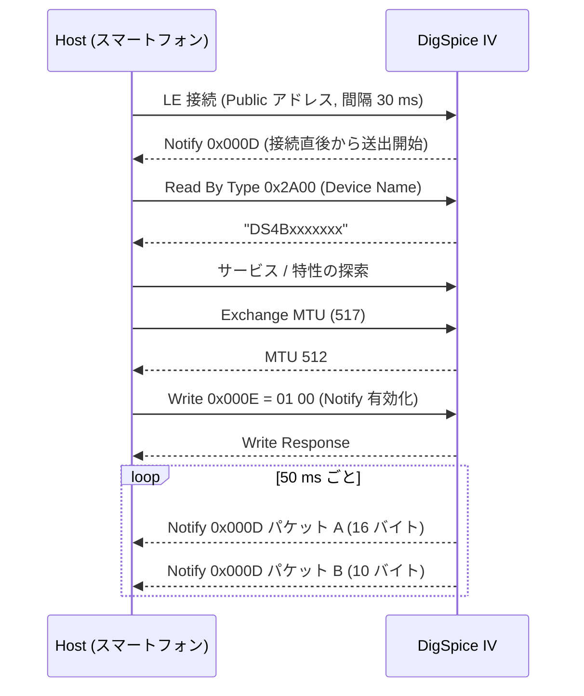

# DigSpice IV Bluetooth (BLE) 通信プロトコル解析レポート

本ドキュメントは、DigSpice IV と Android 端末（Xperia 1 VIII）を Bluetooth 接続した際の HCI スヌープログ
（Android バグレポート内 `FS/data/misc/bluetooth/logs/btsnoop_hci.log`、計 3 ファイル）の解析結果をまとめた技術資料である。
将来の iPhone アプリ版の実装に必要な、接続手順・GATT 構成・位置情報パケットの仕様を対象とする。

> 個体を特定できる値（Bluetooth アドレス下位、デバイス名の番号部分）と、取得場所の座標は伏せ字・ダミー値に置き換えている。

---

## 1. 結論（要点）

- 通信方式は **Bluetooth Low Energy (GATT)**。Classic Bluetooth (SPP / RFCOMM) は使われていない。
- 標準の **Location and Navigation Service (0x1819)** の **Location and Speed (0x2A67)** を通知 (Notify) で受け取るだけで、
  **現在位置・速度・高度・UTC 時刻が 20Hz でリアルタイムに取得できる**。
- 1 測位は **16 バイト + 10 バイトの 2 通知に分割**されて届く。
- **ペアリングは不要**。暗号化なしの接続で通知を受信できている（1 回目の接続）。
- キャプチャに含まれるホスト → 本体の書き込みは **通知の有効化 (CCCD) のみ**。
  設定変更・ログ吸い出しを BLE で行う手順は、このログからは分からない（未取得）。
- USB 側では得られなかったリアルタイム位置情報が、BLE 側では標準形式で得られる。

---

## 2. キャプチャの内容

| ファイル（バグレポート時刻） | 形式 | 内容 |
| :--- | :--- | :--- |
| 19:01 | `btsnooz`（各パケット先頭のみ記録） | 通知 1,739 件。ペイロードは先頭 3 バイトまでで、フラグと年の下位バイトのみ確認可 |
| 19:07 | `btsnoop`（全長記録） | 接続 1 回目の全体（約 134 秒、2,676 測位） |
| 20:25 | `btsnoop`（全長記録） | 上記に加え、接続 2 回目（ペアリングあり、約 109 秒、2,170 測位）を含む |

- 3 つ目のファイルは 2 つ目の内容をすべて含む。解析は主に 3 つ目で行った。
- データリンク種別は 1002（HCI UART / H4）。
- いずれも端末・本体がほぼ静止した状態での取得で、走行中のデータは含まれない。

---

## 3. 物理層・接続手順

### 3.1 アドバタイズ (Confirmed)

| 項目 | 値 |
| :--- | :--- |
| アドレス種別 | Public |
| アドレス | `48:23:35:xx:xx:xx` |
| アドバタイズデータ | `02 01 06` / `0C 09 "DS4Bxxxxxxx"` / `05 02 0D 18 F5 FE` |
| Flags | `0x06`（LE General Discoverable、BR/EDR 非対応） |
| Complete Local Name | `DS4B` + 7 桁（本体記載のシリアル番号。Bluetooth アドレスの下位 28 ビットの 16 進表記とも一致） |
| 16-bit Service UUID（一部） | `0x180D`、`0xFEF5` |

- スキャンレスポンスは空。
- 公式アプリ（DigSpice Circuit Timer Pro）は、周辺の機器をシリアル番号で一覧表示して選択させる。
  **デバイス名の番号部分は、本体に記載されたシリアル番号と一致する**（実機で照合済み）。
  接続前のスキャン時点でシリアル番号が分かるため、追加の読み出しなしで同じ一覧表示を実現できる。
  Bluetooth アドレスの下位もシリアル番号と同じ値になっている。
- アドバタイズには `0x180D`（Heart Rate）が載っているが、GATT には存在しない。実際のサービスは `0x1819`。
  スキャン時の絞り込みは、サービス UUID ではなく **デバイス名の先頭 `DS4`** で行うのが確実。

### 3.2 接続パラメータ (Confirmed)

| 項目 | 値 |
| :--- | :--- |
| 接続間隔 | 接続時 30 ms → サービス探索中 7.5 ms → 以降 30 ms（ホスト主導） |
| Slave Latency / Supervision Timeout | 0 / 5 秒 |
| PHY | 接続約 2 秒後に LE 2M へ移行 |
| Data Length | 最大 251 オクテットへ拡張 |
| ATT MTU | ホスト要求 517、本体応答 512 |
| 本体の Preferred Connection Parameters (0x2A04) | 間隔 500〜750 ms、Latency 0、Timeout 6 秒 |

- MTU を 512 に拡張した後も、位置情報は 16 + 10 バイトの 2 通知に分かれたまま届く（既定 MTU 23 を前提にした設計）。

### 3.3 ペアリング

- **1 回目の接続**: ペアリング・暗号化なし。この状態で通知を受信できている (Confirmed)。
- **2 回目の接続**: ホスト側からペアリングを開始している。
  - 方式: LE Legacy Pairing、Just Works（本体の IO Capability は NoInputNoOutput、MITM なし、ボンディングあり）
  - 鍵サイズ 16、双方が LTK / IRK / CSRK を配布
- ペアリングは必須ではないと判断できる。書き込み可能な特性へのアクセスに暗号化が必要かは未確認。

---

## 4. GATT 構成 (Confirmed)

### 4.1 サービス一覧

| ハンドル範囲 | サービス UUID | 名称 |
| :--- | :--- | :--- |
| `0x0001`〜`0x0007` | `0x1800` | Generic Access |
| `0x0008`〜`0x0008` | `0x1801` | Generic Attribute |
| `0x0009`〜`0x0010` | `0x1819` | **Location and Navigation** |
| `0x0011`〜`0x0026` | `0xFEF5` | Dialog Semiconductor (Renesas) SUOTA（無線ファームウェア更新） |
| `0x0027`〜`0x0033` | `0x180A` | Device Information |

### 4.2 Location and Navigation Service (`0x1819`)

| 値ハンドル | UUID | 標準名 | プロパティ | 備考 |
| :--- | :--- | :--- | :--- | :--- |
| `0x000B` | `0x2A6A` | LN Feature | `0x0C`（Write / Write Without Response） | 標準は Read 専用。用途不明 |
| `0x000D` | `0x2A67` | **Location and Speed** | `0x10`（Notify） | CCCD は `0x000E` |
| `0x0010` | `0x2A69` | Position Quality | `0x0C`（Write / Write Without Response） | 標準は Read 専用。用途不明 |

- `0x2A6A` と `0x2A69` は標準仕様と異なり書き込み専用になっている。本体へのコマンド送信口の可能性があるが、
  キャプチャ中に書き込みがなく、用途は不明 (Unknown)。

### 4.3 その他のサービス

- **Generic Access**: Device Name (`0x2A00`) = `DS4Bxxxxxxx`、Appearance (`0x2A01`) = `0x00C0`、PPCP (`0x2A04`)
- **Device Information (`0x180A`)**: `0x2A29` Manufacturer Name、`0x2A24` Model Number、`0x2A25` Serial Number、
  `0x2A27` Hardware Revision、`0x2A26` Firmware Revision、`0x2A28` Software Revision（いずれも Read。値は未取得）
  - USB 側では取得コマンドが見つからなかったシリアル番号が、ここから読める可能性がある。
- **SUOTA (`0xFEF5`)**: 128-bit UUID の特性 10 個（`8082CAA8-41A6-4021-91C6-56F9B954CC34` ほか）。
  ファームウェア書き換え用のため、アプリからは触れないこと。

---

## 5. 位置情報パケット仕様（Location and Speed, `0x2A67`）

### 5.1 通知の流れ

- 本体は接続直後から通知を送り始める（CCCD への書き込みより前に届いている）。
- 1 測位につき **パケット A（16 バイト）→ パケット B（10 バイト）** の順に 2 通知が届く。
- 測位周期は 50 ms（20Hz）。通知の到着間隔は接続間隔（30 ms）に依存し、30 ms / 60 ms / 90 ms でばらつく。
  時刻はパケット B の UTC 時刻を使うこと。
- 接続直後の最初の 1 組はダミー（位置・時刻がすべて 0、速度欄が `0x5424`）。年が 0 の組は破棄する。

### 5.2 パケット A（16 バイト、リトルエンディアン）

| オフセット | サイズ | 型 | 項目 | 単位・備考 | 確度 |
| :---: | :---: | :---: | :--- | :--- | :--- |
| `+0` | 2 | `uint16` | Flags | 測位中 `0x2085` / 未測位 `0x2005` | Confirmed |
| `+2` | 2 | `uint16` | Instantaneous Speed | 0.01 m/s（LN 標準単位） | Inferred |
| `+4` | 4 | `sint32` | Latitude | 1e-7 度 | Confirmed |
| `+8` | 4 | `sint32` | Longitude | 1e-7 度 | Confirmed |
| `+12` | 4 | `sint32` | Elevation | 0.01 m | Inferred |

Flags のビット構成（LN 標準に準拠）:

| ビット | 意味 | 値 |
| :---: | :--- | :--- |
| 0 | Instantaneous Speed Present | 1 |
| 2 | Location Present | 1 |
| 7〜8 | Position Status | `1` = Position OK / `0` = No Position |
| 13 | （LN 標準では予約） | 常に 1。意味は不明 |

- Elevation は標準では `sint24` かつ Flags のビット 3 で有無を示すが、本機はビット 3 を立てずに `sint32` で常に付加している。
- 未測位（Position Status = 0）の間も、緯度・経度・高度には直前の値が入り続ける。**Flags で有効性を判定すること。**
- **進行方位（Heading）は含まれない。** 方位が必要な場合は連続する座標から算出する。

### 5.3 パケット B（10 バイト、リトルエンディアン）

| オフセット | サイズ | 型 | 項目 | 単位・備考 | 確度 |
| :---: | :---: | :---: | :--- | :--- | :--- |
| `+0` | 2 | `uint16` | Flags | 測位中 `0x00C0` / 未測位 `0x0040` | Confirmed |
| `+2` | 2 | `uint16` | Year | 西暦 | Confirmed |
| `+4` | 1 | `uint8` | Month | | Confirmed |
| `+5` | 1 | `uint8` | Day | | Confirmed |
| `+6` | 1 | `uint8` | Hours | UTC | Confirmed |
| `+7` | 1 | `uint8` | Minutes | | Confirmed |
| `+8` | 1 | `uint8` | Seconds | | Confirmed |
| `+9` | 1 | `uint8` | 1/100 秒 | 0〜95。20Hz 時は 5 刻み | Confirmed |

- Flags はビット 6（UTC Time Present）と、パケット A と同じ Position Status（ビット 7〜8）。
- 末尾の 1/100 秒は LN 標準の Date Time（7 バイト）にはない独自拡張。
- 時刻は UTC。キャプチャ時刻（JST）との差は 9 時間で一致した。

### 5.4 実データ例（座標はダミー値に置換）

```text
A: 85 20 | 07 00 | <lat: sint32> | <lon: sint32> | 6D FF FF FF
   Flags=0x2085 (測位中)  Speed=7 (0.07 m/s)  Elevation=-147 (-1.47 m)
B: C0 00 | EA 07 | 07 | 07 | 0A | 06 | 34 | 05
   Flags=0x00C0  2026-07-07 10:06:52.05 UTC
```

### 5.5 測位状態の遷移例（2 回目の接続）

| 経過 | パケット A / B の Flags | 状態 |
| :--- | :--- | :--- |
| 接続直後〜約 9 秒 | `0x2005` / `0x0040` | 未測位（座標は前回値のまま、時刻は進む） |
| 約 9 秒後〜 | `0x2085` / `0x00C0` | 測位中 |

- 測位開始の前後では時刻の刻みが乱れる（5 刻み以外の値が数回出現）。

---

## 6. 接続シーケンス（1 回目の接続）



---

## 7. iPhone アプリ実装時の指針

1. `CBCentralManager` でスキャンし、**デバイス名が `DS4` で始まる**ペリフェラルを対象にする。
   デバイス名からシリアル番号を取り出して一覧に表示し、本体の記載と見比べて選べるようにする。
   iOS では Bluetooth アドレスを取得できないため、個体の識別はシリアル番号（デバイス名）か `CBPeripheral.identifier` で行う。
2. 接続後、サービス `0x1819` の特性 `0x2A67` を探索し、`setNotifyValue(true)` で通知を有効化する。ペアリング操作は不要。
3. 通知の長さで種別を判定する（16 バイト = パケット A、10 バイト = パケット B）。A を保持し、続く B と組にして 1 測位とする。
4. 年が 0 の組（接続直後のダミー）は破棄する。
5. Flags のビット 7〜8 が 0 の間は「未測位」として扱い、座標を現在値として表示しない。
6. バックグラウンドで受信し続ける場合は `bluetooth-central` のバックグラウンドモードが必要。

---

## 8. 確度と未解明事項

| 項目 | 確度 | 備考 |
| :--- | :--- | :--- |
| BLE GATT 接続・サービス構成 | **Confirmed** | 2 回の接続で同一 |
| Location and Speed の 2 分割通知 | **Confirmed** | 4,846 測位分で長さ・順序が一定 |
| 緯度・経度・UTC 時刻 | **Confirmed** | 取得場所・取得時刻と一致 |
| Position Status フラグ | **Confirmed** | 測位開始の前後で切り替わりを確認 |
| 速度の単位（0.01 m/s） | **Inferred** | 2026-10-19、手で振って動かした記録で、生の値が最大 138（1.38 m/s）。桁は合っている（0.1 m/s なら 13.8 m/s、0.001 なら 0.14 m/s で、どちらも動きと合わない）。一定の速さで動いたときの、位置から求めた速さとの比で要確認 |
| 高度の単位（0.01 m） | **Inferred** | 静止中に数 m 以内でゆっくり変動。0.1 m 単位とすると変動が大きすぎる |
| Flags ビット 13 | **Unknown** | 常に 1 |
| `0x2A6A` / `0x2A69` への書き込み | **Unknown** | 書き込みのキャプチャなし |
| BLE 経由の設定変更・ログ吸い出し | **Unknown** | キャプチャなし。可否も不明 |
| Device Information の各値 | **Confirmed** | 2026-10-19、iPhone アプリで読み出し。Manufacturer `DigSpice`、Model `DS4 BLE`、Serial `B` + シリアル番号 7 桁 + `000`（例: 名前 `DS4Bnnnnnnn` に対して `Bnnnnnnn000`）、Hardware `Rev.3`、Firmware `1.00`、Software `1.01`（いずれも 1 台での値） |
| デバイス名の番号部分とシリアル番号の対応 | **Confirmed** | 本体記載の番号と一致 |
| 10Hz / 5Hz 設定時の通知周期 | **Inferred** | 2026-10-19、iPhone アプリの通知の記録で確認。本体を 10Hz に設定して電源を入れ直しても、通知は 50 ms 刻み（20Hz）のまま。BLE のリアルタイム送信は設定によらず 20Hz と推定。設定が本体に書き込まれていたかは USB での読み直しで要確認。5Hz は未確認 |

追加で取得すると仕様が確定するキャプチャ:

- **走行中のログ**: 速度の単位と、高速域での値の検証
- **公式アプリで設定変更・ログ吸い出しを行ったときのログ**: 書き込み特性の用途
- **Device Information の読み出し**: シリアル番号・ファームウェア版数の取得可否
