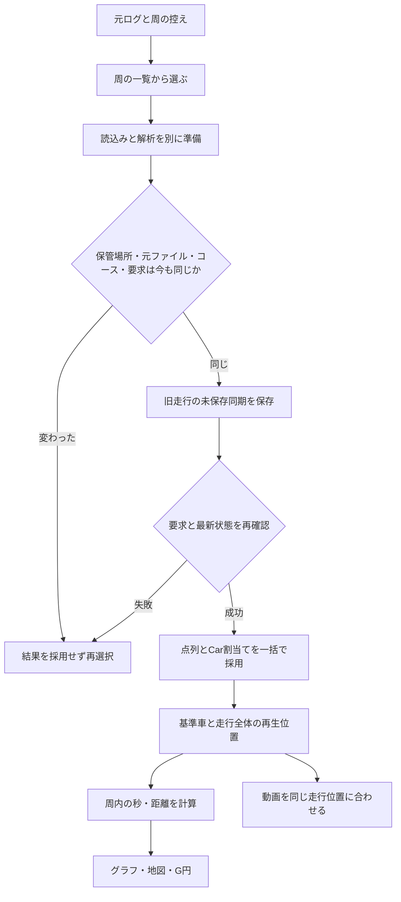

# 解析データと再生位置の保持と呼出し

1.3.0 のラップ選択・再生位置の整理に合わせた説明。元ログ、解析中の点列、周の一覧、Car の割当て、再生位置、動画の状態を区別する。

## データをどこに持つか

| データ | 保持場所と正本 | 更新する担当 | 読む側と呼出し |
|---|---|---|---|
| 元の走行ログ・動画 | 利用者の保管場所のファイル。直接開いたファイルは利用者の選択した元ファイル | 記録・取り込み。今回のラップ選択は元ログを上書きしない | RunStore が Native / Electron の窓口へ読み出しを依頼。ブラウザの直接読込みは File から解析する |
| 周の一覧の控え | 保管場所の `laptimes.json`。元ログと計測線から作り直せる控え | lapHistory / lapIndex。ファイルのサイズ・更新時刻とコースの署名を照合 | 走行一覧と LapPicker。現在の保存先のコース読込みを待ってから控えを作る。一覧の周番号だけを最終的な割当てには使わない |
| 名前・メモ・車種・走行条件 | 保管場所の `runs.json`。保存待ちの編集は共有する RunItem.entry と表示用 Session の RAM | 編集操作が setRunMeta を呼ぶ。再解析時は古い控えより手元の最新行を優先 | 走行一覧・ラップ一覧・解析中の名前。保存前の値を再読込みで戻さない |
| ログの時計補正・動画の時計とピン | 保管場所の `runs.json`。RAM の現在値と保存担当は runOpener / videoSyncManager | 各調整操作が保存を予約。新しい一覧での割当て・保存先選択の前は保存の完了を待つ | 動画の復元、ログ間の時刻換算、次に開くときの同期 |
| 保存した比べ方 | 保管場所の `sessions/*.lapsession.json`、または書き出したファイル | analysisSessions の明示保存・読込み。復元の最後に最新の走行・周の存在を確認 | Library / ファイル読込み。画面内の Car 割当ては明示保存するまで RAM の状態 |
| 解析中の点列と周 | App ごとの AnalysisStore の `sessions`。RAM のみ | ファイルの解析、コースの再計算、G・追加センサーの適用。選択中の読込みは準備が終わるまで別に持つ | グラフ・地図・動画など。Session.points は走行全体、Lap.points は周の始めを基準とする |
| Car 1〜4 の割当て | 同じ AnalysisStore の `selectedCars`。点列と同じまとまり | App の選択窓口が assignLap を呼ぶ。LapPicker 自体は直接更新しない | 基準車の決定、比較位置の計算、各表示。割当て対象の走行・周が存在することを採用時に検査 |
| CSV 定義・計算式 | 保管場所の `formats/`。RAM の控えは読込み済みの保存先に結びつける | 定義と計算式を別に準備して一括採用。保存先変更で旧控えを外し、中断した最新要求を再試行 | ログ・sidecar の読込み、値の表示、設定の編集。確認前は編集を受け付けず、旧保存先で開いた編集から別の保存先へ書かない |
| IMU・追加センサーの値 | 元 CSV と、App の走行 ID ごとの RAM の track / pending | 通常の走行読込みと保存済みラップ選択の両方が同じ sidecar 読込みを呼ぶ。現在の CSV 定義の読込みを待つ。走行ごとの最新の要求だけを残し、取消で中断した読込みは同じ保存先・走行の間だけ再試行。全センサーを準備してから適用 | G の計算・追加の値の結合。閉じた走行の控えは手放す |
| 再生位置の正本 | App の playhead。対象 Session の ID と、走行全体の秒 `sessionSec` | 再生ループ・シーク・コマ送り・基準車の選択 | playbackPosition が周内の秒・距離・周の内外を計算。画面を移っても別の意味の数へ保存し直さない |
| 周内の秒・距離・比較車の位置 | 上の正本と基準周・補正から計算。別の React state に保存しない | playbackPosition と既存の比較補正 | グラフ・地図・G 円・解析の再生バーは周内の秒。動画には走行全体の秒を渡す |
| 読込み要求・一覧の表示条件 | LapPicker の RAM。Car ごとの要求、キャンセル信号、保管場所の世代 | 一覧を開く・コースを選ぶ・読込み直す・閉じる。App は別の操作やコース再計算でも古い要求を無効にする | 一覧表示と prepareStoredLap。採用の最終判断は App |
| 動画の一覧・同期設定 | videoSyncManager の RAM。走行の所有関係と保存予約は runOpener | 動画の追加・同期編集・基準車や比較車の変更 | VideoSyncWindow と再生 controller。各 video 要素の実際の再生時刻は制御対象であり、独立した解析位置の正本にはしない |

割当て・保存先選択前の厳格な保存は、ログ時計・動画同期・ピンに加え、開いている走行の未保存編集も再試行する。保存できなければ新しい一覧での切替えを進めない。名前・メモなどの通常編集には別の書込み経路もあり、開いていない走行の編集全体の失敗表示・自動再試行や、再起動後の未保存値の復元まで今回全面的に整理したとは扱わない。

読込みの中断は、ファイルの破損や周が無い状態とは別に扱う。走査中に保管場所の読込み期間が変わった場合は、周なしの控えを保存せず、走行一覧を読み直す。コースの準備も途中の空・部分結果を採用せず、保持側の非同期待ちの後と、自動保存のキュー内でも期間を確かめる。同じ期間の要求は共有し、最新の中断は選択の終了後にやり直す。取消後に遅い中断応答が届いた場合も同じ。従来のラップ履歴も期間が変われば読み直し、古い要求からの進捗・失敗・終了は現在の表示へ反映しない。

通常編集の未保存項目は、保存先の世代・日付のフォルダ・走行の保存行ごとに RAM で共有し、項目ごとの更新順を確認する。別の一覧が持つ古い RunItem から、既に保存した古い項目を再び持ち込まない。時計・動画同期と一緒に保存した際も、該当する項目の保存が成功したときに、その保存が担当した版だけを外す。

従来の画面で保存済み走行の一部パートを閉じた場合、元の分割番号を詰めて書かないため、その状態のログ時計・動画同期は従来どおり上書きしない。名前など分割番号に依存しない未保存項目は、別に保存・再試行する。新しい一覧は保存済み走行の全パートを保持するが、従来の部分開閉と同期保存の全面整理は残件。

CSV 定義と計算式も保管場所ごとのデータとして扱う。保存先を変えた直後は古い定義を解析や保存に使わず、両方を確認してから編集を受け付ける。取消や中断では部分的な定義を公開しない。保存前に始めた読込みが後から届いても、その保存を戻さない。編集画面を開いた保存先を保持し、別の保存先へ変われば閉じる。保存に失敗した削除で、表示からだけ先に消さない。

## 一覧から Car に割り当てる順序

- 読み込む前後で、保管場所の世代、ファイルの道・サイズ・更新時刻、コースの署名を検査する。フォルダ名・時刻・周番号だけを同一性の根拠にしない。
- 計測線から実際に計算した周を、一覧の UTC 開始時刻・分割位置・タイムと照合する。番号がずれた場合は開始時刻で選び直し、利用者へ知らせる。別のコースや元ファイルへ変わった場合は一覧の更新を求める。
- 同じ元ファイルの分割データを一部だけ持っていても、ファイル全体を読み済みとは扱わない。読んだ元ファイルを解析し直す。同じ保存先・道・サイズ・更新時刻・分割位置が確認できたセッションには ID と時計補正を引き継ぐ。コースの署名は解析条件であり、元ファイルの ID とは別。手動のコース図も引き継ぐが、コースが変わった際の古い自動取得の図は残さない。別の Car の選択中の周が消えるか範囲が変わる場合は、全体を変更せず選び直しを求める。
- 点列と Car の採用は同期的な一つの処理。失敗を React の更新関数の中から投げず、呼び出した一覧へ返す。採用してから動画の関連・再生位置を更新する。途中へ新しい await を差し込まない。
- 同じ Car の新しい選択は前の要求を無効にし、別の Car の要求は別に扱う。保存を待った後にも現在の状態を読み、元データの ID と基準車を確定してから採用する。最初に見た一覧で現在の割当てを上書きしない。
- 保存した比較を複数の走行から復元している間は、新しい一覧からの割当てを受け付けない。復元の各待機後に保存先と読込み期間を確かめ、変わった要求は採用・画面移動・不足警告を出さず終える。復元の最後にも最新の正本で走行・周を検査し、既に無いものへ Car を向けない。
- 新しい一覧で Car に割り当てる際は、未保存の同期情報を旧走行へ保存してから、Car に残った最大 4 本の元データだけを開いておく。保存できなければ割当てと解放を進めず、一覧で失敗を知らせる。従来のデータ・動画の選択窓口では未割当てのログを自動で閉じない。割り当てた保存済み走行の分割データは一組として保持する。元ファイルの削除ではない。直接開いた未割当ての走行は、必要なら再びファイルから開く。
- 直接開いたファイルの分割走行は、それぞれ独立した Session として扱い、未割当てのパートは閉じる。保存済み走行では同期情報が分割番号を参照するため全パートを保持するが、直接開いたものをファイル名だけで同じ組にはしない。

## 再生位置と時刻の意味

- SessionSec は走行全体の秒、LapSec は周の始めからの秒。UTC のミリ秒や動画ファイル内の秒とは別。
- 解析では基準周の範囲へ寄せる。時間で比較するときは、遅い比較車の終点まで進められる。距離は基準周の点から求める。
- 動画では GPS 記録より前の負の時刻も扱う。動画だけの場合も再生できる。動画を止める範囲と解析をループする範囲を混同しない。
- 基準車を明示的に選び直すか、保存した比べ方を開くと、その周の始めへ移す。同じ走行の G 計算が点列配列を作り直しただけでは位置を初期化しない。このため再生位置の所有は配列参照ではなく Session ID に結びつける。
- 音のある動画を時計の基準にする場合、その観測時刻も走行全体の秒として再生ループへ返す。動画の欄から周内の秒を時計へ返さない。

## 保管場所や選択が変わったとき

保管場所そのものの世代と、読込みを採用できる期間を分ける。選択を開く前に旧保存先へ未保存の同期情報を書き、保存できなければ選択を始めない。選択中は古い読込みの採用と I/O を止める。

- 取消・失敗では読込み期間だけを更新する。保存先の世代、走行の関連、既存動画、保存の所有者は維持する。デスクトップで同じ完全な道を選び直した場合も同じ。
- 保存先の変更が確定した場合に、保存先の世代を進める。道だけの走行・動画の関連を切り、古い動画の待機処理と保存予約を引き継がない。既に読み込んだ点列はメモリ上で見ることができる。
- Native の成功応答は変更として扱う。表示名が同じだけでは、同じフォルダと判定しない。
- 古い RunStore は新しい場所に対する呼出しを始められず、選択を挟んで遅れて届いた応答も採用しない。取消後は、同じ保存先のハンドルから新しく I/O を始められる。

従来の一覧から開く場合も、動画・保存担当の準備中に保管場所の選択を挟んだら、その準備を失効させる。保存先を取り消した後は、未完了の印を外して同じ基準走行の準備をやり直す。開始済みの印と、保存担当まで準備できた状態を混同しない。

動画のメタデータ・GPS は公開前に準備し、要求がまだ有効か検査してから URL とトラックを加える。古い処理は同期・ピン・所有する走行を復元しない。手で開いたローカル動画と、保管場所の走行に属する動画は区別する。

同じ保存行の担当は一つだけ。基準車から比較車へ移った場合は、その担当を移し、比較車から基準へ戻る場合も同じ担当と未保存の補正を引き継ぐ。保存した行のオブジェクトを表示側と保存側で共有し、別の写しを後から復元しない。追加で開けた動画だけ保存行から復元し、既に調整した動画の時計・ピンは戻さない。同じ走行 ID のまま選び直した場合も、準備中の動画の関連付けを更新する通知を出す。

動画を保ったまま別の GPS ログを基準にする操作では、元の走行の保存担当を保持する。保存先そのものが変わった際の関連の破棄とは別に扱う。

世代の無効化は、OS に渡してしまった書込みを取り消すものではない。保管場所の移動・同時書込みを追加する保管場所の機能では、ホスト側の保存先固定、書込み中の切替え、ホストで既に始まった書込みの扱いを別途確認する。

## 同じ問題を繰り返しやすい変更

| 変更 | 起こり得る問題 | 着手・確認時の条件 |
|---|---|---|
| 同じ道のファイル監視・上書き | サイズ・更新時刻まで同じ内容変更を見逃す | ホストのファイル版や内容の識別を追加。現在のサイズ・更新時刻だけで十分としない |
| 読込み・計算の worker 化 | 終了した worker が閉じた画面へ結果を返す | 元データとコース・要求の版を渡し、main の採用時にも再確認 |
| 読込形式の追加・同じ元ログの再解釈 | ファイルが同じでも、UTC・分割・時刻の単位が変わり、古い調整を誤って引き継ぐ | 元ファイルの同一性と解析条件の版を分ける。時刻の起点・分割の意味を確かめ、ID・時計補正の引継ぎ条件を開き直す |
| コース・計測線・セクター変更 | 同じ周番号が別の周を表す | 再計算した周と割当てを一括更新し、待機中の旧選択を無効化 |
| 動画の追加・複数カメラ・自動照合 | 旧動画・ピンが別の Car や保管場所に戻る | トラックの公開と所有の復元の両方で要求・走行を確認 |
| レイアウトやタブの変更 | 隠した画面が独自の時計を進める、周の秒を走行全体の秒へ渡す | 共通の再生位置から導き、初回描画と画面往復を検査 |
| 画面の更新方式・UI ライブラリの変更 | Car と明示的な再生開始位置が別々の描画へ分かれる | 同じ走行の後の周から前の周へ、遅い読込みを挟んで選び直す。初回を含む描画が周の始めになることを回帰試験で確認 |
| G・追加センサーの再計算 | 同じ走行を新規読込みと誤認して位置を戻す | Session ID は保持し、再計算した配列の参照と元データの同一性を混同しない |
| 新しい読込み経路とエラーの共通化 | 取消を破損・未存在と同じに扱い、空の控えや部分結果を保存する | 中断を専用の失敗として上へ返し、一覧・控え・保持側・保存キューの全段で古い期間の採用を止める |
| 複数ウィンドウ・複数端末の同時編集 | 各画面で担当が一つでも、同じ保存行を別の画面・端末から上書きする | ホスト側の書込み直列化・保存版と競合検知を設計する。Web 内のキューだけで端末間の一致を保証しない |
| 保存先変更・コピー・競合解決 | 古い所有者が新しい場所へメタデータを書く | 保存先と操作の寿命をホストまで固定。既に送った書込みの限界を確認 |
| 通常編集の保存経路の統一・再試行の追加 | 連続編集の古い完了が新しい RAM の控えを戻す、項目ごとの保存失敗を混ぜる | 名前・条件などの編集世代と未保存項目を追う。通常編集の経路全体は別途検証し、同期情報の厳格な保存と混同しない |

## 所有するコードと回帰の入口

- App.tsx: 窓口の接続、解析中データ、再生の正本、Car ごとの要求と採用。
- lapAssignmentState.ts: 解析中データの同期的な正本と、一括した割当て・保持範囲。
- LapPicker.tsx / lapPickerRows.ts: 一覧の表示・絞込み・取消と、控えの読込み。
- lapSelection.ts: 元ファイルとコースの照合、実際の周の再計算・選び直し。画面や動画の状態は更新しない。
- playbackPosition.ts: 秒の区別と、周内位置の純粋な計算。
- storageRevision.ts / runStore.ts: 保管場所の寿命と、その寿命に結びついた I/O。
- runOpener.ts / videoSyncManager.ts: 動画の所有、公開前の準備、同期の復元と保存予約。
- 各 helper の単体試験と `e2e/lap-playback.mjs`・`e2e/lap-storage.mjs`・`e2e/lap-open-interruption.mjs`: 非同期の逆順、元データ変更、連続操作、画面往復を確認する。物理端末での動画・音声・iCloud 確認は別に記録する。
